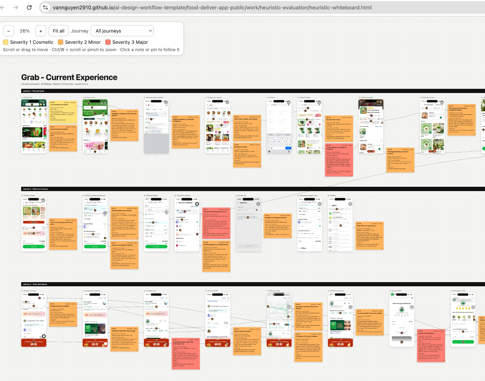
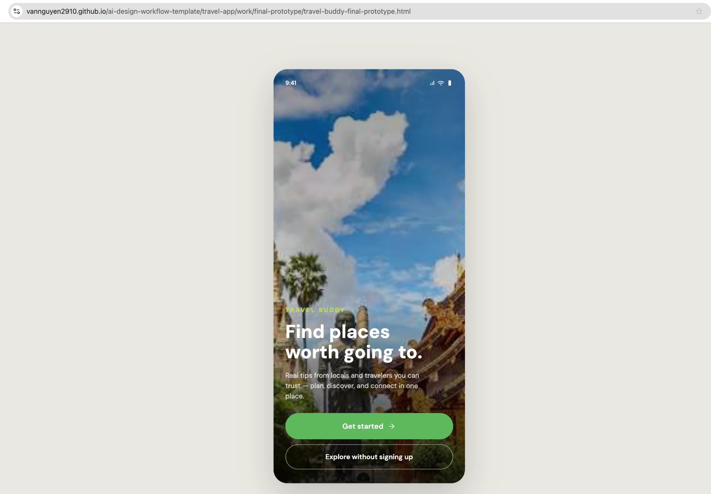

Buổi này đi theo thứ tự phụ thuộc, mỗi phần dùng thứ đã học ở phần trước, và trả lời các câu hỏi: làm việc với AI cần những khái niệm nào, file, folder và rules là gì, skill và connector là gì, agent và đội AI là gì, hub gồm những lớp nào và vì sao một công ty có thể giữ nhiều hub, GitHub dùng để làm gì và publish hub thành live site thế nào, và dữ liệu nào được đưa cho AI.

> **AI-assisted, không phải AI-generated.** AI soạn nháp. Bạn kiểm tra. Bạn quyết định. Lập trường của chương trình: bạn là partner cùng business và product xác định vấn đề cần giải quyết trước khi build.

## Nội dung buổi học

1. Working with AI: bốn khái niệm
2. Files, folders and rules: markdown, HTML, project folder, rules
3. Skills and connectors: skill, cách tạo, connector (MCP)
4. Agents and an AI team: agent, skill và tool, khi nào nên automate, đội AI
5. The hub: ba lớp, ba quy tắc và schema file
6. One hub or many: nhiều hub nối nhau bằng ID chung
7. GitHub and publishing: từ vựng, repo, publish hub thành live site
8. Data safety: ba nhóm tài liệu

## Sau buổi học, bạn có thể

1. Giải thích bốn khái niệm: context, grounding, hallucination, và AI-assisted so với AI-generated
2. Phân biệt markdown và HTML, dùng markdown làm nguồn và HTML làm kết quả, và mô tả một project folder cùng README
3. Giải thích rules là gì, vì sao cần, và viết bản đầu một rules file ngắn
4. Phân biệt prompt, rules file và skill; mô tả skill là một folder, cách tạo, gọi và tìm skill; nói connector (MCP) là gì
5. Mô tả agent khác một lượt hỏi đáp ở điểm nào, phân biệt agent, skill và tool, và phác một đội AI cho product design
6. Đánh giá một workflow có đáng automate hay chưa bằng ba câu hỏi
7. Giải thích ba lớp của hub (raw sources, wiki, schema) và ba quy tắc giữ cho hub đáng tin
8. Giải thích trong hai câu vì sao một công ty có thể giữ mỗi chức năng một hub, và nêu ba quy tắc cho ID chung
9. Đọc sáu từ vựng GitHub, giải thích vì sao hub dùng folder và GitHub, và publish hub thành live site hoặc chọn không publish khi dữ liệu chưa được phép công khai
10. Phân loại tài liệu thành ba nhóm (safe, ask first, never in a public tool) và viết bản đầu data rules

---

## 1. Working with AI: core concepts

### 1.1 Four concepts

Bạn đã dùng AI hằng tuần nên phần này không đọc định nghĩa suông; mỗi khái niệm gắn vào ví dụ ở mục 1.2.

| Khái niệm | Định nghĩa | Hệ quả thực hành |
|---|---|---|
| **Context** | Mọi thứ AI nhìn thấy tại thời điểm đó: instruction, text đã dán, file đính kèm, các tin nhắn trước. Tài liệu dài và lộn xộn làm kết quả kém chính xác | Đưa đúng tài liệu, chỉ những phần một bước cần; AI không biết gì khác về project |
| **Grounding** | Gắn câu trả lời với tài liệu được cung cấp, không dựa vào kiến thức chung của AI | "Chỉ dùng tài liệu bên dưới. Mỗi ý lấy từ đâu?" |
| **Hallucination** | Câu trả lời tự tin nhưng bịa: một competitor không tồn tại, một câu quote chưa ai nói | Yêu cầu nguồn cho từng ý; cho phép AI trả lời "unknown" |
| **AI-assisted so với AI-generated** | AI-generated: AI quyết định. AI-assisted: bạn quyết định, AI soạn nháp và lắp ráp | AI soạn nháp. Bạn kiểm tra. Bạn quyết định |

Bốn thuật ngữ hay gặp khác được dạy đúng chỗ cần chúng: **AI chat tool** (bạn viết, AI trả lời), **AI coding tool** (đọc và ghi file trong project folder, buổi 7), **connector (MCP)**, giống một cái USB cắm giữa tài liệu và công cụ AI để AI đọc được thứ bạn đang làm (mục 3.5), và **agent** (mục 4).

### 1.2 Worked example: one task, done twice

Ví dụ dùng project mẫu hư cấu của chương trình, Delivery App: nhiều khách mới không đặt lại sau đơn đầu tiên, team nghi ngờ giá là lý do và chưa có research nào.

- **Instruction 1 (mơ hồ):** "Làm sao để cải thiện onboarding cho Delivery App của tôi?"
- **Instruction 2 (có cấu trúc, đính kèm project mẫu):** "Chỉ dùng project mẫu. Liệt kê năm điều quan trọng nhất bạn cần biết mà KHÔNG có trong đó, và nói vì sao mỗi điều quan trọng. Không đoán, không dùng kiến thức chung để lấp chỗ trống. Nếu chỗ nào chưa rõ, trả lời 'unknown'. Chỉ trả về danh sách."

**Quan sát điển hình.** Instruction 1 thường cho lời khuyên tự tin nhưng chung chung, có thể nói về sản phẩm như thể đó là sự thật. Instruction 2 thường hỏi đúng những điều chỉ research hoặc business mới trả lời được.

**Diễn giải.** Project mẫu là **context**; "chỉ dùng project mẫu" là **grounding**; lời khuyên tự tin của instruction 1 là rủi ro **hallucination**; câu trả lời "unknown" là lý do instruction 2 hữu ích. Việc cho phép "unknown" giúp giảm nội dung bịa là giả định thực hành, bạn kiểm tra lại ở Practice 1 (bước 5), chưa được đo.

### 1.3 Reuse rather than retype

Một cuộc hội thoại AI mới không biết gì về project, nên cần đính kèm file đã lưu thay vì mô tả từ trí nhớ. Một instruction tốt gồm: tài liệu cần dùng, một task duy nhất, quy định "chỉ dùng tài liệu này, nêu nguồn cho từng ý, trả lời 'unknown' nếu tài liệu không nói", và định dạng mong muốn. Cấu trúc này tương ứng khung CARE của Nielsen Norman Group.

---

## 2. Files, folders and rules

Mục này là nền cho mọi thứ sau: skill, agent và hub đều là file nằm trong một folder và làm việc theo rules. Thứ tự đi từ file, đến folder chứa file, đến rules mà AI đọc khi mở folder.

### 2.1 Markdown and HTML

**Markdown (`.md`)** là văn bản thuần, người và AI cùng đọc được; nó là ngôn ngữ chung giữa designer, developer và AI. Lý do dùng với AI: nhẹ hơn PDF hoặc Word nên tốn ít token, mở và sửa được bằng mọi công cụ, Git theo dõi được từng thay đổi, và gần như mọi công cụ AI đều đọc được. Trong chương trình, hầu hết những gì bạn viết cho AI là markdown: rules file, `SKILL.md`, ghi chú research, tài liệu product, cả output AI trả về. Bạn không cần nhớ cú pháp; AI viết được markdown, bạn chỉ cần đọc và chỉnh. Khi stakeholder cần đọc thì export ra PDF hoặc trang HTML.

Khi mở một file `.md`, bạn gặp sáu thứ:

- **Front matter:** khối giữa hai dòng `---` ở đầu file, ghi thông tin về chính file đó (id, trạng thái, nguồn). Đây là phần AI và chương trình đọc để lọc và kiểm tra.
- **Đề mục:** dòng bắt đầu bằng `#`. Nhiều dấu `#` thì mục càng nhỏ.
- **Danh sách và bảng:** dòng bắt đầu bằng `-` hoặc `1.`, và bảng vẽ bằng dấu `|`.
- **Liên kết:** dạng `[chữ hiển thị](đường dẫn)`. Đường dẫn tương đối cho biết file đó nằm ở đâu trong folder.
- **Quote:** dòng bắt đầu bằng `>`. Trong hub, đây là lời trích nguyên văn.
- **Code block:** khối giữa hai dòng ba dấu huyền, dùng cho ví dụ hoặc lệnh.

Mở một file lạ, bạn không cần hiểu hết. Chỉ cần nhìn ra file này nói về gì, ai viết, và nó dẫn tới file nào.

**HTML (`.html`)** là file mở bằng trình duyệt. Markdown cho AI đọc, HTML cho người xem: xem kết quả ngay không cần cài đặt, chỉ cần một file là chia sẻ được, và gần sản phẩm thật hơn ảnh tĩnh hoặc Figma. Dùng cho prototype tương tác, slide deck, tài liệu hướng dẫn có hình, dashboard hoặc báo cáo nghiên cứu, email và các tool nhỏ tự build. AI viết giúp, bạn chỉ cần xem và chỉnh.

*Ví dụ 1: [whiteboard heuristic evaluation](https://vannguyen2910.github.io/ai-design-workflow-template/food-deliver-app-public/work/heuristic-evaluation/heuristic-whiteboard.html), một file HTML kéo và zoom được.*

*Ví dụ 2: [prototype Travel Buddy](https://vannguyen2910.github.io/ai-design-workflow-template/travel-app/work/final-prototype/travel-buddy-final-prototype.html), chạy ngay trong trình duyệt.*

#### Use case: markdown là nguồn, HTML là kết quả

1. Viết nội dung và quy tắc bằng markdown: brief, rules file, ghi chú research, danh sách màn hình.
2. Đưa file `.md` đó cho AI, kèm yêu cầu "dựng thành một file HTML".
3. Mở file HTML trong trình duyệt để xem. Muốn đổi thì sửa file `.md` hoặc nói với AI rồi dựng lại, không sửa tay trong HTML.

Tách hai lớp vì markdown là nguồn sự thật, dễ đọc và dễ sửa; HTML là bản xuất ra từ nguồn đó và dựng lại được bất cứ lúc nào. Ví dụ trong Delivery App: bạn viết brief và danh sách năm màn hình bằng markdown, đưa cho AI, nhận lại một file HTML bấm qua được từng màn; muốn đổi thứ tự màn, bạn sửa dòng trong `.md` rồi dựng lại. File HTML do AI viết vẫn có thể sai hoặc bịa nội dung, nên bạn đối chiếu lại với file `.md` trước khi gửi cho người khác. Cùng mô hình này cho phép xem một hub như một trang web (mục 7.4).

### 2.2 The project folder

Project folder là một thư mục bình thường trên máy bạn, dùng như không gian làm việc của một project. Bạn gom vào đó mọi thứ AI cần: tài liệu research, brief, file hướng dẫn, và chỗ để AI ghi kết quả. Khi mở AI coding tool trong folder này, AI đọc được cả folder thay vì chỉ một đoạn bạn dán vào chat, nên bạn không phải dán lại ngữ cảnh mỗi lần. Thường có bốn nhóm: tài liệu nền (research, brief, design system), file đang làm, thư mục `learnings/` nơi ghi lại điều đã học, và `README.md`. AI không tự nhớ phiên trước. Một số công cụ có memory riêng, nhưng thứ cần giữ chắc thì ghi vào file.

- Project nằm trong một folder local, vì AI coding tool mở cả folder làm project và đọc mọi thứ bên trong. Không đặt trong Google Drive, iCloud, OneDrive hay Dropbox, vì thư mục đồng bộ có thể làm hỏng file khi AI ghi.
- Bạn tự sắp xếp folder theo cách làm việc của mình. Chỉ cần mỗi nhóm có chỗ riêng và rules ghi rõ chỗ đó.
- Hub mặc định là private.

Mở một folder lạ, bạn chỉ thấy tên file. `README.md` là cổng vào:

| File | Ai đọc | Chứa gì | Vì sao cần |
|---|---|---|---|
| `README.md` | Người, và AI khi bắt đầu | Folder này là gì, nên đọc file nào trước, folder nào chứa gì, bắt đầu từ đâu | Người mới và AI mở folder lần đầu cần một cổng vào. Không có nó, họ phải mở từng file để đoán |

Một README tốt ngắn: nó trả lời "đây là gì, bắt đầu từ đâu" và dẫn sang các file khác, không chép lại nội dung của chúng. Hướng dẫn của GitHub cũng nói README chỉ nên chứa điều người khác cần để bắt đầu, tài liệu dài hơn để chỗ khác. Các nguồn không thống nhất README phải có những mục nào, nên chương trình dùng README làm Index của hub, theo nghĩa ở 8.2.

Thử ngay: mở `README.md` của workspace template và trả lời ba câu. Folder này là gì? Nên đọc file nào trước? File nào dặn AI?

### 2.3 Rules

**Rules** là một file ngắn ghi luật chung của project, AI đọc ở đầu mỗi session. Tên file tuỳ công cụ (`AGENTS.md`, `CLAUDE.md`, Cursor rules); chương trình dùng `AGENTS.md`. Nếu công cụ của bạn đã có file rules riêng, kiểm tra xem nó còn đọc `AGENTS.md` không. Trong file có: thứ tự đọc file, folder không được đọc, ghi vào đâu, và quy tắc cứng.

**Vì sao cần.** Mỗi cuộc hội thoại AI mới bắt đầu từ trống. Luật chỉ nằm trong đầu bạn hoặc trong một cuộc chat cũ thì AI không biết. Viết thành file thì mọi phiên và mọi agent cùng đọc một bản. Prompt khác rules ở chỗ prompt chỉ có hiệu lực trong một cuộc chat.

**Khi nào không cần.** Dặn một lần cho một việc: viết prompt là đủ.

**Rules là lời dặn, không phải rào chắn kỹ thuật.** `AGENTS.md` có thể dặn AI không đọc một folder, nhưng không ép được. `.gitignore` cũng chỉ ngăn file lên Git, không ngăn AI đọc. File confidential thì để ngoài folder. Muốn chặn AI đọc thì dùng cài đặt quyền của công cụ, và cài đặt này cũng không chặn được mọi đường.

**Bốn chỗ bạn gặp rules trong buổi này.**

1. `AGENTS.md`: luật cho AI trong project folder (mục này).
2. Ba quy tắc của hub: không sửa file nguồn gốc, mỗi note có ID, quote nguyên văn (mục 5.3).
3. Ba quy tắc cho ID chung giữa các hub (mục 6.3).
4. Data rules: luật cho chính bạn về việc được dán gì vào AI (mục 8).

**Cách viết rules.**

Rules file ngắn và cụ thể. Chỉ ghi những điều AI không tự suy ra được từ folder: thứ tự đọc, folder nào không đọc, quy tắc cứng (ví dụ ba quy tắc của hub ở mục 5.3). Thêm một dòng khi bạn thấy AI lặp lại cùng một lỗi. Một nghiên cứu arXiv (2026) thấy file ngữ cảnh do người viết chỉ cải thiện khiêm tốn và tăng chi phí xử lý khoảng 20%, nên file dài không tốt hơn file ngắn. Muốn biết file của mình có giúp không, chạy cùng một task có file và không có file rồi so hai kết quả.

Tóm lại ba bước: ghi điều AI không tự suy ra; để AI soạn nháp rồi bạn kiểm tra và viết lại từng rule bằng lời của bạn; thêm dần khi AI lặp lỗi. Bạn làm hai bước đầu ở Practice 1.

---

## 3. Skills and connectors

Rules là luật chung của project. Mục này thêm hai thứ: **skill** là cách làm một loại việc, **connector** là đường để AI tới dữ liệu thật trong công cụ của bạn. Agent ở mục 4 dùng cả hai.

### 3.1 Prompt, rules file, skill

| | Prompt | Rules file | Skill |
|---|---|---|---|
| Là gì | Dặn một lần trong hội thoại | Luật chung của project, luôn đúng | Quy trình cho một loại việc |
| Ví dụ | Message, custom instructions | `AGENTS.md`, `CLAUDE.md`, Cursor rules | Agent Skills, custom GPT |
| Khi nào load | Có hiệu lực trong hội thoại đó | Load ở đầu mỗi session | Full nội dung load khi cần |

Rules file load ở đầu mỗi session nên viết ngắn. Với skill, ban đầu AI chỉ thấy tên và mô tả; phần còn lại chỉ load khi việc bạn nhờ khớp với skill. Trước khi có skill, cách phổ biến là nhét mọi thứ vào một prompt hệ thống luôn được load, và cách đó chiếm chỗ của chính việc đang làm.

### 3.2 A skill is a folder

Một skill là một folder. File bắt buộc là `SKILL.md`, mở đầu bằng một khối khai báo có `name` và `description`, phần thân là hướng dẫn. Hai folder `references/` và `assets/` là tuỳ chọn. AI đọc theo ba mức (progressive disclosure): đầu phiên chỉ thấy tên và mô tả của mọi skill; khi việc bạn nhờ khớp mô tả thì đọc phần thân `SKILL.md`; tài liệu đi kèm chỉ được mở khi hướng dẫn nhắc đến. Vì vậy mô tả quyết định skill có được dùng hay không: hãy viết rõ skill làm gì và dùng khi nào. Giữ `SKILL.md` dưới khoảng 500 dòng, phần chi tiết tách sang `references/`. Định dạng này là chuẩn mở (agentskills.io), nên nhiều công cụ khác dùng được.

### 3.3 Creating, calling and finding skills

**Ba bước tạo.** (1) Làm tay ba lần: chạy việc đó với agent, ghi lại bước nào chạy tốt, bước nào phải sửa. (2) Viết thành `SKILL.md`: tên, mô tả nói rõ khi nào dùng, các bước, tiêu chí và một ví dụ đầu ra. (3) Thử và sửa: chạy trên một việc mới, so với kết quả làm tay. Skill viết sau khi đã làm tay thường tốt hơn viết từ đầu. Mỗi công cụ đặt skill ở một vị trí khác nhau, nên bạn kiểm tra tài liệu của công cụ đang dùng.

**Hai cách gọi.** Tự động: agent thấy tên và mô tả, và dùng skill khi việc bạn nhờ khớp mô tả. Thủ công: bạn nêu đúng tên skill trong yêu cầu; một số công cụ cho gõ `/tên-skill`. Gọi tay khi cần chắc chắn skill được dùng. Cách gọi cụ thể khác nhau theo công cụ.

**Tìm skill có sẵn.** Bạn không cần viết từ đầu: tìm ở marketplace chính thức của công cụ, GitHub hoặc cộng đồng. Bốn bước: tìm theo loại việc, đọc `SKILL.md` và file đi kèm, thử trên một việc đã biết kết quả, rồi giữ nguyên, sửa hoặc bỏ. Việc chung thì dùng nguyên; việc gắn với cách làm của team thì sửa cho khớp principles của team.

### 3.4 When to create a skill, and the risks

Đáng đóng gói thành skill khi việc lặp lại từ ba lần trở lên, có cách làm đúng khá rõ, và nhiều agent hoặc nhiều người dùng chung. Việc chỉ làm một lần thì viết prompt là đủ. Ba rủi ro:

- Skill sai thì sai ở mọi lần chạy.
- Skill cũ khi quy trình hoặc principles đổi, nên cần rà định kỳ.
- Skill từ nguồn lạ có thể chứa chỉ dẫn gây hại hoặc gửi dữ liệu ra ngoài. Đọc `SKILL.md` và các file đi kèm trước khi dùng, và áp data rules như khi dán tài liệu.

Nếu công ty không cho tải skill bên ngoài, đó là chính sách an toàn dữ liệu, không phải trở ngại: hỏi IT xem có kho skill nội bộ đã duyệt không, nếu không thì tự viết skill từ quy trình của mình. Skill là chỉ dẫn cho AI, không bảo đảm kết quả; bạn vẫn kiểm tra output. Skill, `AGENTS.md` hay ghi chú research đều là file trong folder, nên cần một nơi lưu lịch sử và có người rà lại: GitHub, ở mục 7.

### 3.5 Connectors (MCP)

**Connector** là một kết nối cụ thể giữa AI và công cụ hay nguồn dữ liệu bên ngoài, như Figma, Drive, Notion, Slack. **MCP** (Model Context Protocol) là chuẩn mở đứng sau, giống một kiểu ổ cắm chung: mỗi công cụ làm một lần theo chuẩn này, AI nào hỗ trợ chuẩn cũng nối vào được. Không có connector, AI chỉ thấy những gì bạn dán vào chat. Có connector, AI tự mở đúng file, đọc đúng chỗ và làm việc trên dữ liệu thật.

Hai loại việc: đọc (xem file Figma, tài liệu Drive hay Notion, ticket Jira hoặc Linear, truy vấn analytics) và ghi (đăng lên Slack, tạo ticket). Việc ghi tác động ra bên ngoài nên cần cẩn thận hơn; nên để AI hỏi lại bạn trước khi ghi. Ví dụ trong product: Jira, Linear, Asana (đọc ticket, tạo ticket từ insight), Notion, Confluence, Drive (đọc PRD, ghi chú họp, research cũ), Slack (đọc phản hồi, đăng tóm tắt), analytics (hỏi số liệu funnel). Trong design: Figma (đọc file, component, variables), Miro hoặc FigJam (đọc board affinity, journey map), Google Drive hoặc Slides (đọc deck cũ), GitHub (đọc repo và pull request). Danh sách là ví dụ; connector nào có sẵn tuỳ công cụ AI và gói đang dùng. Chỉ nối phần cần thiết và không nối dữ liệu nhạy cảm (mục 8). Connector cho AI nhìn thấy nhiều hơn nhưng không bảo đảm AI hiểu đúng, nên bạn vẫn kiểm tra kết quả với nguồn.

---

## 4. Agents and an AI team

Mục này giới thiệu ở mức khái niệm. Bạn chưa dựng đội trong buổi 1. Agent dùng ba thứ đã học: file và folder (mục 2), rules, và skill cùng connector (mục 3).

**Workflow thiết kế với agent (What, Why, When).** What: mỗi quy trình giao cho một agent; mỗi agent có instruction, input và output riêng, tất cả ghi vào một design memory dùng chung (file markdown), và bạn duyệt trước mỗi lần chuyển phase. Why: AI soạn nháp nhanh phần lặp lại trong quy trình, mỗi bước để lại file và nguồn để truy vết ngược, và quyết định vẫn ở bạn. When: workflow truyền thống đã ổn, làm tay cho kết quả ổn định, và đầu ra kiểm tra được nhanh; chưa dùng khi vấn đề còn mơ hồ hoặc cần người thật (user, người phía Product và Business). Nguyên tắc thực dụng: bắt đầu đơn giản, tăng độ phức tạp khi cần, và chọn mức tự chủ theo chi phí khi sai và khả năng hoàn tác.

**Agent.** Theo cách phân loại của Anthropic, workflow là hệ thống mà mô hình và tool được điều phối theo đường đi định sẵn trong code, còn agent là hệ thống trong đó mô hình tự quyết định quy trình và việc dùng tool ở thời điểm chạy, đến khi xong hoặc cần hỏi người. Theo cách phân loại này, quy trình có phase và gate định sẵn ở trên gần với workflow hơn, còn agent làm việc bên trong từng bước. Một lượt hỏi đáp trong AI chat tool không phải agent: người dùng quyết định bước tiếp theo từng lượt. Hệ quả thực hành: câu trả lời của agent chỉ là bản tóm tắt, kết quả thật nằm ở các file nó đã sửa, nên việc kiểm tra là kiểm tra file.

**Agent, skill và tool.** Agent là nhân viên: nhận việc và tự quyết các bước để đạt mục tiêu (ai làm). Skill là kỹ năng nhân viên đó được dạy: cách làm một loại việc (làm thế nào). Tool là công cụ được giao: đọc file, tìm web, kết nối Figma qua MCP (có gì trong tay). Thiếu một trong ba thì kết quả khác hẳn: có tool mà không có skill thì agent làm theo thói quen của AI; có skill mà không có tool thì nó biết cách nhưng không với tới dữ liệu. Khi kết quả chưa ổn: làm sai cách thì sửa skill, không với tới dữ liệu thì sửa tool hoặc kết nối, giao sai việc thì sửa agent.

**Skill hay agent?** Cả hai đều có thể là file markdown có tên và mô tả nên dễ lẫn. Skill là cách làm một loại việc, và AI làm theo ngay trong cuộc chat bạn đang mở. Bạn dùng skill khi muốn AI làm đúng cách bạn dặn. Agent giống một nhân viên nhận cả một việc, làm trong phiên riêng rồi gửi kết quả về. Agent đáng tạo khi việc lặp lại, phải đọc nhiều hoặc cần giới hạn quyền, ví dụ agent review chỉ được đọc file. Agent vẫn dùng được skill. Một hai buổi user interview thì skill là đủ, còn khi có vài chục buổi, hoặc tuần nào bạn cũng giao lại đúng việc đó, tạo agent mới đáng. Agent chạy thêm một phiên nên tốn thêm hạn mức sử dụng, và cách chạy cụ thể tuỳ công cụ AI. Bạn cứ thử bằng skill trước rồi mới tính đến agent.

**Agent đầu tiên, năm bước** (ví dụ agent tổng hợp vài chục buổi user interview). (1) Chọn một việc lặp lại đã làm tay ổn. (2) Giao vai và kết quả cụ thể, ví dụ vai là trợ lý tổng hợp phỏng vấn, kết quả là bản tóm tắt theo chủ đề kèm quote. (3) Liệt kê các skill và tài liệu agent cần: một agent thường dùng nhiều skill, ví dụ `summarize-interview` (tóm tắt theo chủ đề), `extract-quotes` (trích quote nguyên văn), `tag-themes` (gắn theme), cộng với thư mục transcript đã ẩn danh. (4) Viết thành một file markdown, mỗi agent một file: phần đầu ghi tên và mô tả (agent làm gì, dùng khi nào), thân file ghi vai, skill cần dùng, tài liệu đọc, các bước làm và nơi ghi kết quả. Bạn không cần viết tay: nhờ công cụ AI viết file, rồi đọc lại và chạy thử. (5) Chạy thử, để agent ghi kết quả vào file `.md`, rồi đối chiếu với nguồn (quote phải nguyên văn so với transcript) và chỉnh file agent. Cấu trúc này theo cách tài liệu subagents của Claude Code mô tả (file markdown có `name` và `description` ở đầu, thân file là chỉ dẫn); định dạng, tên file, chỗ đặt file và các trường khác nhau theo công cụ (có công cụ không dùng markdown), và tên skill hay file trong ví dụ là tên minh hoạ.

Một ví dụ thật là agent `session-logger` của người dạy, ghi lại một buổi mentoring: file agent khai báo tên và mô tả (kể cả khi nào không dùng), công cụ (đọc và ghi file, connector Zoom và Notion), vai (biến transcript thô thành ghi chú sạch và bản nháp, dừng trước khi publish) và đầu vào (mentee, ngày, nguồn theo thứ tự ưu tiên). Quy trình chi tiết nằm ở một file khác mà file agent trỏ tới.

**Before automating a workflow.** Trước khi giao một workflow cho agent, cần hỏi workflow này có đáng được tăng tốc hay không. Báo cáo DORA 2025 (khảo sát gần 5.000 người làm công nghệ) mô tả AI như một bộ khuếch đại: AI phóng đại cả điểm mạnh lẫn điểm yếu của team. Số liệu đến từ phát triển phần mềm. Với designer, đây là suy luận: khi AI làm output rẻ đi, chi phí chuyển sang bước kiểm tra, và workflow thiếu gate (bước kiểm tra trước khi công việc đi tiếp) chuyển lỗi sang bước sau nhanh hơn. AI tạo mười hướng trong vài phút, còn chọn hướng đúng và kiểm tra với người dùng thật thì không nhanh theo.

*Hình minh hoạ, không phải số liệu; áp vào design là suy luận.*

**Quy tắc của chương trình:** sửa hoặc bỏ workflow trước, rồi mới dùng AI. Ba câu hỏi trước khi automate:

1. Workflow này nhằm đạt điều gì, và thế nào là kết quả tốt, trong một câu?
2. Khi làm tay, workflow cho kết quả ổn định không?
3. Ai kiểm tra output, và dựa trên cái gì?

Trả lời "không" ở câu 1 hoặc 2: sửa hoặc bỏ workflow trước. Trả lời "không" ở câu 3: thêm một gate và một người chịu trách nhiệm. Checklist đầy đủ tám câu nằm ở handout `before-you-automate.md`, gửi riêng sau buổi học.

**Đội AI cho product design.** Mỗi agent là một instruction, một input riêng và một output ghi vào file; bạn dẫn dắt, kiểm tra và quyết định. Sơ đồ đặt hai agent vào mỗi phase của Double Diamond (Discover, Define, Develop, Deliver), tám agent cùng đọc và ghi một design memory chung, và bạn duyệt ở mỗi lần chuyển phase. Design memory chung này chính là hub ở mục 5.

*Cấu trúc đội, tên và scope agent là mô hình của chương trình.* Hai vai không giao cho AI: người dùng thật và người phía product và business. Không có agent nào duyệt thay bạn, vì một agent duyệt cũng có thể sai. Hiệu quả của đội tám agent này chưa được kiểm chứng.

---

## 5. The hub

Mục này nói hub là gì và theo quy tắc nào.

### 5.1 Why a hub

Mỗi cuộc hội thoại AI mới bắt đầu từ trống. Insight từ project này kẹt trong một khung chat, không đi sang bước sau, và khi ai đó hỏi "vì sao quyết định này?" thì lý do nằm rải rác. Andrej Karpathy (04/2026) mô tả một cách khác: để AI duy trì một wiki bền vững thay vì tìm lại tài liệu gốc ở mỗi câu hỏi, nên kiến thức tích luỹ qua từng lần dùng. Lý do ông nêu: người ta bỏ wiki vì công bảo trì lớn hơn lợi ích, còn AI không ngại cập nhật các liên kết. Hub của chương trình dùng cùng ý này.

### 5.2 Three layers

| Lớp | Nội dung | Ai ghi |
|---|---|---|
| **Raw sources** | Thứ bạn thu được: transcript đã ẩn danh, review, tài liệu của team | Bạn đưa vào. Không ai sửa |
| **Wiki** | Thứ rút ra: source notes, insight, opportunity, decision, finding, mỗi mục một file Markdown liên kết với nhau | AI soạn nháp, bạn kiểm tra |
| **Schema** | Quy ước làm việc: AI đọc gì trước, ghi vào đâu, quy tắc nào cứng. Trong chương trình là `AGENTS.md` | Bạn viết, AI giúp soạn |

Hai file giúp tìm đường trong hub. **Index** cho biết hub có gì và nên đọc gì trước (trong chương trình là `README.md`). **Log** ghi theo thứ tự thời gian mỗi lần đưa nguồn vào hoặc đổi quyết định, mỗi lần một dòng kèm lý do (trong chương trình là `project-log.md`).

### 5.3 Three rules

Ba quy tắc này nằm trong schema và giữ cho hub đáng tin.

1. **Raw sources không bao giờ bị AI sửa.** Nếu bản tóm tắt sai, bạn vẫn có nguồn gốc để đối chiếu. Một nghiên cứu về dùng AI cho UX research cho thấy lý do chính khiến researcher ít tin kết quả AI là không truy được về dữ liệu gốc.
2. **Mỗi note có một ID.** Có ID thì một insight chỉ ra được nó dựa vào note nào, và bạn tìm lại được nguồn.
3. **Quote phải nguyên văn.** Quote do AI tóm tắt lại nghe tự nhiên hơn quote thật, vì người thật nói câu dở dang. Buổi 3 dạy cách kiểm điều này bằng chương trình.

Một bình luận dưới bài của Karpathy báo cáo rằng truy vấn chỉ qua wiki kém hơn truy vấn kèm tài liệu gốc (số tự báo cáo, chưa kiểm chứng). Đó là lý do quy tắc 1 tồn tại.

### 5.4 The schema file

Schema là file ngắn và cụ thể, chính là rules file ở mục 2.3 (trong chương trình là `AGENTS.md`) với ba quy tắc trên làm phần cứng. Cách viết và cách kiểm tra file có giúp hay không nằm ở mục 2.3.

---

## 6. One hub or many

Một số công ty lớn đang thử một hướng khác với "một hub cho tất cả": mỗi chức năng (business, technical, design) giữ hub riêng, và AI là lớp nối để đối chiếu và lấy dữ liệu liên quan. Mục này là lý thuyết, bạn không làm bài tập. Đây là một pattern các tổ chức đang thử, chưa phải một chuẩn.

### 6.1 Why one hub per function

Mỗi chức năng sở hữu một loại dữ liệu khác nhau và có người chịu trách nhiệm riêng. Business giữ mục tiêu và metric, technical giữ ràng buộc và kiến trúc, design giữ insight và decision. Gộp tất cả vào một hub thì không ai là chủ của từng phần. Cách này giống nguyên tắc của data mesh: mỗi miền tự chủ, và chỉ một bộ chuẩn chung rất nhỏ áp cho mọi miền.

### 6.2 The thread is a shared ID

Sợi dây nối các hub là ID chung. Ví dụ một chuỗi:

- một mục tiêu business có ID,
- một opportunity trong hub design gắn với mục tiêu đó,
- một decision gắn với opportunity,
- một ràng buộc kỹ thuật trong hub technical gắn với decision,
- một test gắn với decision và ràng buộc.

Mỗi mục mang ID và nêu ID của mục nó dựa vào. Nhờ vậy AI đi được từ test ngược về mục tiêu business, qua cả ba hub. Đây là ý của requirements traceability: ID có từ trước khi viết, và có hai chiều kiểm tra (mọi mục tiêu có ít nhất một test, và mọi test truy được về một mục tiêu). Hub của bạn đã dùng ý này ở quy mô nhỏ: source ID như `I01-03` và insight ID như `IN-01`.

### 6.3 Three rules for shared IDs

1. **ID không đổi.** Đổi ID là cắt liên kết.
2. **ID không dùng lại.** Xoá một mục thì ID của nó cũng nghỉ.
3. **Mỗi chức năng một tiền tố**, để hai hub không đặt trùng ID. Ví dụ BIZ, DES, TEC là tiền tố minh hoạ, không phải chuẩn.

Ngoài ID, các hub cần một bộ field chung rất nhỏ, ví dụ owner, status, version, để AI nối được mà không phải dịch qua lại.

### 6.4 Two risks

- **Nối sai mà không báo lỗi.** Nếu hai hub dùng cùng ID nhưng cấu trúc khác nhau, phép nối cho ra kết quả sai và không có cảnh báo. Không dùng tên hay email làm khoá.
- **AI nối nhanh, nhưng bạn vẫn kiểm tra.** Khi AI đối chiếu ba hub, bạn mở cả hai nguồn của mỗi kết luận, đúng như với một insight trong hub của riêng bạn.

---

## 7. GitHub and publishing

Từ đầu buổi, mọi thứ bạn dựng cho AI như `AGENTS.md`, skill hay ghi chú research đều là file trong một folder; hub cũng là một folder như vậy. Folder đó cần một nơi để tồn tại, lưu lịch sử và chia sẻ: GitHub. Mục tiêu là hiểu đủ để đọc và trao đổi với engineer, không phải để tự thao tác.

### 7.1 What GitHub is, and six words

GitHub là website lưu folder project của bạn trên mạng, kèm lịch sử mọi thay đổi. Hai chữ cần nhấn là folder và lịch sử. Lý do dùng: nhiều người và nhiều công cụ AI cùng làm trên một bản, và có chỗ để review, góp ý, phân quyền. Hình dung: Google Drive có Version history, còn GitHub giống Drive dành cho cả folder project. Ví dụ này chưa đúng hoàn toàn: GitHub không tự lưu từng ký tự như Google Docs; lịch sử chỉ có khi bạn chủ động chốt một phiên bản. Git là công cụ ghi lịch sử chạy trên máy, GitHub là website dùng nó.

| Từ | Nghĩa |
|---|---|
| **Repo** | Folder của cả project |
| **Commit** | Một lần chốt phiên bản, kèm lời nhắn |
| **Push** | Gửi các commit từ máy lên GitHub. Trước khi push, mọi thứ chỉ nằm trên máy bạn |
| **Branch** | Bản nháp chạy song song, bản chính vẫn nguyên |
| **Pull request** | Đề nghị ghép bản nháp vào bản chính; chỗ designer review output của AI |
| **Run localhost** | Chạy và xem phiên bản trên máy ở địa chỉ dạng `localhost:3000`, chỉ bạn thấy được |

### 7.2 How a repo works

Bạn chỉ đạo AI coding tool; AI sửa file trong folder project trên máy bạn. Bạn xem thử bằng run localhost; chưa ổn thì bảo AI sửa tiếp, mọi thứ vẫn chỉ nằm trên máy. Chỉ khi ổn bạn mới push lên repo. AI không tự push, nên bạn là điểm dừng kiểm tra duy nhất giữa AI và những người khác. Teammate pull về để dùng, hoặc gửi pull request để review trước khi thay đổi vào bản chính.

Khi AI mở một repo, nó đọc ba file đầu tiên: `README.md` (repo là gì, bắt đầu từ đâu), `AGENTS.md` (luật và bản đồ folder cho AI) và `SKILL.md` (cách làm một loại việc). Cả ba đều là markdown, bạn không cần viết tay mà nhờ AI viết rồi đọc lại và chỉnh. Với designer, cần biết: repo là folder của project, commit là một lần chốt, pull request là chỗ review output của AI, và đọc được `README.md` và `AGENTS.md`. Chưa cần: gõ lệnh trong terminal, giải xung đột khi ghép branch, quản lý nhiều branch phức tạp; AI hoặc developer làm giúp.

### 7.3 Why folder and GitHub, not Notion

Notion vẫn dùng tốt để đọc tài liệu, và nếu tài liệu đã nằm ở đó thì nối MCP để AI đọc. Với hub, chương trình chọn folder và GitHub vì bốn lý do: AI làm việc trực tiếp trên file markdown trong folder (Notion thì chỉ làm được những việc connector cho phép); Git ghi từng thay đổi nên AI sửa hỏng thì quay về, còn Notion khó so từng dòng thay đổi; folder markdown mở được ở nhiều công cụ AI nên không bị khoá vào một nền tảng; và dữ liệu mặc định riêng tư, nằm trên máy và trong repo của bạn, không đi qua dịch vụ bên thứ ba nếu bạn không chọn chia sẻ. Đây là lựa chọn của chương trình, chưa có nghiên cứu so sánh trong công việc design.

### 7.4 Publishing the hub as a live site

Push đưa file lên GitHub, còn publish là cho người khác mở bằng link. Trình duyệt không hiển thị markdown đã định dạng: nó hiện file `.md` như chữ thường, nên cần một bước chuyển markdown sang HTML (mục 2.1). Bạn không phải viết HTML bằng tay; nhờ AI dựng `index.html`.

Chọn nhánh bằng một câu hỏi: **toàn bộ project có được phép công khai không?** Không chắc thì chọn nhánh không công khai.

- **Được công khai (GitHub Pages).** Pages miễn phí chỉ chạy với repo Public và công khai mọi file trong repo, nên hãy tạo một repo mới chỉ chứa bản đã làm sạch, không đổi repo Private đang dùng sang Public. Kiểm tra không có dữ liệu mật, thông tin cá nhân của người dùng, `_raw-private/` hay `_personal/`. Rồi: push; trên github.com vào Settings → Pages, chọn Deploy from a branch, `main`, `/(root)`, bấm Save; chờ một đến hai phút và mở link `https://<tên-tài-khoản>.github.io/<tên-repo>/` bằng cửa sổ ẩn danh. Cập nhật về sau: lưu và push lại, link giữ nguyên. Trước khi push, đọc danh sách file AI đưa ra: đây là chỗ cuối cùng để chặn dữ liệu chưa ẩn danh, mật khẩu, khoá API hay file của công ty. AI không tự bật Pages hay chuyển repo sang Public.
- **Không công khai.** Không bật Pages. Gửi file `index.html` hoặc PDF in từ trình duyệt, hoặc mời một người xem repo (Settings → Collaborators).

Site GitHub Pages có thể công khai dù repository là private; chỉ gói Enterprise Cloud mới cho publish riêng tư. Đây là phần cuối của Practice 1, và bạn chỉ làm khi folder toàn dữ liệu giả. Ngoài GitHub Pages còn các cách khác:

Trình duyệt không hiển thị markdown đã định dạng: nó hiện file `.md` như chữ thường. Muốn người khác xem hub như một trang web, cần một bước chuyển markdown sang HTML. Bạn không phải viết HTML bằng tay. Có bốn cách:

| Cách | Ai chuyển sang HTML | Hợp với |
|---|---|---|
| Script riêng của chương trình (hoặc Pandoc) | Script chạy trên máy bạn, ra một file HTML | Hub nhỏ, một người làm, gửi qua email hoặc chat. Đây là cách chương trình dùng |
| MkDocs, Docusaurus, Quartz | Công cụ đọc cả folder, ra cả site có menu và tìm kiếm | Hub nhiều trang, nhiều người xem. Các team kỹ thuật hay dùng khi tài liệu lớn lên |
| GitHub Pages, Notion, Confluence | Nền tảng tự hiển thị | Team đã dùng sẵn nền tảng đó |
| Obsidian Publish | Dịch vụ trả phí | Người đã viết ghi chú trong Obsidian |

Chọn cách nào, câu hỏi đầu tiên vẫn là ai xem được. Bản publish chỉ nên chứa dữ liệu đã ẩn danh và được phép chia sẻ. Chi tiết và nguồn nằm ở `learning/reference/desk-research-publish-markdown-hub.md`; mức độ phổ biến của từng cách trong các công ty chưa có số liệu.

---

## 8. Data safety

Mục này là hướng dẫn thực tế, **không phải tư vấn pháp lý**; chính sách của công ty và luật địa phương là căn cứ quyết định.

### 8.1 Why it matters

PRD, design chưa phát hành, user research có tên người, file của client và số liệu tài chính thường là thông tin confidential hoặc nằm dưới NDA. Ở Việt Nam, dữ liệu cá nhân được điều chỉnh bởi Luật Bảo vệ dữ liệu cá nhân số 91/2025/QH15, có hiệu lực từ 01/01/2026, và Nghị định 356/2025/NĐ-CP quy định chi tiết việc thi hành. Tên, email, số điện thoại và bản ghi của người dùng đều là dữ liệu cá nhân.

Cách tool xử lý dữ liệu đưa vào tuỳ tool và gói sử dụng. Gói consumer thường cho người dùng chọn có cho phép dùng hội thoại để cải thiện model hay không; gói business, enterprise và API thường không dùng dữ liệu khách hàng để train theo mặc định. Cài đặt và điều khoản đổi thường xuyên, nên bạn cần đọc trang data controls của tool đang dùng và không mặc định dữ liệu là private.

### 8.2 Three classes of material

| Nhóm | Ví dụ | Quy tắc |
|---|---|---|
| **Safe**: thông tin công khai, suy nghĩ riêng, project hư cấu | Trang phí giao công khai của competitor; project mẫu của chương trình | Dùng được với bất kỳ tool nào đã chấp nhận |
| **Ask first**: nội bộ nhưng không nhạy cảm | Ghi chú quy trình nội bộ; tóm tắt research chưa công bố, không có tên người | Chỉ dùng trong tool mà bạn đã chọn dùng cho việc đó |
| **Never in a public tool**: dữ liệu cá nhân, kế hoạch chưa phát hành, tài chính, tài liệu NDA | Transcript phỏng vấn có tên; danh sách khách hàng; spec chưa phát hành | Không dán. Ẩn danh trước, hoặc để ngoài |

### 8.3 Four habits before pasting

1. **Kiểm tra chính sách.** Chưa có thì hỏi; còn phân vân thì không dán. Bạn hỏi bộ phận security hoặc IT ba câu: dữ liệu được lưu ở đâu, lưu bao lâu, và có dùng để train model không. Nếu công ty cấm công cụ AI công cộng thì thường đã có một công cụ được duyệt, và bạn hỏi xem đó là công cụ nào. Chưa có thì bạn làm trên project mẫu của chương trình.
2. **Phân loại tài liệu** theo ba nhóm trên.
3. **Xoá thông tin định danh trước**, bằng find and replace trên máy cục bộ chứ không nhờ AI làm, vì khi đó dữ liệu đã được gửi đi. Thay tên bằng P1, P2 chưa phải là ẩn danh, vì vai trò, tuổi, nơi ở hay thời điểm vẫn đủ để nhận ra một người. Bạn nên bỏ các chi tiết đó, hoặc nói chung hơn, ví dụ "một PM ở thành phố lớn".
4. **Giữ file confidential ngoài folder của tool**, vì AI coding tool hoặc agent đọc toàn bộ project folder. `AGENTS.md` có thể dặn tool không đọc một folder, nhưng đó là quy tắc chứ không phải rào chắn kỹ thuật. Cùng nguyên tắc với **connector**: trước khi kết nối, xác định nó đọc và sửa được những gì.

Trước khi dùng agent hoặc skill, bạn cũng nên biết công cụ AI của mình có tự cập nhật không. Nhiều công ty không cho công cụ AI, agent hay skill tự cập nhật, vì phần được load vào có thể đổi sau khi đã được duyệt. Nếu công ty bạn như vậy, bạn gọi agent bằng tay và cập nhật bằng tay khi cần: đọc phần thay đổi, thử trên project mẫu, rồi mới dùng cho việc thật. Bạn hỏi IT ba câu: công cụ dùng bản ổn định hay bản mới nhất, có khoá phiên bản không, và skill hay connector lấy từ đâu.

Quyền dùng output của AI cho công việc với client và quyền sở hữu tuỳ công ty và quốc gia; nên ghi những chỗ đã dùng AI vào log của project. Output của mục này là ba dòng bằng lời của bạn: được dán gì, sẽ không dán gì, dùng tool nào cho việc gì.

---

## Practice: đề tài chung của khoá

Cả khoá làm practice trên một đề tài chung. Bạn tự chọn người dùng, tình huống và giải pháp, miễn là giải thích được vì sao chọn. Đọc [project brief](../../../assets/starter-files/practice-project/project-brief.md) trước, rồi đến [tài liệu nền](../../../assets/starter-files/practice-project/topic-primer.md). Cần khung folder để tham khảo thì xem [repo template](https://github.com/vannguyen2910/ai-design-workflow-template). Bạn muốn làm trên project thật của mình cũng được; đề tài chung chỉ dùng dữ liệu giả.

---

## Phụ lục. What AI is good at, and where it falls short

Phần này cho biết AI làm tốt và còn hạn chế ở loại việc nào. Slide tương ứng nằm ở phần phụ cuối deck.

| Loại việc | Phát hiện | Nguồn, năm, cỡ mẫu |
|---|---|---|
| Tác vụ viết chuyên nghiệp | Thời gian giảm khoảng 40%, chất lượng tăng khoảng 18% | Noy và Zhang, Science, 2023, 453 người |
| Task nằm trong khả năng của mô hình | Nhanh hơn khoảng 25%, chất lượng cao hơn khoảng 40%. Task nằm ngoài khả năng cho kết quả tệ hơn nhóm không dùng AI | Harvard và BCG, 2023, 758 consultant |
| Developer giàu kinh nghiệm trên codebase quen thuộc | Chậm hơn 19% | METR, 2025, 16 developer |
| Tổng hợp nghiên cứu UX | Phiên âm và tóm tắt hữu ích nhưng cần kiểm lại; nhóm dữ liệu do AI tạo chỉ nên coi là bản đầu vì có thể bỏ sót và nhóm hời hợt | Nielsen Norman Group, 2024 |

**Suy luận của chương trình.** AI mạnh ở task có giới hạn rõ, output kiểm tra được nhanh. AI yếu hơn ở task dài, nhiều bước, cần phán đoán hoặc bối cảnh chỉ người trong team biết. Hai điểm đáng nhấn:

- **Kết quả yếu thường trông ổn.** Khảo sát 1.150 desk worker toàn thời gian ở Mỹ (BetterUp Labs và Stanford Social Media Lab): 40% nhận sản phẩm AI trông như đã xong nhưng thiếu nội dung trong tháng qua, mỗi lần mất trung bình khoảng hai giờ xử lý.
- **Người có kinh nghiệm không tự động nhanh hơn.** Developer ở nghiên cứu METR chậm hơn 19% dù tự cảm thấy nhanh hơn khoảng 20%. Đây là kết quả đầu 2025; METR nay ghi các kết quả này đã cũ.

Nhận định "AI mạnh hay yếu" chỉ đúng với một loại task và một thời điểm.

---

## Giới hạn của bài học

- **Bias của dữ liệu train.** Công cụ AI phản ánh pattern trong dữ liệu train, vốn phần lớn đến từ phương Tây và tiếng Anh. Với người dùng Việt Nam hoặc Đông Nam Á, cần đối chiếu gợi ý với mental model của người dùng, không chỉ xem output có thuyết phục hay không.
- **Dữ liệu đưa vào có thể bị lưu lại.** Áp dụng data rules ở mỗi lần dùng.
- **Giới hạn của evidence.** Số liệu về năng lực AI ở Phụ lục đến từ nghiên cứu trên những mô hình tại thời điểm đó và đổi nhanh; evidence về AI như bộ khuếch đại (mục 4) đến từ phát triển phần mềm, áp vào design là suy luận.
- **Mô hình hub.** Ba lớp và ba quy tắc ở mục 5 dựa trên mô tả của Karpathy và các hướng dẫn thực hành, chưa có nghiên cứu đo hiệu quả của hub trong công việc design. Mô hình nhiều hub ở mục 6 là pattern một số tổ chức đang thử; các nguồn chủ yếu là bài viết của nhà cung cấp công cụ và tài liệu về traceability và data mesh, không phải chuẩn cho design.
- **Đọc và publish file markdown.** Nội dung về README (2.2) và bốn cách đưa markdown lên web (7.4) lấy từ tìm kiếm web, chưa đọc toàn văn từng nguồn. Chưa có số liệu mức độ phổ biến của từng cách trong các công ty.
- **Giới hạn của chương trình.** Chương trình không dạy thiết kế sản phẩm AI. Cách chia agent ở mục 4 là phương pháp của chương trình, chưa có nguồn đo hiệu quả.
- **Skill, connector và GitHub.** Nội dung mục 3 và mục 7 dựa trên tài liệu của Anthropic (Agent Skills, MCP) và của GitHub; cách gọi skill và vị trí đặt skill khác nhau theo công cụ, nên kiểm tra tài liệu của công cụ đang dùng. Chưa có nghiên cứu đo hiệu quả của rules file, skill hay hub trong công việc design.
