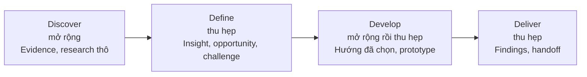
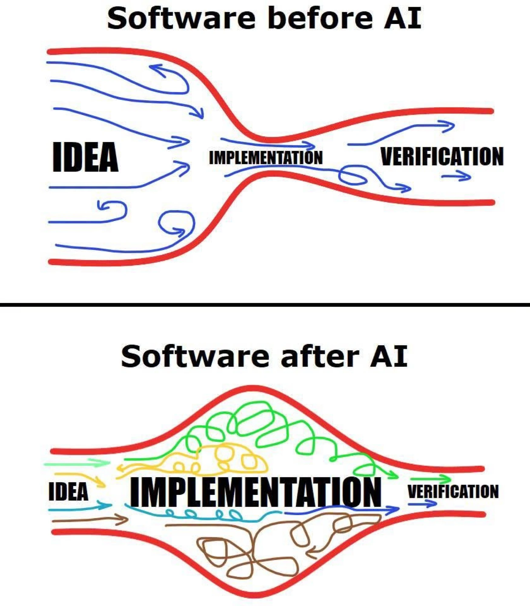
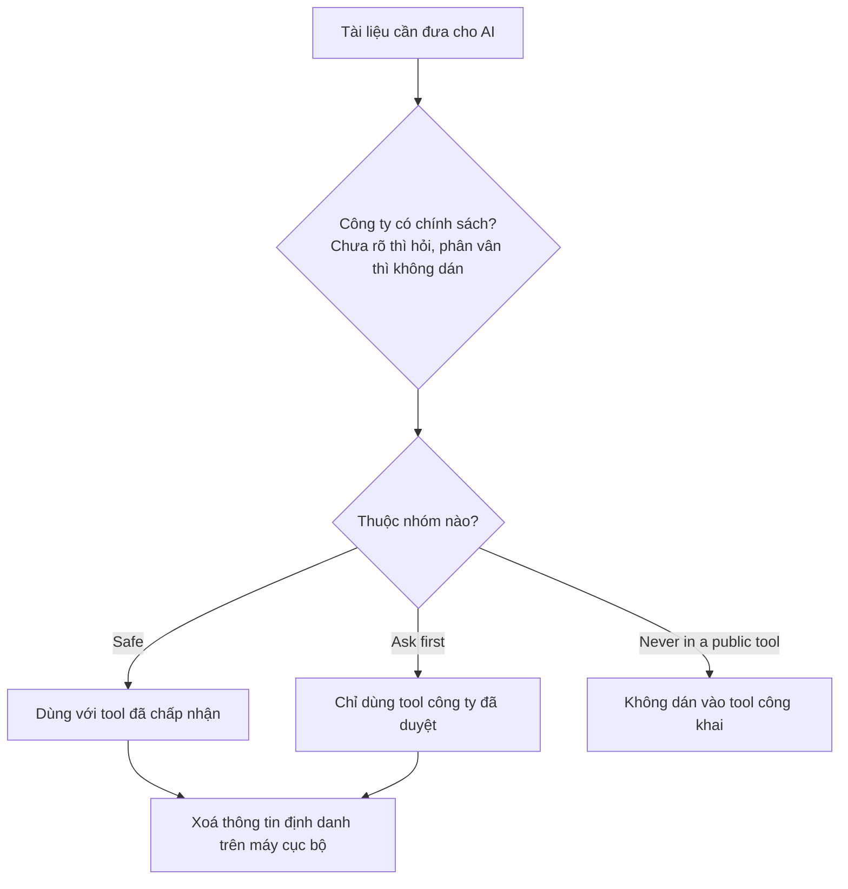

Buổi này trả lời sáu câu hỏi: nghề đang đổi hướng thế nào, quy trình thiết kế khi có AI ra sao, làm việc với AI cần những khái niệm nào, agent và đội AI là gì, dữ liệu nào được đưa cho AI, và workspace nào các buổi sau cùng dùng.

> **AI-assisted, không phải AI-generated.** AI soạn nháp. Bạn kiểm tra. Bạn quyết định. Lập trường của chương trình: bạn là partner cùng business và product chọn vấn đề đáng giải trước khi build.

## Nội dung buổi học

1. Background: AI và nghề thiết kế
2. Career directions: ba hướng đi
3. The design process with AI: bốn stage, method, AI làm tốt và còn yếu ở đâu
4. Working with AI: bốn khái niệm, agent và đội AI
5. Data safety: ba nhóm tài liệu
6. The workspace: project folder và Knowledge Hub

## Sau buổi học, bạn có thể

1. Mô tả ba hướng đi nghề nghiệp (strategic designer, design builder, AI product designer), bằng chứng và giới hạn của chúng, và chọn hướng nghiêng về
2. Nêu, với mỗi stage trong bốn stage, phần AI giúp được và phần bạn vẫn tự làm
3. Giải thích bốn khái niệm: context, grounding, hallucination, và AI-assisted so với AI-generated
4. Nêu hai loại task AI làm tốt và hai loại còn yếu, rồi đánh giá một workflow có đáng automate hay chưa bằng ba câu hỏi
5. Mô tả agent khác một lượt hỏi đáp ở điểm nào, phác một đội AI cho product design, và nêu Knowledge Hub dùng để làm gì
6. Phân loại tài liệu thành ba nhóm (safe, ask first, never in a public tool) và viết bản đầu data rules

---

## 1. Background: AI and the design profession

Mục này tóm tắt những gì các nguồn kiểm chứng được cho biết về tác động của AI lên nghề. Mỗi con số ghi nguồn ngay trong câu.

### 1.1 Findings

| # | Phát hiện | Nguồn |
|---|---|---|
| 1 | **Mức dùng AI rất cao.** Khảo sát hơn 900 designer tại hơn 60 quốc gia (2026): 91% dùng AI ít nhất mỗi tuần (54% một năm trước), 75% dùng mỗi ngày, trung bình mỗi người dùng 7 AI tool (3 một năm trước) | Designer Fund và Foundation Capital, *AI in Design 2026* |
| 2 | **Ranh giới giữa các vai trò mờ đi.** Một nửa số người trả lời đã đưa code do AI tạo lên production; 65% làm nhiều việc product hoặc engineering hơn; 40% cho biết PM và engineer làm nhiều việc design hơn | Designer Fund và Foundation Capital |
| 3 | **Số liệu dự báo chưa cho thấy nghề co lại.** BLS dự báo web và digital interface designer tăng 7,0% trong giai đoạn 2024 đến 2034 (từ 128.900 lên 137.900), so với 3,1% của mọi ngành. Bảng 2025 đến 2035 gộp thêm web developer, ra 5%, và ghi rằng AI trong phát triển web "may soften" mức tăng. Hai bảng gộp nghề và năm gốc khác nhau nên không so sánh trực tiếp | U.S. Bureau of Labor Statistics; Adobe |
| 4 | **Áp lực lộ ra ở entry level.** NN/g nhận định thị trường UX ổn định sau 2023 đến 2024, nhưng vị trí entry-level vẫn "scarce and highly competitive" còn vị trí senior phục hồi nhanh hơn | Nielsen Norman Group, *State of UX 2026* |
| 5 | **Cơ chế tác động.** Nghiên cứu của Stanford trên dữ liệu bảng lương ADP (đến 06/2026): người đi làm sớm (22 đến 25 tuổi) ở các nghề chịu tác động mạnh nhất của AI có việc làm thấp hơn khoảng 19% so với nhóm cùng tuổi ở nghề ít chịu tác động. Nhóm có kinh nghiệm không có khoảng cách tương tự. Nghiên cứu xét mọi nghề, không tách riêng designer | Brynjolfsson, Chandar và Chen, Stanford Digital Economy Lab |

### 1.2 Interpretation

Hai nhận định dưới đây là **suy luận**, không phải kết quả đo trực tiếp.

- **Phần việc bị nén nhanh nhất là từ brief sang screen.** Vị trí thiên về execution ở entry level (wireframe, sản xuất asset) chịu áp lực rõ nhất. Không nguồn nào đo riêng nhóm "nhận brief rồi làm screen"; nhận định suy ra từ phát hiện 4 và 5.
- **Phần AI chưa làm thay được là chọn vấn đề đáng giải, thống nhất thế nào là thành công, và kiểm tra những gì AI soạn nháp.** NN/g mô tả practitioner thành công là "adaptable generalists", coi UX là giải quyết vấn đề chiến lược chứ không phải sản xuất deliverable.

### 1.3 Limitations of the evidence

- Khảo sát designer là tự khai báo, không dùng mẫu ngẫu nhiên, do bên có lợi ích trong lĩnh vực design và AI tooling thực hiện.
- Dự báo của BLS tính tác động của AI còn hạn chế, và bản 2024 đến 2034 có trước phần lớn thay đổi gần đây.
- Chưa có nguồn cho thị trường Việt Nam ở cấp designer. Số liệu chủ yếu về Mỹ và toàn cầu. Các số liệu hay gặp trên báo nghề nghiệp mà không truy được nguồn (ví dụ phần trăm giảm tin tuyển junior) không được dùng ở đây.

---

## 2. Career directions

Ba hướng đi không loại trừ nhau, mô tả xu hướng chứ không phải bảo đảm. Mức bằng chứng ghi kèm để bạn cân nhắc.

| Hướng | Công việc chính | Kỹ năng trọng tâm | Bằng chứng và giới hạn | Chương trình hỗ trợ |
|---|---|---|---|---|
| **Strategic designer** (senior generalist) | Cùng product và business chọn vấn đề đáng giải | Research, framing, stakeholder management, judgment | Vị trí senior và generalist phục hồi nhanh hơn (NN/g); nhóm có kinh nghiệm ổn định (Stanford). **Mức vừa** | Buổi 3 đến 8 (Discover, Define); hub làm bằng chứng cho lập luận |
| **Design builder** (design engineer) | Dựng prototype chạy được và đưa lên production bằng AI coding tool | Design system, kiểm tra file AI đã sửa, đọc output | Một nửa designer được khảo sát đã đưa code do AI tạo lên production. **Mức vừa** về xu hướng; số liệu tuyển dụng yếu | Buổi 9 và 10 (AI Prototyping) |
| **AI product designer** | Thiết kế sản phẩm có AI bên trong: hành vi, ranh giới, lỗi, niềm tin | Hiểu hallucination và grounding, đánh giá output, conversation design | NN/g nêu đây là chuyên môn đang lên; số liệu tăng trưởng chưa đáng tin. **Mức yếu** | **Chỉ nền tảng.** Chương trình dạy dùng AI để làm việc, không dạy thiết kế sản phẩm AI |

Hướng thiên về execution ở entry level chịu áp lực nhiều nhất theo các nguồn trên, và là lý do để chọn hướng sớm. Ở Practice 1, bạn ghi hai đến ba dòng vào `_personal/my-direction.md` (hướng nghiêng về, lý do, một kỹ năng muốn xây). File được xem lại ở buổi 12 và không đưa cho AI tool.

---

## 3. The design process with AI

### 3.1 The four stages

Double Diamond gồm bốn stage; output của stage này là input của stage kế. So với Design Thinking năm stage: Empathise là **Discover**, Define là **Define**, Ideate và Prototype là **Develop**, Test là **Deliver**.

| Stage | Hình dạng | Tạo ra |
|---|---|---|
| **Discover** | Mở rộng: hiểu người dùng và bối cảnh | Evidence, research thô |
| **Define** | Thu hẹp: diễn giải các phát hiện | Insight, opportunity, design challenge |
| **Develop** | Mở rộng rồi thu hẹp: brainstorm, select, prototype | Một hướng đã chọn và một prototype |
| **Deliver** | Thu hẹp: test và bàn giao | Findings, handoff pack, measurement plan |



Mỗi stage kết thúc bằng một checklist ngắn gọi là **gate** trước khi công việc đi tiếp. Buổi này chỉ nói mỗi stage gồm gì và AI giúp được ở đâu; từng method nằm ở pre-read và method card.

### 3.2 Methods and the division of work

Câu hỏi áp dụng cho mọi stage: **AI giúp được ở đâu, và đâu là phần bạn vẫn phải tự làm?**

| Stage | Method | AI giúp | Bạn vẫn tự làm |
|---|---|---|---|
| **Discover** | Research questions, desk research, competitor analysis, stakeholder meetings, questionnaire, user interviews, observation | Soạn nháp research questions, interview guide, questionnaire; đọc nguồn đã thu thập rồi rút dữ kiện; phiên âm và tóm tắt session | Chọn câu hỏi; gặp và quan sát người thật; đối chiếu bản tóm tắt với ghi chú gốc. **AI không phải user** |
| **Define** | Identify themes, sort and cluster, define insights, frame opportunities, set design challenges (công cụ: empathy map, assumption map, JTBD, How Might We, journey map, Lean UX canvas) | Đề xuất theme và cluster; soạn nháp insight statement và How Might We; chỉ ra chỗ evidence còn mỏng | Quyết định theme nào quan trọng; xếp hạng opportunity; thống nhất design challenge với product và business. **AI không đóng vai product và business** |
| **Develop** | Brainstorm (Crazy 8s, How Might We ideation, brainwriting); select (impact vs effort, concept sketching, storyboarding); prototype (wireframes, interactive prototype, proof of concept) | Mở rộng ý tưởng và biến thể; AI coding tool dựng prototype đầu từ flow và design system | Chọn hướng và ghi lý do; kiểm tra từng decision với user need và principle |
| **Deliver** | Internal feedback, concept testing, usability testing, A/B testing; handoff pack và measurement plan | Soạn nháp test plan, script và handoff; sắp xếp ghi chú | Chạy session với user thật; xếp findings theo mức độ quan trọng, không theo số lần được nhắc. **AI không thay user thật** |

Method thuộc về bạn; AI giúp soạn nháp nhanh hơn, việc kiểm tra thuộc về bạn. Mỗi method có một card một trang: [mục lục method card](../../../assets/method-cards/README.md).

### 3.3 The partner stance

Phần AI làm nhanh nhất là biến brief thành screen. Phần AI chưa làm thay được là cùng product và business chọn vấn đề đáng giải và thống nhất thế nào là thành công. Design tham gia sớm với evidence; product và business chia sẻ những gì họ biết về vấn đề, outcome và ràng buộc. Mức làm việc chung với product khác nhau giữa các designer (làm sát product, liên lạc qua trung gian, chưa có cơ hội trao đổi). Chương trình chạy được trong cả ba trường hợp, và Lesson 2 trình bày cách làm.

### 3.4 What AI is good at, and where it falls short

Mục 3.2 trả lời AI giúp được ở đâu. Mục này cho biết giới hạn của câu trả lời đó.

**Phát hiện từ nguồn.**

| Loại việc | Phát hiện | Nguồn, năm, cỡ mẫu |
|---|---|---|
| Tác vụ viết chuyên nghiệp | Thời gian giảm khoảng 40%, chất lượng tăng khoảng 18% | Noy và Zhang, Science, 2023, 453 người |
| Task nằm trong khả năng của mô hình | Nhanh hơn khoảng 25%, chất lượng cao hơn khoảng 40%. Task nằm ngoài khả năng cho kết quả tệ hơn nhóm không dùng AI | Harvard và BCG, 2023, 758 consultant |
| Một task code độc lập | Hoàn thành nhanh hơn khoảng 55% (khoảng tin cậy 21 đến 89%) | GitHub, 2022, 95 developer |
| Developer giàu kinh nghiệm trên codebase quen thuộc | Chậm hơn 19% | METR, 2025, 16 developer |
| Một công việc freelance trọn vẹn | Agent tốt nhất tự hoàn thành khoảng 2,5% dự án khi ra mắt; bảng xếp hạng ngày 22/10/2026 có mô hình đứng đầu trên 21% | Scale AI và CAIS, Remote Labor Index, 2025 và 2026 |
| Tổng hợp nghiên cứu UX | Phiên âm và tóm tắt hữu ích nhưng cần kiểm lại; code và nhóm dữ liệu do AI tạo chỉ nên coi là bản đầu vì có thể bỏ sót và nhóm hời hợt | Nielsen Norman Group, 2024 |

**Suy luận của chương trình.** AI mạnh ở task có giới hạn rõ, đầu ra kiểm tra được nhanh và gần với viết, tóm tắt hoặc dựng bản đầu. AI yếu hơn ở task dài, nhiều bước, cần phán đoán hoặc bối cảnh chỉ người trong team biết. Hai điểm đáng nhấn:

- **Kết quả yếu thường trông ổn.** Khảo sát 1.150 desk worker toàn thời gian ở Mỹ (BetterUp Labs và Stanford Social Media Lab): 40% nhận sản phẩm AI trông như đã xong nhưng thiếu nội dung trong tháng qua, mỗi lần mất trung bình khoảng hai giờ xử lý.
- **Người có kinh nghiệm không tự động nhanh hơn.** Developer ở nghiên cứu METR chậm hơn 19% dù tự cảm thấy nhanh hơn khoảng 20%. Đây là kết quả đầu 2025; METR nay ghi các kết quả này đã cũ.

Số liệu về agent đổi theo từng phiên bản mô hình, nên nhận định "AI mạnh hay yếu" chỉ đúng với một loại task và một thời điểm.

### 3.5 Before automating a workflow

Trước khi hỏi AI giúp được ở đâu, cần hỏi workflow này có đáng được tăng tốc hay không.

**Phát hiện từ nguồn.**

- Báo cáo DORA 2025 (khảo sát gần 5.000 người làm công nghệ) mô tả AI như một bộ khuếch đại: throughput tăng, độ bất ổn cũng tăng, và AI phóng đại cả điểm mạnh lẫn điểm yếu của team. Số liệu đến từ phát triển phần mềm.
- Từ 1990, Michael Hammer lập luận rằng dùng công nghệ để làm nhanh quy trình cũ không tạo ra bước nhảy; phần việc không tạo giá trị nên được bỏ.

**Suy luận của chương trình.** Khi AI làm đầu ra rẻ đi, chi phí chuyển sang bước kiểm tra. Workflow thiếu mục tiêu rõ hoặc thiếu gate sẽ chuyển lỗi sang stage sau nhanh hơn. Với designer, đây là suy luận từ hai nguồn trên, không phải kết quả đo trên công việc design.



*Hình minh hoạ, không phải số liệu. Khung lý thuyết gần nhất là Theory of Constraints (Goldratt, 1984); áp vào design là suy luận.* Trước AI, nút thắt nằm ở implementation. Sau AI, implementation rộng ra nhưng verification vẫn hẹp, nên phần chưa kiểm tra dồn lại ở đó. Với designer: AI tạo mười hướng trong vài phút, còn chọn hướng đúng và kiểm tra với người dùng thật thì không nhanh theo.

**Quy tắc của chương trình:** sửa hoặc bỏ workflow trước, rồi mới dùng AI. Ba câu hỏi trước khi automate:

1. Workflow này nhằm đạt điều gì, và thế nào là kết quả tốt, trong một câu?
2. Khi làm tay, workflow cho kết quả ổn định không?
3. Ai kiểm tra đầu ra, và dựa trên cái gì?

Trả lời "không" ở câu 1 hoặc 2: sửa hoặc bỏ workflow trước. Trả lời "không" ở câu 3: thêm một gate và một người chịu trách nhiệm. Checklist đầy đủ tám câu nằm ở handout `before-you-automate.md`, gửi riêng sau buổi học.

---

## 4. Working with AI: core concepts

### 4.1 Four concepts

Bạn đã dùng AI hằng tuần nên phần này không đọc định nghĩa suông; mỗi khái niệm gắn vào ví dụ ở 4.2.

| Khái niệm | Định nghĩa | Hệ quả thực hành |
|---|---|---|
| **Context** | Mọi thứ AI nhìn thấy tại thời điểm đó: instruction, text đã dán, file đính kèm, các tin nhắn trước. Tài liệu dài và lộn xộn làm kết quả kém chính xác | Đưa đúng tài liệu, chỉ những phần một bước cần; AI không biết gì khác về project |
| **Grounding** | Gắn câu trả lời với tài liệu được cung cấp, không dựa vào kiến thức chung của AI | "Chỉ dùng tài liệu bên dưới. Mỗi ý lấy từ đâu?" |
| **Hallucination** | Câu trả lời tự tin nhưng bịa: một đối thủ không tồn tại, một câu quote chưa ai nói | Yêu cầu nguồn cho từng ý; cho phép AI trả lời "unknown" |
| **AI-assisted so với AI-generated** | AI-generated: AI quyết định. AI-assisted: bạn quyết định, AI soạn nháp và lắp ráp | AI soạn nháp. Bạn kiểm tra. Bạn quyết định |

### 4.1b Six reference terms

Sáu thuật ngữ này được dạy lại đúng buổi cần chúng; bạn đọc trước để quen mặt chữ.

| Thuật ngữ | Định nghĩa | Hệ quả thực hành | Dạy sâu ở |
|---|---|---|---|
| **AI chat tool** | Người dùng viết, AI trả lời. Phù hợp cho tổng hợp, lên ý tưởng, viết | Dùng sâu một tool trước khi thử nhiều tool | Từ buổi 1 |
| **AI coding tool** | Đọc và ghi file trong project folder; dựng prototype chạy được | Cung cấp flow và design system | Buổi 7 |
| **Context window** | Giới hạn lượng thông tin AI giữ được cùng lúc | Chỉ đưa phần một bước cần | Nhắc ở 4.1 |
| **Agent** | Tool tự thực hiện nhiều bước: đọc file, sửa, chạy lệnh, rồi báo lại | Kiểm tra các file đã bị sửa, không chỉ câu trả lời | Giới thiệu ở 4.4; dạy sâu buổi 7 |
| **Connector (MCP)** | Giống một cái USB: cắm giữa file design hoặc tài liệu và AI tool để AI đọc được thứ đang làm | Trước khi kết nối, xác định nó đọc và sửa được những gì | Buổi 7; nhắc ở 5.3 |
| **Reusable instructions** (skills, rules file, project memory) | Instruction đã lưu, bộ quy tắc chung của project, hoặc context project đã lưu | Viết một lần, dùng lại nhiều lần | Buổi 7 (`AGENTS.md` ở 6.2 là ví dụ đầu tiên) |

### 4.2 Worked example: one task, done twice

Ví dụ dùng project mẫu hư cấu của chương trình, Delivery App: nhiều khách mới không đặt lại sau đơn đầu tiên, team nghi ngờ giá là lý do và chưa có research nào.

- **Instruction 1 (mơ hồ):** "Làm sao để cải thiện onboarding cho Delivery App của tôi?"
- **Instruction 2 (có cấu trúc, đính kèm project mẫu):** "Chỉ dùng project mẫu. Liệt kê năm điều quan trọng nhất bạn cần biết mà KHÔNG có trong đó, và nói vì sao mỗi điều quan trọng. Không đoán, không dùng kiến thức chung để lấp chỗ trống. Nếu chỗ nào chưa rõ, trả lời 'unknown'. Chỉ trả về danh sách."

**Quan sát điển hình.** Instruction 1 thường cho lời khuyên tự tin nhưng chung chung, có thể nói về sản phẩm như thể đó là sự thật. Instruction 2 thường hỏi đúng những điều chỉ research hoặc business mới trả lời được.

**Diễn giải.** Project mẫu là **context**; "chỉ dùng project mẫu" là **grounding**; lời khuyên tự tin của instruction 1 là rủi ro **hallucination**; câu trả lời "unknown" là lý do instruction 2 hữu ích. Việc cho phép "unknown" giúp giảm nội dung bịa là giả định thực hành, bạn kiểm tra lại ở Practice 1 (bước 4), chưa được đo. Khái niệm thứ tư, **AI-assisted so với AI-generated**, thể hiện ở chỗ bạn là người chọn bản nào đáng tin.

### 4.3 Reuse rather than retype

Một cuộc hội thoại AI mới không biết gì về project, nên cần đính kèm file đã lưu thay vì mô tả từ trí nhớ. Một instruction tốt gồm:

- tài liệu cần dùng;
- một task duy nhất;
- quy định "chỉ dùng tài liệu này, nêu nguồn cho từng ý, trả lời 'unknown' nếu tài liệu không nói";
- định dạng mong muốn.

Cấu trúc này tương ứng khung CARE của Nielsen Norman Group.

**Mẫu instruction:** "Tôi là UX designer đang làm [project trong một hoặc hai câu]. Đây là context file: [đính kèm context/product-and-users.md]. Chỉ dùng file này, hãy viết instruction nên dùng để nhờ bạn [task cụ thể]. Sau đó phản biện chính instruction đó: chỗ nào còn mơ hồ, chỗ nào có thể trả lời bằng cách đoán, và cần thêm gì để có thể nói 'unknown' thay vì đoán."

### 4.4 Agents and an AI team

Mục này giới thiệu ở mức khái niệm. Bạn chưa dựng đội trong buổi 1; đội được giao việc thật từ buổi 7.

**Agent.** Theo cách phân loại của Anthropic, workflow là hệ thống mà mô hình và tool được điều phối theo đường đi định sẵn trong code, còn agent là hệ thống trong đó mô hình tự quyết định quy trình và việc dùng tool ở thời điểm chạy, đến khi xong hoặc cần hỏi người. Một lượt hỏi đáp trong AI chat tool không phải agent: người dùng quyết định bước tiếp theo từng lượt. Hệ quả thực hành: câu trả lời của agent chỉ là bản tóm tắt, kết quả thật nằm ở các file nó đã sửa, nên việc kiểm tra là kiểm tra file. Agent vẫn có thể báo xong khi chưa xong, cùng cơ chế "kết quả yếu thường trông ổn" ở 3.4.

**Đội AI cho product design.** Mỗi agent là một instruction, một input riêng và một output ghi vào file; bạn dẫn dắt, kiểm tra và quyết định. Sơ đồ đặt hai agent vào mỗi phase của Double Diamond, tám agent cùng đọc và ghi một design memory chung, và bạn duyệt ở mỗi lần chuyển phase.


*Cấu trúc theo các nghiên cứu đã công bố (LacAIDes, MAUX); tên và phạm vi agent là của chương trình.* Bảng dưới minh hoạ trên Delivery App.

| Phase | Agent | Ví dụ output | Bạn vẫn tự làm |
|---|---|---|---|
| Discover | 01 Desk research agent | Dữ kiện từ review công khai và đối thủ, kèm nguồn | Chọn research questions; đối chiếu với nguồn gốc |
| Discover | 02 Interview agent | Interview guide và bản tóm tắt transcript | Gặp người thật; kiểm tra tóm tắt với ghi chú gốc |
| Define | 03 Synthesis agent | Theme, cluster và insight nháp | Chọn theme nào quan trọng |
| Define | 04 Framing agent | Problem statement và câu How Might We nháp | Thống nhất design challenge với product và business |
| Develop | 05 Ideation agent | Concept, biến thể và trade-off | Chọn hướng và ghi lý do |
| Develop | 06 Prototype agent | Flow, màn hình và prototype bản đầu | Kiểm tra với design system và user need |
| Deliver | 07 Test agent | Test plan, script và bản nháp findings | Chạy session với người dùng thật; xếp findings theo mức độ quan trọng |
| Deliver | 08 Handoff agent | Handoff spec và kế hoạch đo | Duyệt trước khi bàn giao |

Hai vai không giao cho AI: người dùng thật và người phía product và business (xem 3.2). Không có agent nào duyệt thay bạn, vì một agent duyệt cũng có thể sai.

**Để đội chạy được** cần bốn thứ trong project folder: context pack, skill trong `toolkit/skills/`, gate và rules file `AGENTS.md`. Thêm vai khi chưa có bốn thứ này không làm đội tốt hơn; theo 3.5, workflow chưa ổn chạy nhanh hơn thì lỗi cũng đến nhanh hơn.

Cách chia vai là phương pháp của chương trình, không phải kết quả nghiên cứu; chưa có nguồn đo hiệu quả của một đội agent trong công việc design.

---

## 5. Data safety

Mục này là hướng dẫn thực tế, **không phải tư vấn pháp lý**; chính sách của công ty và luật địa phương là căn cứ quyết định.

### 5.1 Why it matters

PRD, design chưa phát hành, user research có tên người, file của client và số liệu tài chính thường là thông tin confidential hoặc nằm dưới NDA. Ở Việt Nam, dữ liệu cá nhân được điều chỉnh bởi Luật Bảo vệ dữ liệu cá nhân số 91/2025/QH15, có hiệu lực từ 01/01/2026, và Nghị định 356/2025/NĐ-CP quy định chi tiết việc thi hành. Tên, email, số điện thoại và bản ghi của người dùng đều là dữ liệu cá nhân.

Cách tool xử lý dữ liệu đưa vào tuỳ tool và gói sử dụng. Gói consumer thường cho người dùng chọn có cho phép dùng hội thoại để cải thiện model hay không; gói business, enterprise và API thường không dùng dữ liệu khách hàng để train theo mặc định. Cài đặt và điều khoản đổi thường xuyên, nên bạn cần đọc trang data controls của tool đang dùng và không mặc định dữ liệu là private.

### 5.2 Three classes of material

| Nhóm | Ví dụ | Quy tắc |
|---|---|---|
| **Safe**: thông tin công khai, suy nghĩ riêng, project hư cấu | Trang phí giao công khai của đối thủ; project mẫu của chương trình | Dùng được với bất kỳ tool nào đã chấp nhận |
| **Ask first**: nội bộ nhưng không nhạy cảm | Ghi chú quy trình nội bộ; tóm tắt research chưa công bố, không có tên người | Chỉ dùng trong tool mà công ty đã duyệt |
| **Never in a public tool**: dữ liệu cá nhân, kế hoạch chưa phát hành, tài chính, tài liệu NDA | Transcript phỏng vấn có tên; danh sách khách hàng; spec chưa phát hành; ảnh chụp admin dashboard đang chạy thật | Không dán. Ẩn danh trước, dùng tool đã được duyệt, hoặc để ngoài |



### 5.3 Four habits before pasting

1. **Kiểm tra chính sách.** Chưa có thì hỏi; còn phân vân thì không dán.
2. **Phân loại tài liệu** theo ba nhóm trên.
3. **Xoá thông tin định danh trước**, bằng find and replace trên máy cục bộ chứ không nhờ AI làm, vì khi đó dữ liệu đã được gửi đi.
4. **Giữ file confidential ngoài folder của tool**, vì AI coding tool hoặc agent đọc toàn bộ project folder. Dữ liệu gốc cần ẩn danh nằm trong `work/sources/_raw-private/`: folder này không lên GitHub và `AGENTS.md` bảo tool không đọc, nhưng đó là quy tắc chứ không phải rào chắn kỹ thuật. Cùng nguyên tắc với **connector**: trước khi kết nối, xác định nó đọc và sửa được những gì, và áp data rules như khi dán.

Quyền dùng output của AI cho công việc với client và quyền sở hữu tuỳ công ty và quốc gia; nên ghi những chỗ đã dùng AI vào `project-log.md`. Output của mục này là `context/data-rules.md`: ba dòng bằng lời của bạn (được dán gì, sẽ không dán gì, dùng tool nào cho việc gì).

---

## 6. The workspace

### 6.1 File formats and location

- **Markdown (`.md`)** là tài liệu làm việc: plain text mà AI tool xử lý ổn định. HTML là phần trình bày; hub vẫn là Markdown, và khi stakeholder cần đọc thì export ra PDF.
- Project nằm trong một folder local, không đồng bộ cloud, vì AI coding tool mở cả folder làm project và đọc mọi thứ bên trong.

### 6.2 Project folder

```
[project-name]/
├── index.html           báo cáo của project, xuất từ các file Markdown, mở bằng trình duyệt
├── README.md            Project card (tên, câu hỏi business, stage hiện tại) và việc nên làm tiếp
├── AGENTS.md            rules file cho AI tool: bản đồ folder, thứ tự đọc, các quy tắc cứng
├── context/             context pack: product-and-users, data-rules, accessibility-rules, glossary,
│                        open-questions, design-system-notes (thêm ở buổi 7)
├── work/                mọi thứ làm ra: phân tích, persona, wireframe, prototype
│   └── sources/         anonymised/ (AI đọc) và _raw-private/ (AI không đọc, không lên GitHub)
├── insights/            opportunities, hypotheses, metrics, decisions, evidence, findings,
│                        project-log.md (mỗi decision một dòng, kèm lý do)
├── stages/              câu chuyện của từng stage, do hub tự dựng
├── standards/           gates, principle-checks (viết ở buổi 4), severity-levels
└── _personal/           my-direction.md, learning-log.md; không đưa cho AI tool
```

Mỗi folder một vai: `context/` đưa vào đầu tiên ở mọi bước, `work/` chứa những gì làm ra, `insights/` chứa những gì học được và quyết định. `AGENTS.md` là quy tắc chung mà tool tự đọc khi mở folder, nhưng không phải rào chắn kỹ thuật; file thật sự confidential vẫn để ngoài folder.

### 6.3 Working-file rules

Mỗi activity điền vào một file Markdown, từng section một. Hai quy tắc cốt lõi: AI chỉ trả về section của nó và bạn tự dán vào; bản nháp của AI và bản đã kiểm tra nằm ở hai section riêng.

### 6.4 Knowledge Hub and sharing

Mọi output đi vào **Knowledge Hub**: một folder Markdown trong project folder, mỗi item (opportunity, hypothesis, metric, decision, test) là một file trong `insights/`, liên kết qua properties, nên có thể lần từ một design decision ngược về user need và evidence. Hub mặc định là private. Bạn chia sẻ qua `index.html` hoặc PDF, file nén, repository private, hoặc công khai chỉ khi toàn bộ project được phép (`guides/04-share-your-hub.md`).

---

## Giới hạn của bài học

- **Thiên lệch của dữ liệu train.** AI tool phản ánh pattern trong dữ liệu train, vốn nghiêng về phương Tây và tiếng Anh. Với người dùng Việt Nam hoặc Đông Nam Á, cần đối chiếu gợi ý với mental model của người dùng, không chỉ xem output có thuyết phục hay không.
- **Dữ liệu đưa vào có thể bị lưu lại.** Áp dụng data rules ở mỗi lần dùng.
- **Giới hạn của bằng chứng.** Bằng chứng nghề nghiệp xem 1.3; các hướng đi ở mục 2 là xu hướng, không phải dự báo cá nhân. Số liệu về năng lực AI (3.4) đến từ nghiên cứu trên những mô hình tại thời điểm đó và đổi nhanh; bằng chứng về AI như bộ khuếch đại (3.5) đến từ phát triển phần mềm, áp vào design là suy luận.
- **Giới hạn của chương trình.** Chương trình không dạy thiết kế sản phẩm AI. Cách chia agent ở 4.4 là phương pháp của chương trình, chưa có nguồn đo hiệu quả.
