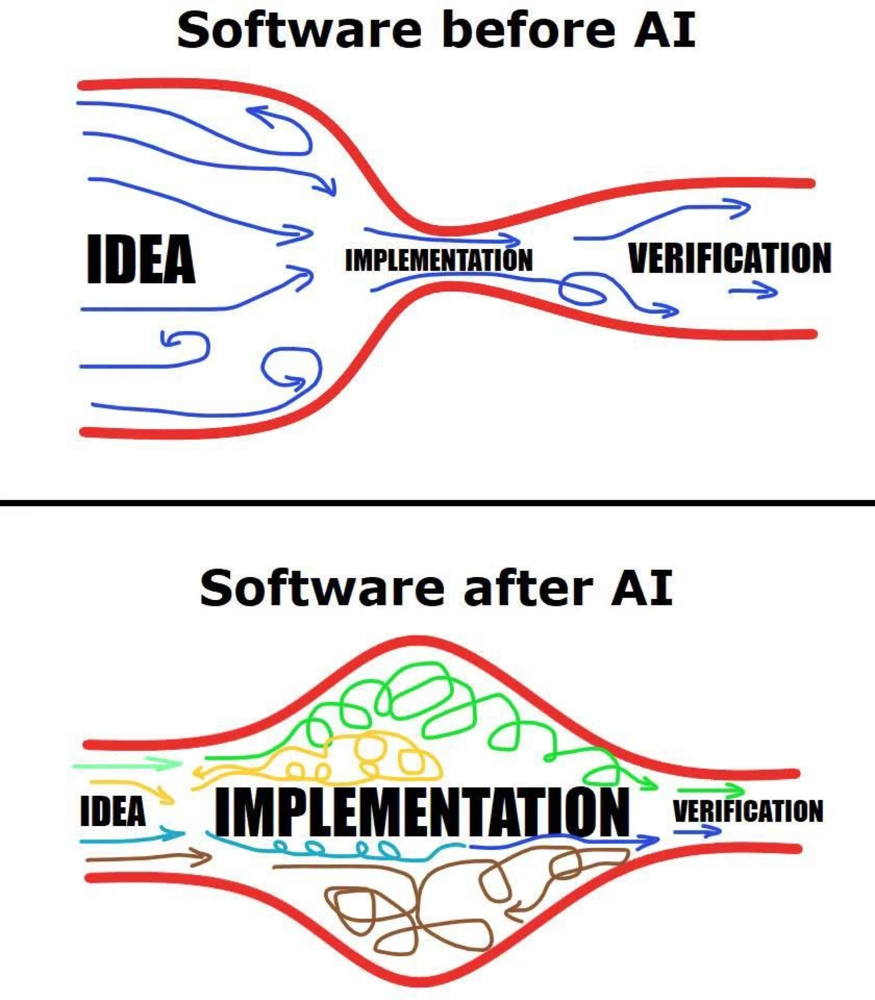

Buổi này trả lời bảy câu hỏi: nghề đang đổi hướng thế nào, quy trình thiết kế khi có AI ra sao, làm việc với AI cần những khái niệm nào, agent và đội AI là gì, dữ liệu nào được đưa cho AI, hub của bạn gồm những lớp nào và theo quy tắc nào, và vì sao một công ty có thể giữ nhiều hub.

> **AI-assisted, không phải AI-generated.** AI soạn nháp. Bạn kiểm tra. Bạn quyết định. Lập trường của chương trình: bạn là partner cùng business và product chọn vấn đề đáng giải trước khi build.

## Nội dung buổi học

1. Background: AI và nghề thiết kế
2. Career directions: ba hướng đi
3. The design process with AI: bốn stage, AI làm tốt và còn yếu ở đâu
4. Working with AI: bốn khái niệm, agent và đội AI
5. Data safety: ba nhóm tài liệu
6. The hub: ba lớp, ba quy tắc và schema file
7. One hub or many: nhiều hub nối nhau bằng ID chung

## Sau buổi học, bạn có thể

1. Mô tả ba hướng đi nghề nghiệp (strategic designer, design builder, AI product designer), evidence và giới hạn của chúng, và chọn hướng nghiêng về
2. Nêu, với mỗi stage trong bốn stage, phần AI giúp được và phần bạn vẫn tự làm
3. Giải thích bốn khái niệm: context, grounding, hallucination, và AI-assisted so với AI-generated
4. Nêu hai loại task AI làm tốt và hai loại còn yếu, rồi đánh giá một workflow có đáng automate hay chưa bằng ba câu hỏi
5. Mô tả agent khác một lượt hỏi đáp ở điểm nào, và phác một đội AI cho product design
6. Phân loại tài liệu thành ba nhóm (safe, ask first, never in a public tool) và viết bản đầu data rules
7. Giải thích ba lớp của hub (raw sources, wiki, schema) và ba quy tắc giữ cho hub đáng tin
8. Giải thích trong hai câu vì sao một công ty có thể giữ mỗi chức năng một hub, và nêu ba quy tắc cho ID chung

---

## 1. Background: AI and the design profession

Mục này tóm tắt những gì các nguồn kiểm chứng được cho biết về tác động của AI lên nghề. Mỗi con số ghi nguồn ngay trong câu.

### 1.1 Findings

| # | Phát hiện | Nguồn |
|---|---|---|
| 1 | **Mức dùng AI rất cao.** Khảo sát hơn 900 designer tại hơn 60 quốc gia (2026): 91% dùng AI ít nhất mỗi tuần (54% một năm trước), trung bình mỗi người dùng 7 AI tool (3 một năm trước) | Designer Fund và Foundation Capital, *AI in Design 2026* |
| 2 | **Ranh giới giữa các vai trò mờ đi.** Một nửa số người trả lời đã đưa code do AI tạo lên production; 40% cho biết PM và engineer làm nhiều việc design hơn | Designer Fund và Foundation Capital |
| 3 | **Số liệu dự báo chưa cho thấy nghề co lại.** BLS dự báo web và digital interface designer tăng 7,0% trong giai đoạn 2024 đến 2034, so với 3,1% của mọi ngành | U.S. Bureau of Labor Statistics |
| 4 | **Áp lực lộ ra ở entry level.** NN/g nhận định vị trí entry-level vẫn "scarce and highly competitive" còn vị trí senior phục hồi nhanh hơn | Nielsen Norman Group, *State of UX 2026* |
| 5 | **Cơ chế tác động.** Người đi làm sớm (22 đến 25 tuổi) ở các nghề chịu tác động mạnh nhất của AI có việc làm thấp hơn khoảng 19% so với nhóm cùng tuổi ở nghề ít chịu tác động. Nhóm có kinh nghiệm không có khoảng cách tương tự. Nghiên cứu xét mọi nghề, không tách riêng designer | Brynjolfsson, Chandar và Chen, Stanford Digital Economy Lab |

### 1.2 Interpretation

Hai nhận định dưới đây là **suy luận**, không phải kết quả đo trực tiếp.

- **Phần việc bị nén nhanh nhất là từ brief sang screen.** Không nguồn nào đo riêng nhóm "nhận brief rồi làm screen"; nhận định suy ra từ phát hiện 4 và 5.
- **Phần AI chưa làm thay được là chọn vấn đề đáng giải, thống nhất thế nào là thành công, và kiểm tra những gì AI soạn nháp.** NN/g mô tả practitioner thành công là "adaptable generalists".

### 1.3 Limitations of the evidence

- Khảo sát designer là tự khai báo, không dùng mẫu ngẫu nhiên, do bên có lợi ích trong lĩnh vực design và AI tooling thực hiện.
- Dự báo của BLS tính tác động của AI còn hạn chế, và bản 2024 đến 2034 có trước phần lớn thay đổi gần đây.
- Chưa có nguồn cho thị trường Việt Nam ở cấp designer. Số liệu chủ yếu về Mỹ và toàn cầu.

---

## 2. Career directions

Ba hướng đi không loại trừ nhau, mô tả xu hướng chứ không phải bảo đảm. Mức evidence ghi kèm để bạn cân nhắc.

| Hướng | Công việc chính | Kỹ năng trọng tâm | Evidence và giới hạn | Chương trình hỗ trợ |
|---|---|---|---|---|
| **Strategic designer** (senior generalist) | Cùng product và business chọn vấn đề đáng giải | Research, framing, stakeholder management, judgment | Vị trí senior và generalist phục hồi nhanh hơn (NN/g); nhóm có kinh nghiệm ổn định (Stanford). **Mức vừa** | Buổi 3 đến 8 (Discover, Define); hub làm evidence cho lập luận |
| **Design builder** (design engineer) | Dựng prototype chạy được và đưa lên production bằng AI coding tool | Design system, kiểm tra file AI đã sửa, đọc output | Một nửa designer được khảo sát đã đưa code do AI tạo lên production. **Mức vừa** về xu hướng; số liệu tuyển dụng yếu | Buổi 9 và 10 (AI Prototyping) |
| **AI product designer** | Thiết kế sản phẩm có AI bên trong: hành vi, ranh giới, lỗi, niềm tin | Hiểu hallucination và grounding, đánh giá output, conversation design | NN/g nêu đây là chuyên môn đang lên; số liệu tăng trưởng chưa đáng tin. **Mức yếu** | **Chỉ nền tảng.** Chương trình dạy dùng AI để làm việc, không dạy thiết kế sản phẩm AI |

Hướng thiên về execution ở entry level chịu áp lực nhiều nhất theo các nguồn trên, và là lý do để chọn hướng sớm.

---

## 3. The design process with AI

### 3.1 The four stages

Double Diamond gồm bốn stage; output của stage này là input của stage kế. So với Design Thinking năm stage: Empathise là **Discover**, Define là **Define**, Ideate và Prototype là **Develop**, Test là **Deliver**.

| Stage | Hình dạng | Tạo ra |
|---|---|---|
| **Discover** | Mở rộng: hiểu người dùng và bối cảnh | Evidence, research thô |
| **Define** | Thu hẹp: diễn giải các phát hiện | Insight, opportunity, design challenge |
| **Develop** | Mở rộng rồi thu hẹp: brainstorm, select, prototype | Một hướng đã chọn và một prototype |
| **Deliver** | Thu hẹp: test và handoff | Findings, handoff pack, measurement plan |

Mỗi stage kết thúc bằng một checklist ngắn gọi là **gate** trước khi công việc đi tiếp. Bạn đã biết các stage này, nên buổi này chỉ hỏi một câu ở mỗi stage: AI giúp được ở đâu, và kết quả đó đi vào hub thế nào.

### 3.2 The division of work

Câu hỏi áp dụng cho mọi stage: **AI giúp được ở đâu, và đâu là phần bạn vẫn phải tự làm?**

| Stage | AI giúp | Bạn vẫn tự làm | Đi vào hub |
|---|---|---|---|
| **Discover** | Soạn nháp research questions, interview guide; đọc nguồn rồi rút dữ kiện; phiên âm và tóm tắt | Gặp và quan sát người thật; đối chiếu bản tóm tắt với ghi chú gốc. **AI không phải user** | Source notes có ID |
| **Define** | Đề xuất theme, cluster; soạn nháp insight và How Might We; chỉ ra chỗ evidence còn mỏng | Quyết định theme nào quan trọng; thống nhất design challenge với product và business. **AI không đóng vai product và business** | Insight, opportunity |
| **Develop** | Mở rộng ý tưởng; AI coding tool dựng prototype đầu từ flow và design system | Chọn hướng và ghi lý do; kiểm tra với user need và principle | Decision và lý do |
| **Deliver** | Soạn nháp test plan, script và handoff; sắp xếp ghi chú | Chạy session với user thật; xếp findings theo mức độ quan trọng. **AI không thay user thật** | Findings, metric |

Method thuộc về bạn; AI giúp soạn nháp nhanh hơn, việc kiểm tra thuộc về bạn. Mỗi method có một card một trang: [mục lục method card](../../../assets/method-cards/README.md).

### 3.3 The partner stance

Phần AI làm nhanh nhất là biến brief thành screen. Phần AI chưa làm thay được là cùng product và business chọn vấn đề đáng giải. Mức làm việc chung với product khác nhau giữa các designer; chương trình chạy được trong cả ba trường hợp (làm sát product, liên lạc qua trung gian, chưa có cơ hội trao đổi), và Lesson 2 trình bày cách làm.

### 3.4 What AI is good at, and where it falls short

Mục 3.2 trả lời AI giúp được ở đâu. Mục này cho biết giới hạn của câu trả lời đó.

| Loại việc | Phát hiện | Nguồn, năm, cỡ mẫu |
|---|---|---|
| Tác vụ viết chuyên nghiệp | Thời gian giảm khoảng 40%, chất lượng tăng khoảng 18% | Noy và Zhang, Science, 2023, 453 người |
| Task nằm trong khả năng của mô hình | Nhanh hơn khoảng 25%, chất lượng cao hơn khoảng 40%. Task nằm ngoài khả năng cho kết quả tệ hơn nhóm không dùng AI | Harvard và BCG, 2023, 758 consultant |
| Developer giàu kinh nghiệm trên codebase quen thuộc | Chậm hơn 19% | METR, 2025, 16 developer |
| Tổng hợp nghiên cứu UX | Phiên âm và tóm tắt hữu ích nhưng cần kiểm lại; nhóm dữ liệu do AI tạo chỉ nên coi là bản đầu vì có thể bỏ sót và nhóm hời hợt | Nielsen Norman Group, 2024 |

**Suy luận của chương trình.** AI mạnh ở task có giới hạn rõ, output kiểm tra được nhanh. AI yếu hơn ở task dài, nhiều bước, cần phán đoán hoặc bối cảnh chỉ người trong team biết. Hai điểm đáng nhấn:

- **Kết quả yếu thường trông ổn.** Khảo sát 1.150 desk worker toàn thời gian ở Mỹ (BetterUp Labs và Stanford Social Media Lab): 40% nhận sản phẩm AI trông như đã xong nhưng thiếu nội dung trong tháng qua, mỗi lần mất trung bình khoảng hai giờ xử lý.
- **Người có kinh nghiệm không tự động nhanh hơn.** Developer ở nghiên cứu METR chậm hơn 19% dù tự cảm thấy nhanh hơn khoảng 20%. Đây là kết quả đầu 2025; METR nay ghi các kết quả này đã cũ.

Nhận định "AI mạnh hay yếu" chỉ đúng với một loại task và một thời điểm.

### 3.5 Before automating a workflow

Trước khi hỏi AI giúp được ở đâu, cần hỏi workflow này có đáng được tăng tốc hay không. Báo cáo DORA 2025 (khảo sát gần 5.000 người làm công nghệ) mô tả AI như một bộ khuếch đại: AI phóng đại cả điểm mạnh lẫn điểm yếu của team. Số liệu đến từ phát triển phần mềm. Với designer, đây là suy luận: khi AI làm output rẻ đi, chi phí chuyển sang bước kiểm tra, và workflow thiếu gate chuyển lỗi sang stage sau nhanh hơn. AI tạo mười hướng trong vài phút, còn chọn hướng đúng và kiểm tra với người dùng thật thì không nhanh theo.

*Hình minh hoạ, không phải số liệu. Khung lý thuyết gần nhất là Theory of Constraints (Goldratt, 1984); áp vào design là suy luận.*

**Quy tắc của chương trình:** sửa hoặc bỏ workflow trước, rồi mới dùng AI. Ba câu hỏi trước khi automate:

1. Workflow này nhằm đạt điều gì, và thế nào là kết quả tốt, trong một câu?
2. Khi làm tay, workflow cho kết quả ổn định không?
3. Ai kiểm tra output, và dựa trên cái gì?

Trả lời "không" ở câu 1 hoặc 2: sửa hoặc bỏ workflow trước. Trả lời "không" ở câu 3: thêm một gate và một người chịu trách nhiệm. Checklist đầy đủ tám câu nằm ở handout `before-you-automate.md`, gửi riêng sau buổi học.

---

## 4. Working with AI: core concepts

### 4.1 Four concepts

Bạn đã dùng AI hằng tuần nên phần này không đọc định nghĩa suông; mỗi khái niệm gắn vào ví dụ ở 4.2.

| Khái niệm | Định nghĩa | Hệ quả thực hành |
|---|---|---|
| **Context** | Mọi thứ AI nhìn thấy tại thời điểm đó: instruction, text đã dán, file đính kèm, các tin nhắn trước. Tài liệu dài và lộn xộn làm kết quả kém chính xác | Đưa đúng tài liệu, chỉ những phần một bước cần; AI không biết gì khác về project |
| **Grounding** | Gắn câu trả lời với tài liệu được cung cấp, không dựa vào kiến thức chung của AI | "Chỉ dùng tài liệu bên dưới. Mỗi ý lấy từ đâu?" |
| **Hallucination** | Câu trả lời tự tin nhưng bịa: một competitor không tồn tại, một câu quote chưa ai nói | Yêu cầu nguồn cho từng ý; cho phép AI trả lời "unknown" |
| **AI-assisted so với AI-generated** | AI-generated: AI quyết định. AI-assisted: bạn quyết định, AI soạn nháp và lắp ráp | AI soạn nháp. Bạn kiểm tra. Bạn quyết định |

Bốn thuật ngữ hay gặp khác được dạy đúng buổi cần chúng: **AI chat tool** (bạn viết, AI trả lời), **AI coding tool** (đọc và ghi file trong project folder, buổi 7), **agent** (giới thiệu ở 4.4) và **connector (MCP)**, giống một cái USB cắm giữa tài liệu và AI tool để AI đọc được thứ bạn đang làm (buổi 7).

### 4.2 Worked example: one task, done twice

Ví dụ dùng project mẫu hư cấu của chương trình, Delivery App: nhiều khách mới không đặt lại sau đơn đầu tiên, team nghi ngờ giá là lý do và chưa có research nào.

- **Instruction 1 (mơ hồ):** "Làm sao để cải thiện onboarding cho Delivery App của tôi?"
- **Instruction 2 (có cấu trúc, đính kèm project mẫu):** "Chỉ dùng project mẫu. Liệt kê năm điều quan trọng nhất bạn cần biết mà KHÔNG có trong đó, và nói vì sao mỗi điều quan trọng. Không đoán, không dùng kiến thức chung để lấp chỗ trống. Nếu chỗ nào chưa rõ, trả lời 'unknown'. Chỉ trả về danh sách."

**Quan sát điển hình.** Instruction 1 thường cho lời khuyên tự tin nhưng chung chung, có thể nói về sản phẩm như thể đó là sự thật. Instruction 2 thường hỏi đúng những điều chỉ research hoặc business mới trả lời được.

**Diễn giải.** Project mẫu là **context**; "chỉ dùng project mẫu" là **grounding**; lời khuyên tự tin của instruction 1 là rủi ro **hallucination**; câu trả lời "unknown" là lý do instruction 2 hữu ích. Việc cho phép "unknown" giúp giảm nội dung bịa là giả định thực hành, bạn kiểm tra lại ở Practice 1 (bước 5), chưa được đo.

### 4.3 Reuse rather than retype

Một cuộc hội thoại AI mới không biết gì về project, nên cần đính kèm file đã lưu thay vì mô tả từ trí nhớ. Một instruction tốt gồm: tài liệu cần dùng, một task duy nhất, quy định "chỉ dùng tài liệu này, nêu nguồn cho từng ý, trả lời 'unknown' nếu tài liệu không nói", và định dạng mong muốn. Cấu trúc này tương ứng khung CARE của Nielsen Norman Group.

### 4.4 Agents and an AI team

Mục này giới thiệu ở mức khái niệm. Bạn chưa dựng đội trong buổi 1; đội được giao việc thật từ buổi 7.

**Agent.** Theo cách phân loại của Anthropic, workflow là hệ thống mà mô hình và tool được điều phối theo đường đi định sẵn trong code, còn agent là hệ thống trong đó mô hình tự quyết định quy trình và việc dùng tool ở thời điểm chạy, đến khi xong hoặc cần hỏi người. Một lượt hỏi đáp trong AI chat tool không phải agent: người dùng quyết định bước tiếp theo từng lượt. Hệ quả thực hành: câu trả lời của agent chỉ là bản tóm tắt, kết quả thật nằm ở các file nó đã sửa, nên việc kiểm tra là kiểm tra file.

**Đội AI cho product design.** Mỗi agent là một instruction, một input riêng và một output ghi vào file; bạn dẫn dắt, kiểm tra và quyết định. Sơ đồ đặt hai agent vào mỗi phase của Double Diamond, tám agent cùng đọc và ghi một design memory chung, và bạn duyệt ở mỗi lần chuyển phase. Design memory chung này chính là hub ở mục 6.

*Cấu trúc theo các nghiên cứu đã công bố (LacAIDes, MAUX); tên và scope agent là của chương trình.* Hai vai không giao cho AI: người dùng thật và người phía product và business. Không có agent nào duyệt thay bạn, vì một agent duyệt cũng có thể sai. Cách chia vai là phương pháp của chương trình, chưa có nguồn đo hiệu quả của một đội agent trong công việc design.

---

## 5. Data safety

Mục này là hướng dẫn thực tế, **không phải tư vấn pháp lý**; chính sách của công ty và luật địa phương là căn cứ quyết định.

### 5.1 Why it matters

PRD, design chưa phát hành, user research có tên người, file của client và số liệu tài chính thường là thông tin confidential hoặc nằm dưới NDA. Ở Việt Nam, dữ liệu cá nhân được điều chỉnh bởi Luật Bảo vệ dữ liệu cá nhân số 91/2025/QH15, có hiệu lực từ 01/01/2026, và Nghị định 356/2025/NĐ-CP quy định chi tiết việc thi hành. Tên, email, số điện thoại và bản ghi của người dùng đều là dữ liệu cá nhân.

Cách tool xử lý dữ liệu đưa vào tuỳ tool và gói sử dụng. Gói consumer thường cho người dùng chọn có cho phép dùng hội thoại để cải thiện model hay không; gói business, enterprise và API thường không dùng dữ liệu khách hàng để train theo mặc định. Cài đặt và điều khoản đổi thường xuyên, nên bạn cần đọc trang data controls của tool đang dùng và không mặc định dữ liệu là private.

### 5.2 Three classes of material

| Nhóm | Ví dụ | Quy tắc |
|---|---|---|
| **Safe**: thông tin công khai, suy nghĩ riêng, project hư cấu | Trang phí giao công khai của competitor; project mẫu của chương trình | Dùng được với bất kỳ tool nào đã chấp nhận |
| **Ask first**: nội bộ nhưng không nhạy cảm | Ghi chú quy trình nội bộ; tóm tắt research chưa công bố, không có tên người | Chỉ dùng trong tool mà bạn đã chọn dùng cho việc đó |
| **Never in a public tool**: dữ liệu cá nhân, kế hoạch chưa phát hành, tài chính, tài liệu NDA | Transcript phỏng vấn có tên; danh sách khách hàng; spec chưa phát hành | Không dán. Ẩn danh trước, hoặc để ngoài |

### 5.3 Four habits before pasting

1. **Kiểm tra chính sách.** Chưa có thì hỏi; còn phân vân thì không dán. Bạn hỏi bộ phận security hoặc IT ba câu: dữ liệu được lưu ở đâu, lưu bao lâu, và có dùng để train model không. Nếu công ty cấm công cụ AI công cộng thì thường đã có một công cụ được duyệt, và bạn hỏi xem đó là công cụ nào. Chưa có thì bạn làm trên project mẫu của chương trình.
2. **Phân loại tài liệu** theo ba nhóm trên.
3. **Xoá thông tin định danh trước**, bằng find and replace trên máy cục bộ chứ không nhờ AI làm, vì khi đó dữ liệu đã được gửi đi. Thay tên bằng P1, P2 chưa phải là ẩn danh, vì vai trò, tuổi, nơi ở hay thời điểm vẫn đủ để nhận ra một người. Bạn nên bỏ các chi tiết đó, hoặc nói chung hơn, ví dụ "một PM ở thành phố lớn".
4. **Giữ file confidential ngoài folder của tool**, vì AI coding tool hoặc agent đọc toàn bộ project folder. `AGENTS.md` có thể dặn tool không đọc một folder, nhưng đó là quy tắc chứ không phải rào chắn kỹ thuật. Cùng nguyên tắc với **connector**: trước khi kết nối, xác định nó đọc và sửa được những gì.

Trước khi dùng agent hoặc skill, bạn cũng nên biết công cụ AI của mình có tự cập nhật không. Nhiều công ty không cho công cụ AI, agent hay skill tự cập nhật, vì phần được nạp vào có thể đổi sau khi đã được duyệt. Nếu công ty bạn như vậy, bạn gọi agent bằng tay và cập nhật bằng tay khi cần: đọc phần thay đổi, thử trên project mẫu, rồi mới dùng cho việc thật. Bạn hỏi IT ba câu: công cụ dùng bản ổn định hay bản mới nhất, có khoá phiên bản không, và skill hay connector lấy từ đâu.

Quyền dùng output của AI cho công việc với client và quyền sở hữu tuỳ công ty và quốc gia; nên ghi những chỗ đã dùng AI vào log của project. Output của mục này là ba dòng bằng lời của bạn: được dán gì, sẽ không dán gì, dùng tool nào cho việc gì.

---

## 6. The hub

Từ đầu buổi đến giờ, mỗi stage đều kết thúc bằng câu "kết quả đi vào hub". Mục này nói hub là gì và theo quy tắc nào.

### 6.1 Why a hub

Mỗi cuộc hội thoại AI mới bắt đầu từ trống. Insight từ project này kẹt trong một khung chat, không đi sang bước sau, và khi ai đó hỏi "vì sao quyết định này?" thì lý do nằm rải rác. Andrej Karpathy (04/2026) mô tả một cách khác: để AI duy trì một wiki bền vững thay vì tìm lại tài liệu gốc ở mỗi câu hỏi, nên kiến thức tích luỹ qua từng lần dùng. Lý do ông nêu: người ta bỏ wiki vì công bảo trì lớn hơn lợi ích, còn AI không ngại cập nhật các liên kết. Hub của chương trình dùng cùng ý này.

### 6.2 Three layers

| Lớp | Nội dung | Ai ghi |
|---|---|---|
| **Raw sources** | Thứ bạn thu được: transcript đã ẩn danh, review, tài liệu của team | Bạn đưa vào. Không ai sửa |
| **Wiki** | Thứ rút ra: source notes, insight, opportunity, decision, finding, mỗi mục một file Markdown liên kết với nhau | AI soạn nháp, bạn kiểm tra |
| **Schema** | Quy ước làm việc: AI đọc gì trước, ghi vào đâu, quy tắc nào cứng. Trong chương trình là `AGENTS.md` | Bạn viết, AI giúp soạn |

Hai file giúp tìm đường trong hub. **Index** cho biết hub có gì và nên đọc gì trước (trong chương trình là `README.md`). **Log** ghi theo thứ tự thời gian mỗi lần đưa nguồn vào hoặc đổi quyết định, mỗi lần một dòng kèm lý do (trong chương trình là `project-log.md`).

### 6.3 Three rules

Ba quy tắc này nằm trong schema và giữ cho hub đáng tin.

1. **Raw sources không bao giờ bị AI sửa.** Nếu bản tóm tắt sai, bạn vẫn có nguồn gốc để đối chiếu. Một nghiên cứu về dùng AI cho UX research cho thấy lý do chính khiến researcher ít tin kết quả AI là không truy được về dữ liệu gốc.
2. **Mỗi note có một ID.** Có ID thì một insight chỉ ra được nó dựa vào note nào, và bạn tìm lại được nguồn.
3. **Quote phải nguyên văn.** Quote do AI tóm tắt lại nghe tự nhiên hơn quote thật, vì người thật nói câu dở dang. Buổi 2 dạy cách kiểm điều này bằng chương trình.

Một bình luận dưới bài của Karpathy báo cáo rằng truy vấn chỉ qua wiki kém hơn truy vấn kèm tài liệu gốc (số tự báo cáo, chưa kiểm chứng). Đó là lý do quy tắc 1 tồn tại.

### 6.4 The schema file

Schema là file ngắn và cụ thể. Chỉ ghi những điều AI không tự suy ra được từ folder: thứ tự đọc, folder nào không đọc, quy tắc cứng như ba quy tắc trên. Thêm một dòng khi bạn thấy AI lặp lại cùng một lỗi. Một nghiên cứu arXiv (2026) thấy file ngữ cảnh do người viết chỉ cải thiện khiêm tốn và tăng chi phí xử lý khoảng 20%, nên file dài không tốt hơn file ngắn. Muốn biết file của mình có giúp không, chạy cùng một task có file và không có file rồi so hai kết quả.

### 6.5 Files, folders and sharing

- **Markdown (`.md`)** là định dạng của hub: plain text mà AI tool xử lý ổn định. Khi stakeholder cần đọc thì export ra PDF hoặc trang HTML.
- Project nằm trong một folder local, vì AI coding tool mở cả folder làm project và đọc mọi thứ bên trong.
- Bạn tự sắp xếp folder theo cách làm việc của mình. Chỉ cần mỗi lớp ở trên có chỗ riêng và schema ghi rõ chỗ đó.
- Hub mặc định là private. Bạn chia sẻ qua trang HTML hoặc PDF, file nén, repository private, hoặc công khai chỉ khi toàn bộ project được phép.

---

## 7. One hub or many

Một số công ty lớn đang thử một hướng khác với "một hub cho tất cả": mỗi chức năng (business, technical, design) giữ hub riêng, và AI là lớp nối để đối chiếu và lấy dữ liệu liên quan. Mục này là lý thuyết, bạn không làm bài tập. Đây là một pattern các tổ chức đang thử, chưa phải một chuẩn.

### 7.1 Why one hub per function

Mỗi chức năng sở hữu một loại dữ liệu khác nhau và có người chịu trách nhiệm riêng. Business giữ mục tiêu và metric, technical giữ ràng buộc và kiến trúc, design giữ insight và decision. Gộp tất cả vào một hub thì không ai là chủ của từng phần. Cách này giống nguyên tắc của data mesh: mỗi miền tự chủ, và chỉ một bộ chuẩn chung rất nhỏ áp cho mọi miền.

### 7.2 The thread is a shared ID

Sợi dây nối các hub là ID chung. Ví dụ một chuỗi:

- một mục tiêu business có ID,
- một opportunity trong hub design trỏ về mục tiêu đó,
- một decision trỏ về opportunity,
- một ràng buộc kỹ thuật trong hub technical trỏ về decision,
- một test trỏ về decision và ràng buộc.

Mỗi mục mang ID và nêu ID của mục nó dựa vào. Nhờ vậy AI đi được từ test ngược về mục tiêu business, qua cả ba hub. Đây là ý của requirements traceability: ID có từ trước khi viết, và có hai chiều kiểm tra (mọi mục tiêu có ít nhất một test, và mọi test truy được về một mục tiêu). Hub của bạn đã dùng ý này ở quy mô nhỏ: source ID như `I01-03` và insight ID như `IN-01`.

### 7.3 Three rules for shared IDs

1. **ID không đổi.** Đổi ID là cắt liên kết.
2. **ID không dùng lại.** Xoá một mục thì ID của nó cũng nghỉ.
3. **Mỗi chức năng một tiền tố**, để hai hub không đặt trùng ID. Ví dụ BIZ, DES, TEC là tiền tố minh hoạ, không phải chuẩn.

Ngoài ID, các hub cần một bộ field chung rất nhỏ, ví dụ owner, status, version, để AI nối được mà không phải dịch qua lại.

### 7.4 Two risks

- **Nối sai mà không báo lỗi.** Nếu hai hub dùng cùng ID nhưng cấu trúc khác nhau, phép nối cho ra kết quả sai và không có cảnh báo. Không dùng tên hay email làm khoá.
- **AI nối nhanh, nhưng bạn vẫn kiểm tra.** Khi AI đối chiếu ba hub, bạn mở cả hai nguồn của mỗi kết luận, đúng như với một insight trong hub của riêng bạn.

---

## Giới hạn của bài học

- **Thiên lệch của dữ liệu train.** AI tool phản ánh pattern trong dữ liệu train, vốn nghiêng về phương Tây và tiếng Anh. Với người dùng Việt Nam hoặc Đông Nam Á, cần đối chiếu gợi ý với mental model của người dùng, không chỉ xem output có thuyết phục hay không.
- **Dữ liệu đưa vào có thể bị lưu lại.** Áp dụng data rules ở mỗi lần dùng.
- **Giới hạn của evidence.** Evidence nghề nghiệp xem 1.3; các hướng đi ở mục 2 là xu hướng, không phải dự báo cá nhân. Số liệu về năng lực AI (3.4) đến từ nghiên cứu trên những mô hình tại thời điểm đó và đổi nhanh; evidence về AI như bộ khuếch đại (3.5) đến từ phát triển phần mềm, áp vào design là suy luận.
- **Mô hình hub.** Ba lớp và ba quy tắc ở mục 6 dựa trên mô tả của Karpathy và các hướng dẫn thực hành, chưa có nghiên cứu đo hiệu quả của hub trong công việc design. Mô hình nhiều hub ở mục 7 là pattern một số tổ chức đang thử; các nguồn chủ yếu là bài viết của nhà cung cấp công cụ và tài liệu về traceability và data mesh, không phải chuẩn cho design.
- **Giới hạn của chương trình.** Chương trình không dạy thiết kế sản phẩm AI. Cách chia agent ở 4.4 là phương pháp của chương trình, chưa có nguồn đo hiệu quả.
