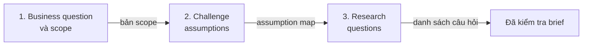
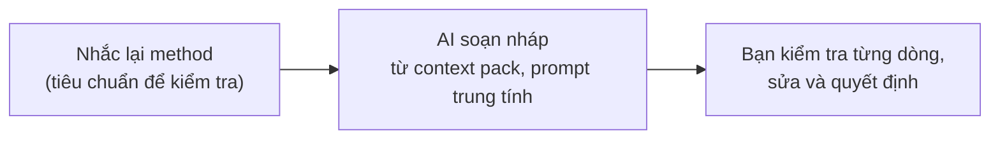

Buổi này mở stage Discover. Bạn đặt một bộ principles chung, học cách phá brief (break the brief), rồi chuẩn bị và chạy phỏng vấn người dùng thật. Bạn làm cả chuỗi này trên project của mình ở nhà sau buổi học. Phần từ ghi chú phỏng vấn đến insight (synthesis) học ở Lesson 3.

> **AI soạn nháp. Bạn kiểm tra. Bạn quyết định.** Mọi điều bạn ghi ở Discover truy được về một nguồn, hoặc mang nhãn "chưa có nguồn". Độ tin cậy nằm ở đó, không nằm ở độ trơn tru của bản AI soạn.

## Nội dung buổi học

1. AI trong Discover Problem: Discover nằm ở đâu và AI giúp được gì
2. Principles cho AI: chuẩn để AI đối chiếu
3. Break the brief: scope, assumption và research question
4. Understand our users: research plan, script, buổi phỏng vấn và quy tắc dữ liệu
5. Những gì vào hub sau buổi này
6. Ví dụ xuyên suốt với Delivery App

Phụ lục, ngoài 90 phút: competitor analysis.

## Sau buổi học, bạn có thể

1. Chỉ ra Discover nằm ở đâu trong Double Diamond và nêu AI giúp được gì, chưa giúp được gì ở stage này
2. Viết một principle riêng của sản phẩm có thể đảo ngược một quyết định và có dòng "điều này không có nghĩa là", và giải thích vì sao chuẩn đặt trước khi AI chạy
3. Mô tả ba việc của Break the brief (scope, assumption, research question), file mỗi việc tạo ra và phần bạn kiểm tra
4. Giải thích vì sao AI không được đóng vai PO hay user, và gắn trạng thái confirmed hoặc assumed cho scope
5. Nêu bốn thói quen của một buổi phỏng vấn tốt, vai trò của AI khi chuẩn bị phỏng vấn, và bốn câu hỏi trước khi đưa dữ liệu phỏng vấn cho AI

---

## 1. Background: where Discover sits and what AI can do

### 1.1 Discover in the Double Diamond

Kim cương thứ nhất (Discover rồi Define) mở rộng để hiểu vấn đề, rồi thu hẹp về vấn đề đáng giải. Kim cương thứ hai (Develop rồi Deliver) làm tương tự cho giải pháp. Discover là điểm mở rộng đầu tiên: gom điều team đã biết, điều người dùng nói và làm, điều thị trường đang làm.

Một brief thường nêu giải pháp ("thêm bước onboarding"). Một business question nêu vấn đề mà giải pháp phục vụ ("vì sao khách mới không đặt lại sau đơn đầu tiên?"). Brief là điểm xuất phát tốt để cùng kiểm tra, không phải thứ cần sửa. Break the brief (mục 3) là cách kiểm tra đó.

### 1.2 What AI can do in Discover

Ở Discover, AI soạn nháp được các việc sau, cùng một nhịp "AI soạn nháp, bạn kiểm tra":

- Tạo transcript buổi phỏng vấn và usability test: bạn kiểm lại tên riêng, thuật ngữ và con số.
- Dịch và localise transcript research: bạn mở nguồn gốc ra đối chiếu khi AI dịch.
- Tóm tắt một buổi phỏng vấn thành các ý chính: bạn đối chiếu từng quote với transcript, vì bản tóm tắt hay thêm chi tiết không có thật.
- Gắn tag đoạn trích theo codebook có sẵn: người xem lại các trường hợp mơ hồ.
- Gom ghi chú thành nhóm affinity bản đầu: AI tìm liên hệ về nghĩa, bạn sắp xếp lại và đặt tên nhóm.
- Tìm lại research cũ của team: bạn mở nguồn gốc khi AI trích.
- Soạn nháp interview guide: bạn loại câu hỏi dẫn dắt và sắp xếp theo mức rủi ro.
- Làm sạch và tóm tắt câu trả lời mở trong survey: lấy mẫu kiểm tra xem có bỏ sót ý kiến thiểu số không.

AI chưa làm được hai việc: biết điều không có trong tài liệu (nó lấp chỗ trống bằng điều nghe hợp lý) và thay người thật trả lời. Danh sách trên là ước tính từ catalogue task, chưa phải số đo trên designer Việt Nam. Chọn điều gì đáng đưa vào scope và chấm severity vẫn thuộc về bạn.

### 1.3 The partner stance

Phần AI làm nhanh nhất là biến brief thành màn hình. Phần AI chưa làm thay được là cùng product và business chọn vấn đề đáng giải và thống nhất thế nào là thành công. Design tham gia sớm với evidence, product và business chia sẻ điều họ biết về vấn đề, outcome và ràng buộc. Lập trường ở đây là partner, không phải người nhận order: thay vì làm ngay màn hình onboarding, hỏi "vì sao khách mới không đặt lại sau đơn đầu tiên?".

---

## 2. Design Principles: the standard AI checks against

### 2.1 Two parts

Không có chuẩn, AI đối chiếu công việc với "điều nghe hợp lý nói chung". Có chuẩn viết sẵn, AI đối chiếu với đúng tiêu chí của project. Bạn viết chuẩn một lần, các bước sau dùng lại.

| Phần | Nội dung | Nguồn |
|---|---|---|
| UX principles | 3 đến 5 principle riêng của sản phẩm (2.2) | Bạn viết |
| Business principles | Ràng buộc và ưu tiên của business mà thiết kế không được vi phạm: mission, brand value, compliance, KPI, guardrail | Từ business hoặc PRD; không tiếp cận được business thì lấy từ PRD và thông tin công khai, ghi **assumed** |

### 2.2 Product UX principles

| | |
|---|---|
| **What** | Principle riêng là quy tắc của sản phẩm, dùng để chọn khi hai hướng đều hợp lệ |
| **Why** | AI và bạn cùng đối chiếu một chuẩn thay vì cảm giác |
| **When** | Viết trước khi AI chạy, ở Step 1 của bài tập về nhà |

Một principle dùng được cần bốn điều (tổng hợp từ hướng dẫn của 18F và một tài liệu practitioner, nên là gợi ý, chưa phải chuẩn):

1. **Đủ cụ thể để đảo ngược một quyết định.** "Đơn giản và dễ dùng" không đảo ngược được quyết định nào; "đổi ý phải dễ hơn cam kết" thì có.
2. **Có thứ tự ưu tiên khi hai principle xung đột.** Không có thứ tự, AI và bạn mỗi bên chọn một kiểu.
3. **Có một dòng "điều này không có nghĩa là…".** Dòng này chặn AI áp dụng quá tay.
4. **Ít.** Tối đa 7 cho cả sản phẩm; project của chương trình cần 3 đến 5.

Ví dụ trong Delivery App: *"Đổi ý phải dễ hơn cam kết. Không có nghĩa là bỏ bước xác nhận thanh toán."* Principle này đảo ngược quyết định "không đổi được khung giờ giao sau khi thanh toán" và cho AI một tiêu chí cụ thể. Mỗi principle nên viết được thành một câu hỏi có hoặc không, ví dụ "Khách đổi được khung giờ giao sau khi thanh toán không?".

Principle riêng cũng là rubric cho AI chấm. Nghiên cứu UXBench cho thấy AI chấm UX trên một màn hình dễ cho nhận xét trơn tru nhưng thiếu căn cứ, nên tiêu chí cần viết quan sát được và chạy thử vài vòng trên output thật.

### 2.3 Principles first, then AI

Bạn nắm principles trước để nhận ra khi AI gán sai principles hoặc đưa ra nhận định chung chung: AI chạy sau, trên chuẩn của bạn, không ngược lại.

Hình dung nhờ AI đánh giá cùng một màn hình thanh toán hai lần mà không nạp chuẩn nào: lần một ra mười finding, chín cái là "làm cho rõ ràng hơn", lần hai ra một bộ khác hẳn, và không ai biết bộ nào đúng. Đây là ví dụ minh hoạ, bạn có thể thay bằng lần chạy thật của mình. Nạp principles thì AI so với cùng một chuẩn, kết quả gần nhau giữa các lần, và kiểm một finding chỉ cần hỏi nó vi phạm principle nào.

### 2.4 What AI can do with the principles

Sáu việc, gom thành ba nhóm:

| Nhóm | AI làm | Bạn làm |
|---|---|---|
| Viết principles | Soạn nháp từ research và scope; chỉ ra hai principle mâu thuẫn nhau; chấm lại theo bốn tiêu chí của một principle tốt | Chọn và chốt từng cái |
| Đối chiếu | Cross-check finding với principle, ví dụ finding "khách không tìm thấy nút đổi khung giờ" với principle "đổi ý phải dễ hơn cam kết" | Kiểm lại, vì AI dễ gán sai principle cho finding |
| Kiểm tra | Chấm output của chính nó hoặc của AI khác theo rubric viết từ bộ principles | Viết tiêu chí quan sát được, chạy thử vài vòng trước khi tin |

AI rất giỏi biến principle thành nhận xét nghe chắc chắn, như "vi phạm nhất quán", mà không hỏi sự không nhất quán đó có giải một vấn đề thật hay không. Principle giúp AI bám chuẩn, còn quyết định vẫn là của bạn.

### 2.5 Package the principles: rules file and skill

Để AI dùng lại bộ principles mà không phải dán lại mỗi lần, có hai cách package, dùng cùng nhau:

- **Rules file:** ngắn, nạp ở đầu mỗi bước, chứa điều luôn đúng như principle và ràng buộc business. Giữ dưới khoảng 200 dòng và viết đủ cụ thể để kiểm chứng được.
- **Skill:** một thư mục gói một quy trình lặp lại, ví dụ "đối chiếu một flow với principles". Tên và mô tả luôn có sẵn, nội dung đầy đủ chỉ nạp khi cần, nên không chiếm chỗ khi không dùng.

Điều luôn đúng thì vào rules file, việc lặp lại nhiều bước thì làm skill. Ba lưu ý khi viết: đủ cụ thể để kiểm chứng ("đổi ý phải dễ hơn cam kết" kiểm được, "dễ dùng" thì không), không để hai quy tắc mâu thuẫn nhau, và rà lại định kỳ để bỏ quy tắc đã cũ. Rules file là ngữ cảnh cho AI, không phải ràng buộc cứng, nên bạn vẫn kiểm output ở các bước sau.

---

## 3. Break the brief

### 3.1 Three steps, three files

Break the brief là cách kiểm tra brief trước khi chấp nhận nó, và bắt đầu từ context pack đã dựng ở bài tập buổi 1. Thứ tự đi từ điều quan sát được đến điều cần học: chốt business question và scope, liệt kê điều đang tin mà chưa có evidence, biến những điều đó thành research question. Competitor analysis nặng hơn và nằm ở phụ lục, làm khi còn thời gian.

Mỗi hoạt động chạy theo ba pha: nhắc lại method (tiêu chuẩn để kiểm tra), AI soạn nháp từ context pack và các file đã có bằng prompt trung tính, rồi bạn kiểm tra từng dòng, sửa và quyết định. Bạn cần nắm method để kiểm tra được AI, không để làm lại việc AI làm.

| # | Activity | Input của bạn | AI làm | Bạn kiểm tra và quyết định | Output |
|---|---|---|---|---|---|
| 1 | Business question và scope | Business question và quyết định (một hai câu) | Soạn nháp năm câu gửi business, hỏi trung tính | Gửi, ghi agreement status | bản scope |
| 2 | Challenge assumptions | Context pack, scope | Liệt kê assumption theo công thức, tìm assumption ẩn, hỏi ngược evidence | Xếp ma trận, chọn ba assumption hàng đầu | assumption map |
| 3 | Research questions | Ba assumption hàng đầu | Soạn research question theo tiêu chí, gắn quyết định và nơi tìm | Cắt câu dẫn dắt, chốt danh sách | danh sách research question |

Mỗi bước chạy cùng một vòng ba pha:

Tên file và cấu trúc thư mục chỉ là gợi ý. Cách tổ chức nào cũng được, miễn là mỗi bước có một output lưu lại được, AI đọc được và người khác kiểm tra được.

### 3.2 Business question và scope

| | |
|---|---|
| **What** | Bản scope gồm business question, quyết định, outcome, metric, các điều đang tin và agreement status |
| **Why** | Thống nhất thế nào là thành công trước khi thiết kế |
| **When** | Đầu tiên, trước mọi việc khác của Break the brief |

Có hai tầng câu hỏi. Tầng cao mang tính vision và mission ("sản phẩm này tồn tại để giải việc gì cho người dùng?"). Tầng gửi business có năm câu: outcome, success metric, baseline, ràng buộc, thời hạn và người quyết định. Bạn viết thêm **quyết định** mà câu trả lời sẽ phục vụ. Câu đã có trả lời ghi vào scope là **confirmed**; câu chưa có ghi **assumed**, kèm người cần xác nhận. Scope gồm business question, quyết định, outcome, metric, các điều đang tin và **agreement status** (agreed, pending, not available).

**AI không đóng vai PO hay user.** Các nghiên cứu về người trả lời mô phỏng cho thấy họ thiên về câu trả lời dễ nghe. Với stakeholder, AI còn bịa dữ kiện business và metric nghe hợp lý. AI chuẩn bị câu hỏi và soạn nháp ghi chú, còn câu trả lời luôn do người thật đưa ra.

**Hỏi trung tính.** Câu nêu sẵn giả thuyết làm AI nghiêng theo người hỏi. "Liệt kê những điều có thể giải thích hiện tượng này" đáng tin hơn "giải thích vì sao giá là nguyên nhân".

**Ba mức access.** Câu hỏi gửi bằng văn bản là đường chính cho mọi người; buổi họp chỉ là phần thêm.

| Access level | Tình huống | Bạn làm gì | Agreement status |
|---|---|---|---|
| 1 Full access | Gặp được PO và business | Gửi câu hỏi bằng văn bản, họp nếu được mời, chia sẻ lại scope nháp | **agreed** |
| 2 Limited access | Tiếp cận gián tiếp (qua lead, PM hoặc account manager) | Gửi câu hỏi và danh sách điều đang tin kèm ngày cần trả lời; xin chỉnh sửa thay vì xin họp | **pending** cho đến khi có trả lời |
| 3 No access | Không tiếp cận được | Dựng scope từ PRD hoặc brief, thông tin công khai và dữ liệu nhìn thấy được; ghi mọi outcome và metric là **assumed** | **not available** |

Không có access là vị thế yếu hơn, và quy trình chỉ giảm nhẹ chứ không che đi điều đó. Một scope bằng văn bản có nhãn assumption vẫn tốt hơn thiết kế từ một brief mà assumption bị giấu.

### 3.3 Challenge assumptions

| | |
|---|---|
| **What** | Assumption là điều đang tin mà chưa có evidence; xếp lên ma trận Importance × Evidence |
| **Why** | Biết điều gì phải kiểm chứng trước khi tốn công thiết kế |
| **When** | Sau scope, trước Research questions |

Assumption là điều đang tin về người dùng, vấn đề, giải pháp hoặc business mà chưa có evidence. **Method cần nhắc** (theo framework Assumption Map của Strategyzer và Product Talk):

- **Bốn loại:** User, Problem, Solution, Business (khả thi thị trường, giá, quy định).
- **Công thức:** "Chúng tôi tin rằng [nhóm người dùng nào] sẽ [làm gì] vì [vì sao]. Chúng tôi biết mình đúng khi [tín hiệu]."
- **Ma trận Importance × Evidence:** góc quan trọng cao, evidence yếu là chỗ phải kiểm chứng trước. Vị trí của góc này phụ thuộc cách đặt trục (một số bản đảo trục evidence), nên luôn đọc nhãn trục trước khi đọc vị trí. Framework cho phép 3 đến 5 assumption; chương trình chọn 3 vì thời gian.
- **Cập nhật bản đồ:** chuyển assumption sang Confirmed, Unconfirmed hay Unknown sau khi có insight từ phỏng vấn (làm ở Lesson 3).

AI đọc context pack và scope rồi liệt kê assumption theo công thức, gắn loại, tìm assumption ẩn của brief và hỏi ngược evidence của từng assumption ("dựa vào file nào? Nếu không có, ghi unknown"). Bạn tự xếp lên ma trận, vì mức quan trọng và evidence phụ thuộc bối cảnh AI không có. Mục AI đưa ra mà tài liệu không có thì ghi "chưa có nguồn"; bạn sửa ít nhất hai assumption AI viết cho cụ thể với project. Kết quả là **ba assumption hàng đầu** ở góc cần kiểm chứng trước, input của bước tiếp theo.

### 3.4 Research questions

| | |
|---|---|
| **What** | Câu hỏi cụ thể, điều tra được, trả lời xong thì xác nhận hoặc bác một assumption |
| **Why** | Giữ phỏng vấn bám vào điều cần học |
| **When** | Sau Challenge assumptions, trước research plan và phỏng vấn |

Chuỗi là **assumption, rồi research question, rồi 5 đến 8 interview question**. Interview question là các câu mồi trong cuộc trò chuyện, viết ở bước research plan.

**Method cần nhắc:** viết research question trung tính về hành vi, thái độ hoặc bối cảnh, không nói về giải pháp định đưa ra; không quá rộng ("người dùng cảm thấy gì về ngân hàng?") hay quá hẹp ("thích nút xanh hay xanh lá?"); viết trước khi phỏng vấn. Ba kiểu câu xấu: tìm phản hồi, kiểm tra sở thích, hỏi hành vi giả định ("có dùng tính năng X không?"). Hai tiêu chí thêm: gắn với đúng một assumption và một quyết định, và biết tìm câu trả lời ở đâu (file, desk research, phỏng vấn, data).

**Công thức:** *"Chúng ta cần hiểu gì về [hành vi, vấn đề, bối cảnh] để [đưa ra quyết định]?"*. Research question không bao giờ được hỏi thẳng người dùng: họ kể chuyện của họ, và câu trả lời nằm trong những câu chuyện đó. Interview question nào không dẫn về research question nào là câu thừa; research question nào không có assumption phía trên là câu lan man.

Ví dụ trong Delivery App: assumption "khách bỏ đơn vì không đổi được khung giờ giao" thành câu hỏi "Khách đang làm gì khi cần dời khung giờ giao của đơn đã đặt, và điều gì khiến họ bỏ dở?". Câu yếu thì trả lời được bằng có hoặc không ("Người dùng có thích sản phẩm của mình không?"), xin người dùng làm việc của designer ("Người dùng muốn tính năng nào?"), hoặc đã coi như họ không tin ("Vì sao người dùng không tin chúng ta?").

AI soạn research question cho từng assumption hàng đầu theo các tiêu chí trên bằng prompt trung tính. Bạn cắt câu dẫn dắt hoặc hỏi sở thích, sửa câu quá rộng hay quá hẹp và chốt danh sách. Đây là input của research plan và phỏng vấn.

---

## 4. Understand our users (theory)

Hai nhánh: methods, và research với AI (plan và script). Bạn phỏng vấn user thật của project ở nhà, sau buổi này và trước buổi practice trên lớp; input là research question đã chốt ở 3.4. Phần từ ghi chú phỏng vấn đến insight (synthesis) học ở Lesson 3, nhưng quy tắc dữ liệu (4.3) áp dụng ngay khi bạn có transcript đầu tiên.

### 4.1 Methods: interview và survey

**Interview** dùng khi cần hiểu hành vi, bối cảnh và lý do: người dùng đang làm gì, vì sao, gặp gì. **Survey** dùng khi đã biết cần hỏi gì và cần con số trên nhiều người; survey không thay được phỏng vấn để tìm điều chưa biết. Mục tiêu của phỏng vấn là hiểu thực tế của user, không phải để user xác nhận ý tưởng. Khi người phỏng vấn bắt đầu trình bày giải pháp hoặc hỏi "có dùng cái này không?", đó không còn là user research.

Bốn thói quen của một buổi phỏng vấn tốt, và một quy tắc bao trùm: hiểu thế giới của họ, không xác nhận giải pháp của bạn.

1. **Hỏi câu mở.** "Kể lại lần gần nhất…" mời một câu chuyện; câu đóng ("thích A hay B?") cho dữ liệu không dùng được.
2. **Đi theo câu chuyện.** Khi user nói điều bất ngờ, dừng lại và đi theo, kể cả ngoài script. Script là lưới an toàn, không phải khuôn.
3. **Tò mò, không dẫn dắt.** Tò mò như lần đầu, kể cả khi đã nghe năm lần giống nhau. Không xác nhận assumption của bạn; để câu trả lời làm bạn bất ngờ.
4. **Nghe và quan sát.** Người phỏng vấn nói quá khoảng 20% thời gian thì có điều gì đó sai. Im lặng là bình thường. User nói "ổn" nhưng dừng năm giây trước khi bấm, thì khoảng dừng mới là insight; điều họ làm khác điều họ nói thì ghi cả hai.

Chuỗi xin câu chuyện rồi hỏi sâu đi theo một nhịp: xin một lần cụ thể gần nhất ("Kể mình nghe lần gần nhất bạn đặt đồ ăn"), hỏi chuyện gì xảy ra sau đó, hỏi vì sao điều đó quan trọng, rồi xin họ chỉ cho xem. Cần tránh ba kiểu câu: hành vi giả định ("Bạn có dùng tính năng đổi khung giờ không?"), câu đặt sẵn đáp án vào miệng họ ("Bạn có thấy bước chọn giờ khó hiểu không?") và câu đóng cho con số mà không có lý do ("Bạn đặt đồ ăn bao lâu một lần?").

Với survey, AI soạn nháp và đánh giá câu hỏi nhanh nhưng bỏ sót vấn đề tinh vi như social desirability. Người trả lời mô phỏng bằng AI chỉ khớp ở mức nhóm và thiên về câu dễ nghe, nên thử câu hỏi với người thật.

### 4.2 Research với AI: plan và script

AI giúp rõ nhất ở khâu chuẩn bị. Trước khi viết câu hỏi, cần một research plan một trang, trả lời bốn câu: người dùng là ai (mô tả theo hành vi và bối cảnh, không chỉ nhân khẩu học), mục tiêu là gì (một câu, điều cần học để ra quyết định thiết kế), chỉ số đo là gì (dấu hiệu cho biết đã có câu trả lời), và trả lời câu hỏi nào (research question và assumption rủi ro nhất). Mẫu research plan có sáu mục: project overview, research goals, methods, research questions, tools và recruiting. Hai mục dễ bị bỏ quên là tools và recruiting; hỏi sớm sẽ đỡ trễ lịch phỏng vấn.

Chuỗi: research goal, người cần phỏng vấn, research question (từ 3.4), 5 đến 8 interview question, rồi facilitation script. Một research question tách thành 5 đến 8 interview question; phép thử cho mọi câu là câu này dẫn về research question nào, và không dẫn về đâu thì bỏ.

| Việc | AI làm | Bạn làm |
|---|---|---|
| Research goal | Gợi ý cách diễn đạt; hỏi ngược "điều gì thay đổi nếu biết câu trả lời" | Quyết định goal, thống nhất với product |
| Người cần phỏng vấn | Gợi ý profile và câu hỏi lọc (screener) | Tuyển người thật, xin phép |
| Interview question | Soạn 8 đến 10 câu mở từ một research question, chỉ câu dẫn dắt | Cắt ít nhất một nửa (AI hay lặp ý), viết lại câu dẫn dắt |
| Facilitation script | Soạn lời mở, câu hỏi, nhánh follow-up, lời kết | Chỉnh giọng, bỏ câu dẫn dắt |
| Công cụ cầm tay lúc phỏng vấn | Dựng một trang nhỏ từ script: câu hỏi theo thứ tự, nhánh follow-up, ô ghi chú, timer | Quyết định cấu trúc, kiểm tra chạy đúng |

Hai điều bắt buộc. **Chạy thử với một đồng nghiệp hoặc người quen** trước buổi thật, vì AI yếu ở bước thử trước (pretest): nghe họ trả lời, ghi chỗ họ khựng hoặc hiểu sai câu hỏi, rồi sửa guide, vì khách thật chỉ có một lần. **Xin phép người tham gia** trước khi bắt đầu ở ba điểm: ghi hình, dùng cho bài tập hoặc nghiên cứu nội bộ, không chia sẻ ra ngoài; người từ chối ghi hình thì ghi chú tay. Chương trình dạy mức thực hành, không thay tư vấn pháp lý.

Trong buổi phỏng vấn, bạn giữ vai moderator; công cụ chỉ giữ cấu trúc. Nếu cả buổi chỉ đi theo thứ tự câu hỏi thì script đã thành bảng khảo sát.

Ở mỗi bước chuẩn bị, vai của bạn và AI giữ cùng một nhịp. Ở assumption, AI tìm assumption ẩn và hỏi ngược evidence, bạn chấm importance và evidence rồi chọn ba assumption; AI hay gọi kiến thức chung là "đã có evidence". Ở research question, AI hỏi "quyết định nào đổi nếu biết câu trả lời?" và chỉ câu có hoặc không; bạn viết câu này phục vụ quyết định nào. Ở interview question, AI soạn nháp guide và nhánh follow-up; bạn bỏ câu dẫn dắt và chạy thử với người thật. AI nghiêng theo cách bạn đặt câu hỏi, nên hãy nhờ nó phản biện thay vì hỏi "đúng không?", và chỉ cho nó dùng tài liệu bạn đã đưa, thiếu thì ghi unknown. Evidence riêng cho ba bước này còn mỏng: điều đã biết chắc là AI soạn câu hỏi rõ nhưng bỏ sót thiên kiến tinh vi và yếu ở bước thử với người thật.

### 4.3 Four questions before sending interview data to AI

Sau phỏng vấn bạn có transcript và recording, và rất muốn dán cho AI tóm tắt. Trả lời đủ bốn câu trước khi đưa dữ liệu cho AI. Câu nào chưa biết thì dừng lại và tìm câu trả lời trước. Đây là thói quen làm việc, không phải tư vấn pháp lý.

| # | Câu hỏi | Vì sao |
|---|---|---|
| 1 | Participant đã đồng ý điều gì, gồm cả việc dùng AI để xử lý? | Dùng dữ liệu vượt scope đã đồng ý là vấn đề đạo đức; hướng dẫn nghiên cứu (MRS, Esomar) khuyên nêu việc dùng AI trong consent. Lúc xin phép chưa nói đến AI thì dừng ở đây |
| 2 | Công cụ có huấn luyện trên dữ liệu tải lên không, và lưu bao lâu? | Câu hỏi trung tâm trong hướng dẫn cho nhà nghiên cứu; đọc điều khoản, không đoán |
| 3 | Đã ẩn danh trên máy chưa? | Đổi tên thành participant code (P1, P2) bằng find and replace trên máy, trước khi tải lên. Tên, số điện thoại và địa chỉ không đi vào AI |
| 4 | Bản gốc có tên thật đã nằm ngoài vùng AI đọc chưa? | Chỉ AI thấy bản đã gắn P1, P2 |

Không nhờ AI ẩn danh giúp, vì như vậy dữ liệu gốc đã đi qua AI. Luật Việt Nam về bảo vệ dữ liệu cá nhân (Luật 91/2025/QH15, hiệu lực 01/01/2026) lấy sự đồng ý làm trung tâm; nội dung luật chưa được đọc toàn văn trong tài liệu này.

---

## 5. What goes into the hub

Bốn thứ mang ra khỏi buổi này vào hub của bạn, và là input của chuỗi việc ở nhà:

| Thứ | Nội dung |
|---|---|
| Principles | Bộ principles design và business, viết trước khi AI chạy |
| Scope | Business question, outcome, metric và trạng thái confirmed hoặc assumed |
| Assumption map | Ba assumption hàng đầu và mức evidence của chúng |
| Research questions | Câu hỏi điều tra được, mỗi câu gắn với một assumption và một quyết định |

Mỗi thứ có nguồn hoặc nhãn "chưa có nguồn", để người sau không coi assumption là sự thật. Hub mặc định riêng tư và nằm trong project folder của bạn; đưa lên GitHub là tuỳ chọn. Lesson 3 bắt đầu từ các file này và từ transcript phỏng vấn bạn thu được.

---

## 6. Worked example: Delivery App

Project mẫu (hư cấu): Delivery App, nhiều khách mới không đặt lại sau đơn đầu tiên, team nghi ngờ giá là lý do, chưa có research nào.

- **Brief:** "Cải thiện onboarding."
- **Business question:** "Vì sao khách mới không đặt lại sau đơn đầu tiên, và điều gì giữ họ lại?"
- **Principles:** UX principle riêng: "đổi ý phải dễ hơn cam kết, không có nghĩa là bỏ bước xác nhận thanh toán". Business principle: không tăng tỷ lệ huỷ đơn sau đơn đầu tiên (assumed).
- **Điều đang tin** (AI soạn nháp, bạn đối chiếu): giá là lý do chính; khách không hiểu cách đổi khung giờ giao; bước thanh toán làm khách ngại cam kết. Mục thứ hai và thứ ba chưa có nguồn trong project mẫu, nên đánh dấu "chưa có nguồn".
- **Metric:** tỷ lệ đặt đơn thứ hai trong 30 ngày; baseline chưa biết, ghi assumed, người xác nhận là business.
- **Research question** (từ assumption "khách không hiểu cách đổi khung giờ giao"): "Khách đang làm gì khi cần dời khung giờ giao của đơn đã đặt, và điều gì khiến họ bỏ dở?" Câu này phục vụ quyết định có thiết kế lại bước đổi khung giờ hay không, và tìm câu trả lời ở phỏng vấn user.

---

## Appendix. Competitor analysis

Ngoài 90 phút của buổi học. Dùng khi còn thời gian hoặc khi lớp hỏi thêm; làm sau research question, khi cần thêm giả thuyết.

Năm điều cần nắm:

1. **Mục đích là trả lời một assumption, không phải liệt kê competitor có gì.** Mỗi thứ ghi lại gắn với một assumption hàng đầu nó xác nhận hoặc bác.
2. **Chọn hai đến bốn competitor, trộn trực tiếp và gián tiếp** (gián tiếp là khác loại sản phẩm nhưng cùng việc cho người dùng), gồm cả competitor tốt hơn sản phẩm đang xét.
3. **Ghi pattern, không ghi ảnh chụp.** Pattern có giá trị khi thấy ở nhiều nguồn và gắn với assumption ("cả ba competitor đều hiện định dạng file trước bước upload").
4. **AI mô tả trước, đánh giá sau, bạn đối chiếu.** Chốt scope trước (một journey, tối đa sáu tiêu chí). AI mô tả từng ảnh chụp rồi điền bảng evidence, mỗi ô ghi tên file nguồn. Bạn mở ảnh gốc cho các ô quan trọng và ghi tỷ lệ ô sai, vì AI đọc ảnh giao diện chỉ ở mức khá và một bảng gọn dễ tạo cảm giác chắc chắn.
5. **Giới hạn: chỉ cho biết competitor làm gì, không cho biết user vì sao chọn họ.** Đây là *competitive review* của chuyên gia, khác *competitive testing* với user. Kết luận là giả thuyết để hỏi trong phỏng vấn.

---

## Giới hạn của bài học

- Danh sách việc AI làm được ở Discover (1.2) là ước tính từ catalogue task, chưa phải số đo trên designer Việt Nam. Evidence riêng cho AI ở ba bước assumption, research question và interview question còn mỏng.
- Hướng dẫn viết principle (2.2) tổng hợp từ 18F và một tài liệu practitioner, không phải nghiên cứu thực nghiệm. UXBench mới được đọc qua kết quả tìm kiếm.
- Ba mức access và agreement status do chương trình thiết kế, chưa thử với lớp thật.
- Delivery App là case hư cấu do chương trình soạn, không đại diện cho dữ liệu thật hay phỏng vấn bằng tiếng Việt.
