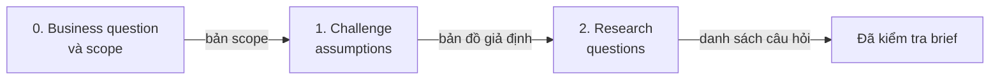
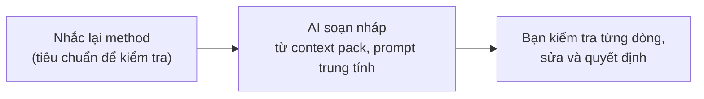

Buổi này mở stage Discover. Bạn đặt một bộ nguyên tắc chung, học cách phá brief (break the brief) và chuẩn bị phỏng vấn người dùng thật. Bạn làm cả chuỗi này trên project của mình ở nhà sau buổi học. Phần biến phỏng vấn thành insight học ở Lesson 3.

> **AI soạn nháp. Bạn kiểm tra. Bạn quyết định.** Đặt chuẩn trước khi AI chạy, kiểm tra brief trước khi nhận, và mọi câu hỏi truy được về một giả định.

## Nội dung buổi học

1. Discover nằm ở đâu và AI giúp được gì
2. Design Principles: chuẩn để AI đối chiếu
3. Break the brief: scope, assumption và research question
4. Understand our users: user interview, research plan, phỏng vấn tốt và chạy thử với AI
5. Ví dụ xuyên suốt với Delivery App

## Sau buổi học, bạn có thể

1. Chỉ ra Discover nằm ở đâu trong Double Diamond và nêu AI giúp được gì, chưa giúp được gì ở stage này
2. Viết một principle riêng của sản phẩm có thể đảo ngược một quyết định và có dòng "điều này không có nghĩa là", và giải thích vì sao chuẩn đặt trước khi AI chạy
3. Mô tả ba việc của Break the brief (scope, challenge assumptions, research questions), file mỗi việc tạo ra và phần bạn kiểm tra
4. Giải thích vì sao AI không được đóng vai PO hay user, và gắn trạng thái confirmed hoặc assumed, cùng agreement status, cho scope
5. Viết một research question theo công thức từ một assumption, và phân biệt câu weak với câu strong
6. Nêu bốn thói quen của một buổi phỏng vấn tốt, và vai trò của AI ở từng khâu chuẩn bị phỏng vấn

---

## 1. Background: where Discover sits and what AI can do

### 1.1 Discover in the Double Diamond

Kim cương thứ nhất (Discover rồi Define) mở rộng để hiểu vấn đề, rồi thu hẹp về vấn đề đáng giải. Kim cương thứ hai (Develop rồi Deliver) làm tương tự cho giải pháp. Discover là điểm mở rộng đầu tiên: gom điều team đã biết, điều người dùng nói và làm, điều thị trường đang làm.

Một brief thường nêu giải pháp ("thêm bước onboarding"). Một business question nêu vấn đề mà giải pháp phục vụ ("vì sao khách mới không đặt lại sau đơn đầu tiên?"). Brief là điểm xuất phát tốt để cùng kiểm tra, không phải thứ cần sửa. Break the brief (mục 3) là cách kiểm tra đó.

### 1.2 What AI can do in Discover

AI giúp được ở ba việc: đọc nhanh nhiều tài liệu, soạn nháp danh sách rộng (câu hỏi, điều đang tin, finding) và gom ghi chú thành nhóm. AI chưa giúp được ở hai việc: biết điều không có trong tài liệu (nó lấp chỗ trống bằng điều nghe hợp lý) và thay người thật trả lời. Chọn điều gì đáng đưa vào scope và chấm mức độ nghiêm trọng vẫn thuộc về bạn.

### 1.3 The partner stance

Phần AI làm nhanh nhất là biến brief thành màn hình. Phần AI chưa làm thay được là cùng product và business chọn vấn đề đáng giải và thống nhất thế nào là thành công. Design tham gia sớm với evidence, product và business chia sẻ điều họ biết về vấn đề, outcome và ràng buộc.

---

## 2. Design Principles: the standard AI checks against

### 2.1 Two parts

Không có chuẩn, AI đối chiếu công việc với "điều nghe hợp lý nói chung". Có chuẩn viết sẵn, AI đối chiếu với đúng tiêu chí của project. Bạn viết chuẩn một lần, các bước sau dùng lại.

| Phần | Nội dung | Nguồn |
|---|---|---|
| UX principles | 3 đến 5 principle riêng của sản phẩm (2.2) | Bạn viết |
| Business principles | Ràng buộc và ưu tiên của business mà thiết kế không được vi phạm: mission, brand value, compliance, KPI, guardrail | Từ business hoặc PRD; không tiếp cận được business thì lấy từ PRD và thông tin công khai, ghi **assumed** |

### 2.2 Product UX principles

| | |
|---|---|
| **What** | Principle riêng là quy tắc của sản phẩm, dùng để chọn khi hai hướng đều hợp lệ |
| **Why** | AI và bạn cùng đối chiếu một chuẩn thay vì cảm giác |
| **When** | Viết trước khi AI chạy, ở Step 1 của bài tập về nhà |

Một principle dùng được cần bốn điều (tổng hợp từ hướng dẫn của 18F và một tài liệu practitioner, nên là gợi ý, chưa phải chuẩn):

1. **Đủ cụ thể để đảo ngược một quyết định.** "Đơn giản và dễ dùng" không đảo ngược được quyết định nào; "đổi ý phải dễ hơn cam kết" thì có.
2. **Có thứ tự ưu tiên khi hai principle xung đột.** Không có thứ tự, AI và bạn mỗi bên chọn một kiểu.
3. **Có một dòng "điều này không có nghĩa là…".** Dòng này chặn AI áp dụng quá tay.
4. **Ít.** Tối đa 7 cho cả sản phẩm; project của chương trình cần 3 đến 5.

Ví dụ trong Delivery App: *"Đổi ý phải dễ hơn cam kết. Không có nghĩa là bỏ bước xác nhận thanh toán."* Principle này đảo ngược quyết định "không đổi được khung giờ giao sau khi thanh toán" và cho AI một tiêu chí cụ thể. Mỗi principle nên viết được thành một câu hỏi có hoặc không, ví dụ "Khách đổi được khung giờ giao sau khi thanh toán không?".

Principle riêng cũng là rubric cho AI chấm. Nghiên cứu UXBench cho thấy AI chấm UX trên một màn hình dễ cho nhận xét trơn tru nhưng thiếu căn cứ, nên tiêu chí cần viết quan sát được và chạy thử vài vòng trên output thật.

### 2.3 Principles first, then AI

Bạn nắm nguyên tắc trước để nhận ra khi AI gán sai nguyên tắc hoặc đưa ra nhận định chung chung: AI chạy sau, trên chuẩn của bạn, không ngược lại.

---

## 3. Break the brief

### 3.1 Three steps, three files

Break the brief là cách kiểm tra brief trước khi chấp nhận nó, và bắt đầu từ context pack đã dựng ở bài tập buổi 1. Thứ tự đi từ điều quan sát được đến điều cần học: chốt business question (bước 0), liệt kê điều đang tin mà chưa có bằng chứng, biến những điều đó thành research question.

Mỗi hoạt động chạy theo ba pha: nhắc lại method (tiêu chuẩn để kiểm tra), AI soạn nháp từ context pack và các file đã có bằng prompt trung tính, rồi bạn kiểm tra từng dòng, sửa và quyết định. Bạn cần nắm method để kiểm tra được AI, không để làm lại việc AI làm.

| # | Activity | Đầu vào của bạn | AI làm | Bạn kiểm tra và quyết định | Đầu ra |
|---|---|---|---|---|---|
| 0 | Business question và scope | Business question và quyết định (một hai câu) | Soạn nháp năm câu gửi business, hỏi trung tính | Gửi, ghi agreement status | bản scope |
| 1 | Challenge assumptions | Context pack, scope | Liệt kê giả định theo công thức, tìm giả định ẩn, hỏi ngược bằng chứng | Xếp ma trận, chọn ba giả định hàng đầu | bản đồ giả định |
| 2 | Research questions | Ba giả định hàng đầu | Soạn research question theo tiêu chí, gắn quyết định và nơi tìm | Cắt câu dẫn dắt, chốt danh sách | danh sách research question |

Mỗi bước chạy cùng một vòng ba pha:

Tên file và cấu trúc thư mục trong hub mẫu chỉ là gợi ý. Cách làm khác vẫn đạt mục tiêu miễn là mỗi bước có một đầu ra lưu lại được, AI đọc được và người khác kiểm tra được.

### 3.2 Business question và scope

| | |
|---|---|
| **What** | Bản scope gồm business question, quyết định, outcome, metric, các điều đang tin và agreement status |
| **Why** | Thống nhất thế nào là thành công trước khi thiết kế |
| **When** | Đầu tiên, trước mọi hoạt động khác của Break the brief |

Có hai tầng câu hỏi. Tầng cao mang tính vision và mission ("sản phẩm này tồn tại để giải việc gì cho người dùng?"). Tầng gửi business có năm câu: outcome, success metric, baseline, ràng buộc, thời hạn và người quyết định. Bạn viết thêm **quyết định** mà câu trả lời sẽ phục vụ. Câu đã có trả lời ghi vào scope là **confirmed**; câu chưa có ghi **assumed**, kèm người cần xác nhận. Scope gồm business question, quyết định, outcome, metric, các điều đang tin và **agreement status** (agreed, pending, not available).

**AI không đóng vai PO hay user.** Các nghiên cứu về người trả lời mô phỏng cho thấy họ thiên về câu trả lời dễ nghe. Với stakeholder, AI còn bịa dữ kiện business và metric nghe hợp lý. AI chuẩn bị câu hỏi và soạn nháp ghi chú, còn câu trả lời luôn do người thật đưa ra.

**Hỏi trung tính.** Câu nêu sẵn giả thuyết làm AI nghiêng theo người hỏi. "Liệt kê những điều có thể giải thích hiện tượng này" đáng tin hơn "giải thích vì sao giá là nguyên nhân".

**Ba mức access.** Câu hỏi gửi bằng văn bản là đường chính cho mọi người; buổi họp chỉ là phần thêm.

| Access level | Tình huống | Bạn làm gì | Agreement status |
|---|---|---|---|
| 1 Full access | Gặp được PO và business | Gửi câu hỏi bằng văn bản, họp nếu được mời, chia sẻ lại scope nháp | **agreed** |
| 2 Limited access | Tiếp cận gián tiếp (qua lead, PM hoặc account manager) | Gửi câu hỏi và danh sách điều đang tin kèm ngày cần trả lời; xin chỉnh sửa thay vì xin họp | **pending** cho đến khi có trả lời |
| 3 No access | Không tiếp cận được | Dựng scope từ PRD hoặc brief, thông tin công khai và dữ liệu nhìn thấy được; ghi mọi outcome và metric là **assumed** | **not available** |

Không có access là vị thế yếu hơn, và quy trình chỉ giảm nhẹ chứ không che đi điều đó. Một scope bằng văn bản có nhãn assumption vẫn tốt hơn thiết kế từ một brief mà assumption bị giấu.

### 3.3 Challenge assumptions

| | |
|---|---|
| **What** | Giả định là điều đang tin mà chưa có bằng chứng; xếp lên ma trận Importance × Evidence |
| **Why** | Biết điều gì phải kiểm chứng trước khi tốn công thiết kế |
| **When** | Sau scope, trước Research questions |

Giả định là điều đang tin về người dùng, vấn đề, giải pháp hoặc business mà chưa có bằng chứng. **Method cần nhắc** (theo framework Assumption Map của Strategyzer và Product Talk):

- **Bốn loại:** User, Problem, Solution, Business (khả thi thị trường, giá, quy định).
- **Công thức:** "Chúng ta tin rằng [nhóm người dùng nào] sẽ [làm gì] vì [vì sao]. Chúng ta biết mình đúng khi [tín hiệu]."
- **Ma trận Importance × Evidence:** góc quan trọng cao, bằng chứng thấp (top-left) là chỗ phải kiểm chứng trước. Framework cho phép 3 đến 5 giả định; chương trình chọn 3 vì thời gian.
- **Cập nhật bản đồ:** chuyển giả định sang Confirmed, Unconfirmed hay Unknown sau khi có insight từ phỏng vấn (Lesson 3).

AI đọc context pack và scope rồi liệt kê giả định theo công thức, gắn loại, tìm giả định ẩn của brief và hỏi ngược bằng chứng của từng giả định ("dựa vào file nào? Nếu không có, ghi unknown"). Bạn tự xếp lên ma trận, vì mức quan trọng và bằng chứng phụ thuộc bối cảnh AI không có. Mục AI đưa ra mà tài liệu không có thì ghi "chưa có nguồn"; bạn sửa ít nhất hai giả định AI viết cho cụ thể với project. Kết quả là **ba giả định hàng đầu** ở góc top-left, đầu vào của bước tiếp theo.

**Bốn loại giả định, ví dụ trong Delivery App:**

| Loại | Ví dụ |
|---|---|
| User | "Khách mới là người đi làm, hay đặt đồ ăn giờ tan ca." |
| Problem | "Khách bỏ đơn vì không đổi được khung giờ giao." |
| Solution | "Cho đổi khung giờ sau khi đặt sẽ giữ khách lại." |
| Business | "Khách chịu trả thêm phí để chọn khung giờ giao." |

Gắn loại cho từng giả định giúp thấy team đang dồn vào một loại (thường là Solution) và bỏ quên User hay Problem. Đây là ví dụ minh hoạ, chưa phải dữ liệu của case.

**Từ màn hình đến giả định (Travel Buddy).** Một giả định có thể đi ra từ một màn hình sản phẩm có thật: "Chúng ta tin rằng du khách tin lời khuyên của người đã đến sẽ chính xác hơn mô tả do app viết." Kèm theo là các dấu hiệu quan sát được (khách đọc tip của người đã đến trước, khách lưu địa điểm có tip từ người địa phương, khách bỏ qua phần mô tả do app viết), **bằng chứng** (hiện chưa có dữ liệu) và **mức quan trọng** (cao). Hai thứ sau quyết định giả định nằm ở đâu trên ma trận.

**Bốn ô, bốn hành động trên ma trận:** quan trọng cao, bằng chứng yếu: kiểm chứng trước. Quan trọng cao, bằng chứng mạnh: kiểm tra nhanh trước khi cam kết. Quan trọng thấp, bằng chứng yếu: theo dõi sau. Quan trọng thấp, bằng chứng mạnh: an toàn để đi tiếp. Một số bản ma trận đảo trục ngang, nên luôn đọc nhãn trục trước khi đọc vị trí.

### 3.4 Research questions

| | |
|---|---|
| **What** | Câu hỏi cụ thể, điều tra được, trả lời xong thì xác nhận hoặc bác một giả định |
| **Why** | Giữ phỏng vấn bám vào điều cần học |
| **When** | Sau Challenge assumptions, trước research plan và phỏng vấn |

Chuỗi là **giả định, rồi research question, rồi 5 đến 8 interview question**. Interview question là các câu mồi trong cuộc trò chuyện, viết ở bước research plan.

**Method cần nhắc:** viết research question trung tính về hành vi, thái độ hoặc bối cảnh, không nói về giải pháp định đưa ra; không quá rộng ("người dùng cảm thấy gì về ngân hàng?") hay quá hẹp ("thích nút xanh hay xanh lá?"); viết trước khi phỏng vấn. Ba kiểu câu xấu: tìm phản hồi, kiểm tra sở thích, hỏi hành vi giả định ("có dùng tính năng X không?"). Hai tiêu chí thêm: gắn với đúng một giả định và một quyết định, và biết tìm câu trả lời ở đâu (file, desk research, phỏng vấn, data).

**Công thức:** "Chúng ta cần hiểu gì về [hành vi, vấn đề, bối cảnh] để [đưa ra quyết định]?" Công thức có hai chỗ trống: điều cần hiểu, và quyết định mà câu trả lời phục vụ.

Ví dụ trong Delivery App: giả định "khách bỏ đơn vì không đổi được khung giờ giao" thành câu hỏi "Khách làm gì và nghĩ gì khi cần dời khung giờ giao, và điều gì khiến họ bỏ dở?"

**Câu weak và strong.** Weak: "Người dùng có thích sản phẩm của mình không?" (sở thích, có hoặc không), "Người dùng muốn tính năng nào?" (xin người dùng làm việc của designer), "Vì sao người dùng không tin chúng ta?" (dẫn dắt, coi như họ không tin). Strong: "Khoảnh khắc nào trong lần đặt đầu tiên khiến khách không quay lại, và lúc đó họ tin điều gì?", "Khách xoay xở thế nào khi cần dời khung giờ giao, và điều đó cho thấy nhu cầu nào chưa được đáp ứng?", "Khách tìm những tín hiệu nào trước khi bấm đặt?". Phép thử nhanh: trả lời được bằng có hoặc không không? Nói về sản phẩm hay về người dùng? Có gắn với một giả định không? Một trong ba là có thì viết lại.

**Chuỗi nối.** Một giả định dẫn đến một research question, một research question dẫn đến 5 đến 8 interview question. Research question không bao giờ được hỏi thẳng người dùng: họ kể chuyện của họ, và câu trả lời nằm trong những câu chuyện đó. Interview question không dẫn về research question nào là câu thừa; research question không có assumption phía trên là câu lan man.

AI soạn research question cho từng giả định hàng đầu theo các tiêu chí trên bằng prompt trung tính. Bạn cắt câu dẫn dắt hoặc hỏi sở thích, sửa câu quá rộng hay quá hẹp và chốt danh sách. Đây là đầu vào của research plan và phỏng vấn.

### 3.5 AI trong ba bước

| Bước | AI làm | Bạn làm | Cẩn thận |
|---|---|---|---|
| Assumption | Tìm giả định ẩn trong brief, hỏi ngược "dựa vào file nào?" | Chấm importance và evidence, chọn 3 giả định | AI gọi kiến thức chung là "đã có bằng chứng" |
| Research question | Hỏi "quyết định nào đổi nếu biết câu trả lời?", chỉ ra câu có/không | Viết câu này phục vụ quyết định nào | Câu AI thêm nghe hợp lý nhưng không gắn quyết định |
| Interview question | Soạn nháp guide và nhánh follow-up | Bỏ câu dẫn dắt, chạy thử với một người thật | AI yếu ở bước thử trước |

Hai nguyên tắc cho cả ba bước. AI nghiêng theo cách bạn đặt câu hỏi, nên nhờ nó phản biện thay vì hỏi "đúng không?". Và chỉ cho nó dùng tài liệu bạn đã đưa, thiếu thì ghi unknown, vì nó rất dễ bịa chi tiết nghe hợp lý.

Bằng chứng cho riêng ba bước này còn mỏng. Điều đã biết chắc là AI soạn câu hỏi rõ nhưng bỏ sót thiên kiến tinh vi và yếu ở bước thử với người thật, nên hai việc cuối luôn về tay bạn.

---

## 4. Understand our users (theory)

Hai nhánh: methods, và research với AI (plan và script). Nhánh thứ ba, post-interview (từ ghi chú đến insight), học ở Lesson 3. Bạn phỏng vấn user thật của project ở nhà, sau buổi này và trước buổi practice trên lớp; đầu vào là research question đã chốt ở 3.4.

### 4.1 Methods: interview và survey

**Interview** dùng khi cần hiểu hành vi, bối cảnh và lý do: người dùng đang làm gì, vì sao, gặp gì. **Survey** dùng khi đã biết cần hỏi gì và cần con số trên nhiều người; survey không thay được phỏng vấn để tìm điều chưa biết. Mục tiêu của phỏng vấn là hiểu thực tế của user, không phải để user xác nhận ý tưởng. Khi người phỏng vấn bắt đầu trình bày giải pháp hoặc hỏi "có dùng cái này không?", đó không còn là user research.

Bốn thói quen của một buổi phỏng vấn tốt:

1. **Hỏi câu mở.** "Hiện tại bạn làm việc này như thế nào?" hay "Kể lại lần gần nhất…" mời một câu chuyện; câu đóng ("thích A hay B?") cho dữ liệu không dùng được.
2. **Đi theo câu chuyện.** Khi user nói điều bất ngờ, dừng lại và đi theo, kể cả ngoài script. Script là lưới an toàn, không phải khuôn.
3. **Tò mò, không dẫn dắt.** Không xác nhận assumption, để câu trả lời làm bạn bất ngờ, kể cả khi đã nghe năm lần giống nhau.
4. **Nghe và quan sát.** Nghe nhiều hơn nói; người phỏng vấn nói quá khoảng 20% thời gian thì có điều gì đó sai. Im lặng là bình thường. Điều họ làm khác điều họ nói thì ghi cả hai: user nói "ổn" nhưng dừng năm giây trước khi bấm, khoảng dừng mới là insight.

**Quy tắc vàng:** hiểu thế giới của họ, không xác nhận giải pháp của bạn.

**Xin câu chuyện, rồi hỏi sâu.** Tránh: hành vi giả định ("Bạn có dùng tính năng đổi khung giờ không?"), câu có sẵn đáp án ("Bạn có thấy bước chọn giờ khó hiểu không?"), câu đóng ("Bạn thường đặt đồ ăn bao lâu một lần?"). Mồi: "Kể mình nghe lần gần nhất bạn đặt đồ ăn." rồi "Sau đó chuyện gì xảy ra?", "Vì sao điều đó quan trọng với bạn?", "Bạn có thể chỉ mình xem bạn đã làm thế nào không?"

Với survey, AI soạn nháp và đánh giá câu hỏi nhanh nhưng bỏ sót vấn đề tinh vi như social desirability. Người trả lời mô phỏng bằng AI chỉ khớp ở mức nhóm và thiên về câu dễ nghe, nên thử câu hỏi với người thật.

### 4.2 Research plan một trang

Trước khi viết câu hỏi, cần một research plan một trang trả lời bốn câu: **người dùng là ai** (mô tả theo hành vi và bối cảnh, không chỉ nhân khẩu học, ví dụ khách đã đặt một đơn và chưa đặt lại), **mục tiêu là gì** (một câu, điều cần học để ra quyết định thiết kế), **chỉ số đo là gì** (dấu hiệu cho biết đã có câu trả lời) và **trả lời câu hỏi nào** (research question dẫn dắt buổi phỏng vấn, và giả định rủi ro nhất cần kiểm chứng trước). Một mẫu research plan có sáu mục: Project overview, Research goals, Methods, Research questions, Tools, Recruiting. Tools và Recruiting dễ bị bỏ quên; hỏi sớm sẽ đỡ trễ lịch phỏng vấn.

### 4.3 Research với AI: plan và script

AI giúp rõ nhất ở khâu chuẩn bị. Chuỗi: research goal, người cần phỏng vấn, research question (từ 3.4), 5 đến 8 interview question, rồi facilitation script.

| Việc | AI làm | Bạn làm |
|---|---|---|
| Research goal | Gợi ý cách diễn đạt; hỏi ngược "điều gì thay đổi nếu biết câu trả lời" | Quyết định goal, thống nhất với product |
| Người cần phỏng vấn | Gợi ý profile và câu hỏi lọc (screener) | Tuyển người thật, xin phép |
| Interview question | Soạn 8 đến 10 câu mở từ một research question, chỉ câu dẫn dắt | Cắt ít nhất một nửa (AI hay lặp ý), viết lại câu dẫn dắt |
| Facilitation script | Soạn lời mở, câu hỏi, nhánh follow-up, lời kết | Chỉnh giọng, bỏ câu dẫn dắt |
| Công cụ cầm tay lúc phỏng vấn | Dựng một trang nhỏ từ script: câu hỏi theo thứ tự, nhánh follow-up, ô ghi chú, timer | Quyết định cấu trúc, kiểm tra chạy đúng |

Hai điều bắt buộc. **Chạy thử với một đồng nghiệp** trước buổi thật, vì AI yếu ở bước thử trước (pretest). **Xin phép người tham gia** trước khi bắt đầu ở ba điểm: ghi hình, dùng cho nghiên cứu nội bộ, không chia sẻ ra ngoài; người từ chối ghi hình thì ghi chú tay. Chương trình dạy mức thực hành cho nghiên cứu nội bộ, không thay chính sách công ty hay tư vấn pháp lý.

Trong buổi phỏng vấn, bạn giữ vai moderator; công cụ chỉ giữ cấu trúc. Nếu cả buổi chỉ đi theo thứ tự câu hỏi thì script đã thành bảng khảo sát.

---

## 5. Worked example: Delivery App

Project mẫu (hư cấu): Delivery App, nhiều khách mới không đặt lại sau đơn đầu tiên, team nghi ngờ giá là lý do, chưa có research nào.

- **Brief:** "Cải thiện onboarding."
- **Business question:** "Vì sao khách mới không đặt lại sau đơn đầu tiên, và điều gì giữ họ lại?"
- **Principles:** UX principle riêng: "đổi ý phải dễ hơn cam kết, không có nghĩa là bỏ bước xác nhận thanh toán". Business principle: không tăng tỷ lệ huỷ đơn sau đơn đầu tiên (assumed).
- **Điều đang tin** (AI soạn nháp, bạn đối chiếu): giá là lý do chính; khách không hiểu cách đổi khung giờ giao; bước thanh toán làm khách ngại cam kết. Mục thứ hai và thứ ba chưa có nguồn trong project mẫu, nên đánh dấu "chưa có nguồn".
- **Metric:** tỷ lệ đặt đơn thứ hai trong 30 ngày; baseline chưa biết, ghi assumed, người xác nhận là business.
- **Research question** (từ giả định "khách không hiểu cách đổi khung giờ giao"): "Khách đang làm gì khi cần dời khung giờ giao của đơn đã đặt, và điều gì khiến họ bỏ dở?" Câu này phục vụ quyết định có thiết kế lại bước đổi khung giờ hay không, và tìm câu trả lời ở phỏng vấn user.

---

## Giới hạn của bài học

- Bằng chứng về AI soạn research question và interview guide (3.5, 4.3) còn mỏng: điều đã biết chắc là AI soạn câu hỏi rõ nhưng bỏ sót thiên kiến tinh vi và yếu ở bước thử với người thật. Áp vào phỏng vấn UX bằng tiếng Việt là suy luận và chưa có số đo.
- Hướng dẫn viết principle (2.2) tổng hợp từ 18F và một tài liệu practitioner, không phải nghiên cứu thực nghiệm. UXBench mới được đọc qua kết quả tìm kiếm.
- Ba mức access và agreement status do chương trình thiết kế, chưa thử với lớp thật.
- Danh sách việc AI làm được ở Discover (1.2) phần lớn là ước tính từ catalogue task, chưa phải số đo trên designer Việt Nam.
- Ví dụ Delivery App là dữ liệu hư cấu do chương trình soạn, không đại diện cho dữ liệu thật hay phỏng vấn bằng tiếng Việt.
