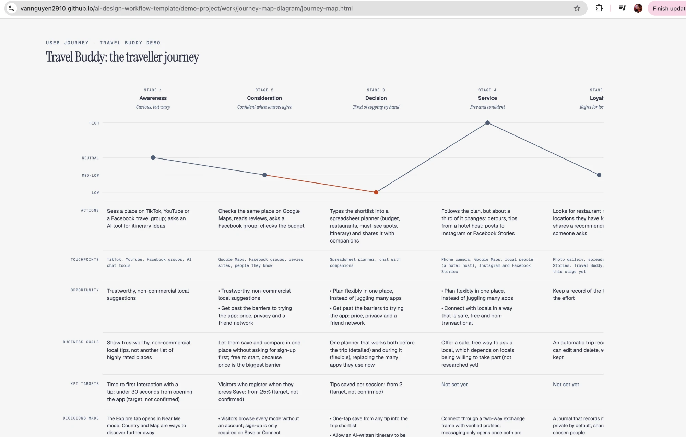

Sau Lesson 2, bạn có source notes có ID, cắt từ transcript đã ẩn danh của các buổi phỏng vấn, và mọi quote đã qua phép kiểm tra bằng chương trình. Buổi này đi từ source notes đến insight đã kiểm tra (synthesis), rồi dựng persona, customer journey map và opportunity mà mỗi dòng truy được về insight ID. Bộ principles vừa là ràng buộc trong prompt, vừa là phép kiểm tra của bạn. Cuối cùng bạn đưa insight đã kiểm tra vào insight hub.

> **AI soạn nháp. Bạn kiểm tra. Bạn quyết định.** Một insight hay một persona đọc thuyết phục chưa chắc có dữ liệu đứng sau. Dòng nào không truy được về insight ID thì xoá hoặc ghi unknown.

## Nội dung buổi học

1. Synthesis: từ source notes đến một insight đã kiểm tra
2. Persona
3. Journey map
4. Opportunity
5. Insight hub
6. Bốn câu hỏi về giới hạn của AI trong research
7. Ví dụ xuyên suốt với Delivery App

Phụ lục, ngoài 90 phút: persona, journey map và opportunity với AI, và package quy trình thành agent.

## Sau buổi học, bạn có thể

1. Chạy blind synthesis trên source notes của bạn (đã cắt ở Lesson 2), rồi chạy ba bước Decision, Insight, Challenge
2. Kiểm tra từng insight AI trả lại bằng hai lớp (source ID có thật, ngữ cảnh còn nguyên), và giữ ý kiến trái chiều cùng trang với insight
3. Dựng persona, journey map hoặc opportunity từ insight đã kiểm tra, mỗi dòng dẫn về insight ID, và đánh dấu ô chưa có insight làm căn cứ là assumption
4. Phân biệt persona dựng từ insight với persona AI tự sinh, và chỉ ra dòng không có insight nào làm căn cứ
5. Viết opportunity như một user need, qua test ba giải pháp, rồi chấm và chọn
6. Đóng góp một insight đã kiểm tra vào insight hub, và tìm trong hub trước khi hỏi lại
7. Quyết định khi nào dùng và khi nào bỏ AI cho một bộ dữ liệu
8. Chạy sáu AI move (soát nguồn persona, gom nhóm blind và primed, dựng map không persona rồi so, soát đường cảm xúc, bắt câu dạng giải pháp, thử ba giải pháp), nêu phần bạn kiểm tra ở mỗi move, và nói được move nào có nguyên lý đỡ, move nào mới là cách làm của khoá

---

## 1. Synthesis: from source notes to an insight you can trust

Bạn đang cầm source notes của các buổi phỏng vấn ở Lesson 2. Synthesis biến chúng thành một insight mà mỗi dòng dẫn về source ID và nói rõ nguồn là phỏng vấn, scope hay assumption. Persona, journey map và opportunity đều dựng từ insight, nên nếu insight chưa qua Challenge thì mọi thứ phía sau chưa được kiểm tra.

| Bạn mang từ Lesson 2 | Nội dung |
|---|---|
| Source notes | Cắt từ transcript đã ẩn danh: mỗi note một ý, một ID, dạng `ID | text`; mọi quote AI trích đã qua phép kiểm tra bằng chương trình (Lesson 2, mục 5) |
| Transcript | Đã ẩn danh trên máy bằng participant code; dữ liệu gốc nằm ngoài vùng AI đọc |
| Bốn câu hỏi về dữ liệu | Participant đã đồng ý gì, công cụ có học từ dữ liệu không, đã ẩn danh trên máy chưa, bản gốc nằm ngoài vùng AI đọc chưa (Lesson 2, mục 4.3) |
| Bộ principles, scope, assumption map, research question | Làm ràng buộc trong prompt và làm phép kiểm tra của bạn |
| Còn thiếu | Insight đã kiểm tra: hôm nay đi từ source notes đến đó bằng ba bước |

### 1.1 From source notes to blind synthesis

Việc cắt transcript thành source notes đã làm ở Lesson 2, mục 5. Bước đầu tiên hôm nay, trước khi nhờ AI rút insight, là rà lại bộ source notes của bạn:

- Mỗi ghi chú **một ý và một ID**. Ví dụ `I01-01` là ghi chú đầu của phỏng vấn số 1. Thiếu ghi chú nào thì cắt thêm từ transcript đã ẩn danh theo cùng dạng `ID | text`, đặt ID mới và không dùng lại ID cũ.
- Ghi chú ghi điều người đó nói và làm, không thêm diễn giải của bạn. Người số 1 đặt vào Chủ nhật và chạm vào khung giờ đầu tiên hiện ra thì ghi đúng hành động đó, chưa kết luận "khách vội". Kết luận là việc của các bước sau.
- Ghi chú giữ đủ ngữ cảnh để đọc lại sau này vẫn hiểu.

Rồi chạy **blind synthesis** trên chính các note này (bạn làm ở practice, Step 1), như đã xem ở Lesson 2, mục 6: một lần chỉ có câu hỏi, một lần thêm hypothesis hàng đầu của team, rồi so chủ đề nào đứng đầu và note ID nào được trích. Ở Lesson 2 bạn thấy hypothesis đổi thứ AI nói trước; ở đây bạn xem điều đó có xảy ra với dữ liệu của bạn không.

Mọi insight ở các bước sau phải dẫn về một ID như vậy. Ghi chú không có ID thì không có chỗ đứng.

### 1.2 Rules with the data

1. **Ẩn danh trên máy trước khi đưa cho AI**, bằng find and replace, thay tên bằng participant code (P1, P2). Bạn đã làm việc này ở Lesson 2; dữ liệu gốc chưa ẩn danh vẫn nằm ngoài vùng AI đọc. Công cụ tự động tìm thông tin định danh giúp tìm ra số điện thoại, email và các mã có định dạng cố định để bạn bỏ đi, nhưng không đảm bảo bắt hết, và thường mạnh nhất với tiếng Anh. Tên người, nơi làm và chi tiết gián tiếp trong tiếng Việt vẫn cần bạn đọc lại.
2. **Mỗi source notes có source ID** theo nguồn: R01 cho review, F01 cho bài đăng forum, I01-03 cho ghi chú thứ 3 của phỏng vấn 01 (P1). Mỗi insight có insight ID (IN-01), nêu nguồn là interview, scope hay assumption, và dẫn source ID, để mọi dòng về sau dẫn được về đúng chỗ.
3. **AI được phép nói unknown.** Khi không được phép, AI lấp chỗ trống bằng nội dung nghe hợp lý. Quy tắc đi kèm: chỉ dùng source notes được đưa, và mọi insight kèm source ID có thật.

### 1.3 The three steps

Cả ba bước bắt đầu từ cùng một bộ source notes đã ẩn danh và có source ID (xem [three-steps-with-ai.html](../assets/three-steps-with-ai.html)). Ở bước Insight, ngoài insight, bạn nhờ AI liệt kê điều người tham gia nói mà chưa được đưa vào, vì đọc danh sách chỉ bắt được điều viết sai, không bắt được điều thiếu. Insight mới được gộp vào ghi chú có sẵn theo cách "đề xuất trước": AI nêu ý nào vào đâu, bạn duyệt rồi mới ghi, chỉ thêm vào cuối và giữ một bản sao trước.

| Bước | Việc | Ai làm |
|---|---|---|
| 1. Decision | Gọi tên các lựa chọn mà nghiên cứu này phục vụ, trước khi ai tóm tắt | Bạn |
| 2. Insight | AI nhóm source notes thành tối đa 3 insight theo mẫu "[Ai] làm hoặc cần [gì] khi [bối cảnh], và điều này quan trọng với quyết định [nào]". Mỗi insight kèm source ID, nguồn (interview, scope hay assumption), số người nói và một dòng "nguồn này không cho biết điều gì". Bạn mở từng source ID kiểm tra (1.4), chọn một insight và viết lại bằng lời riêng | AI đề xuất, bạn kiểm tra, chọn và viết |
| 3. Challenge | Tấn công insight: chỗ nói quá, source ID sai, cách giải thích khác, điều bị bỏ. Ghi điều gì làm đổi ý. Giữ ý kiến trái chiều | Bạn, AI đóng vai người phản biện |

**Phát hiện.** AI soạn nháp được pattern; độ tin cậy nằm ở scope nguồn dẫn và ý kiến trái chiều được giữ lại. Bước Decision bạn tự viết vì chỉ bạn biết quyết định nào đang chờ.

### 1.4 Checking an insight

Mỗi insight AI trả lại được kiểm tra hai lớp (xem [source-check.html](../assets/source-check.html)):

1. **Tìm đúng source ID trong source notes**, vì ID không có trong bộ source notes là nguồn bịa. Lớp này chạy được bằng chương trình kiểm quote của Lesson 2: đưa file insight dạng `insight | note IDs | quote` cho script, dòng nào ID không tồn tại hoặc quote không có trong note sẽ báo không đạt.
2. **Đọc ngữ cảnh quanh ghi chú**, vì ghi chú có thật nhưng bị cắt hoặc ghép làm đổi nghĩa vẫn là lỗi.

Một nghiên cứu về mô hình ngôn ngữ trên phỏng vấn ở Kenya thấy việc chọn nội dung dẫn từ phỏng vấn "thấp và không đều", và lỗi bịa kéo dài từ đổi một từ, cắt cụt, đến ghép các đoạn làm đổi nghĩa. Tìm đúng source ID bắt được nguồn bịa nhưng không bắt được ý bị diễn đạt lại bằng lời khác. Lớp bảo vệ cho trường hợp này là dòng "nguồn này không cho biết điều gì" ở bước Insight (1.3).

### 1.5 Do you still read the research?

Có. Nghiên cứu so hai công cụ AI chat với người phân tích theme trên 40 tin nhắn SMS cho thấy AI nhanh hơn rất nhiều nhưng độ đồng thuận khi gắn code chỉ 36 đến 47%, và người nhận ra theme tinh tế, mang tính diễn giải tốt hơn. Output của AI trơn tru khiến lỗi khó thấy hơn (suy luận, chưa có số đo riêng cho research UX).

**Cách làm đề xuất** (chưa đo): đọc trực tiếp một vài transcript trước khi hỏi AI, và đọc ngữ cảnh gốc của mọi source notes dùng cho insight.

### 1.6 Is the insight still yours?

Tính "của chính bạn" xác định bằng ba việc, trùng với ba bước: tự viết Decision, tự viết lại Insight, tự phản biện ở Challenge. Phép thử: đóng AI lại, giải thích insight và chỉ ra source ID nào đỡ nó. Chưa làm được thì chưa phải của bạn. Người tin AI nhiều hơn tự báo cáo ít tư duy phản biện hơn (dữ liệu tự báo cáo).

### 1.7 Five things that make an insight sound stronger than it is

Năm điều cần soi ở bước Challenge (cách hiểu của chương trình):

1. **Scope:** insight nói rộng hơn số người và bối cảnh trong mẫu.
2. **Sự đồng thuận:** "ai cũng nói vậy" trong khi chỉ vài người nói.
3. **Sample mix:** ai nằm trong mẫu và ai vắng mặt.
4. **Giải pháp:** nhảy sang tính năng thay vì user need.
5. **Cảm xúc:** ghi chú nhiều cảm xúc che việc nó hiếm.

### 1.8 Challenge: keeping the dissent

Bước Challenge là chỗ bạn làm chủ kết luận. Năm câu phản biện cho một insight:

1. Chỗ nào insight nói rộng hơn dữ liệu (bao nhiêu người nói, và ai)?
2. Source ID nào có thể bị dẫn sai hoặc hiểu sai?
3. Ba cách giải thích khác cho cùng dữ liệu là gì?
4. Dữ liệu nào mâu thuẫn hoặc bị bỏ ra ngoài?
5. Dữ liệu mới nào sẽ làm insight này sai?

**Phát hiện về việc làm phẳng.** Nghiên cứu mô phỏng ý kiến bằng LLM trên khảo sát chính trị Mỹ báo cáo hai lỗi ở mức dân số: độ chính xác không giữ khi đổi mức gộp nhóm, và ý kiến thiểu số bị thu hẹp (homogenization). Nghiên cứu so người và LLM trên 31 phỏng vấn sinh viên khuyết tật thấy độ khớp theme thấp (AMI 0,231). LLM thay cách nói cá nhân bằng cách nói khái quát (ví dụ "ableism" thành "discrimination"), tác giả gọi là semantic sanitisation. Mẫu có một mô hình và một người mã hoá. Một poster 2026 nêu LLM bỏ sót quan điểm thiểu số, và sửa quá tay làm xấu các chỉ số khác.

**Cách làm.** Đặt ý kiến trái chiều cùng trang với insight, không ở phụ lục. Khi mẫu có nhóm khác biệt rõ, phân tích riêng từng nhóm trước khi gộp. Ghi sample mix.

---

## 2. Persona

Persona điền chỗ "ai", journey map điền chỗ "khi nào", opportunity điền chỗ "quyết định nào". Đây là cách nhìn của chương trình. Chuỗi nối chúng: synthesis (mục 1), persona, journey map, opportunity, insight hub. Mỗi bước dùng output của bước trước, và mọi dòng dẫn về insight ID. Xem sơ đồ [insight-chain.html](../assets/insight-chain.html).

Bộ principles từ Lesson 2 dùng hai lần ở cả ba output: đưa vào prompt làm ràng buộc, và dùng lại khi bạn kiểm tra bản AI soạn.

**Sáu AI move của buổi này.** Mỗi mục persona, journey map, opportunity có các AI move: việc AI làm tốt hơn người ở bước đó, kèm phần bạn kiểm tra. Method của ba mục (định nghĩa, cấu trúc, lỗi hay gặp) bạn đã biết, nên phần dưới giữ gọn và dồn chỗ cho các move. Prompt, dữ liệu mẫu và kết quả đã lưu của cả sáu move nằm ở `define-moves.md` trong course case. Mỗi move gắn một trong ba mức cơ sở:

- **Có nguyên lý đỡ:** có nghiên cứu hoặc nguồn practitioner đỡ nguyên lý phía sau. Move vẫn là cách làm của khoá, chưa được đo riêng.
- **Cách làm của khoá:** mình thiết kế và chỉ thử trên bộ mẫu, một mô hình, một lần chạy.
- **Chưa có cơ sở:** chưa tìm thấy nguồn nào; coi là ý tưởng để bạn tự thử.

Không move nào là best practice đã kiểm chứng. Các nguồn dưới đây mình mới đọc phần tóm tắt, nhiều nguồn là preprint hoặc bài của practitioner; hãy kiểm lại trước khi trích.

| | |
|---|---|
| **What** | Mô tả một nhóm người dùng có cùng hành vi, mục tiêu và kỳ vọng trong một tình huống, dựng từ dữ liệu research. Không phải một người điển hình, cũng không phải một nhóm nhân khẩu học |
| **Why** | Cả team nói về cùng một người thay vì mỗi người hình dung một kiểu, và tránh thiết kế theo sở thích của người thiết kế |
| **When** | Sau khi synthesis cho thấy các nhóm hành vi khác nhau, trước journey map. Không cần khi chỉ có một nhóm rõ ràng; khi dữ liệu mới có vài phỏng vấn, gọi nó là assumption |
| **How with AI** | AI gom insight đã kiểm tra thành tối đa 3 nhóm hành vi và soạn mô tả, theo bộ principles. Bạn đối chiếu từng dòng với insight ID; dòng không có insight thì xoá hoặc ghi unknown |
| **AI không làm** | Tự sinh persona từ kiến thức chung |

**Phát hiện.** Một nghiên cứu tại CHI 2024 phân tích 450 persona do LLM sinh (4 người đánh giá nội bộ, 5 chuyên gia): các persona thiên lệch về tuổi, nghề, pain point và nghiêng mạnh về persona ở Mỹ. Người đánh giá chấm các mô tả là thông tin, đáng tin và gần gũi; chuyên gia chấm hơi rập khuôn hơn. Mẫu người đánh giá nhỏ và không so với persona dựng từ dữ liệu thật.

Nielsen Norman Group chạy lại ba nghiên cứu cũ với người dùng AI: giá trị và user need nêu ra quá nông, mọi yếu tố được coi ngang nhau nên không giúp xếp ưu tiên, và người dùng AI lý tưởng hoá hành vi. NN/g chấp nhận proto persona được xem lại sau research thật. Hướng "persona có nguồn" (chỉ trả lời từ tài liệu thật, từ chối khi thiếu dữ liệu) có ở một preprint, chưa được đánh giá độc lập.

**Suy luận.** Vấn đề không phải AI viết persona được hay không (viết được và đọc thuyết phục) mà là người đọc không phân biệt được persona có dữ liệu với persona nghe hợp lý.

**Quy trình làm việc với persona.** Ba bước: gom theme thành nhóm hành vi (AI đề xuất, bạn kiểm tra và chọn; nhóm theo hành vi, không theo tuổi hay nghề), soạn từng dòng (goals, frustration, expectation, motivation), rồi xoá hoặc ghi unknown ở dòng không có insight, giữ ý kiến trái chiều cùng nhóm. Tối đa ba nhóm hành vi cho buổi này. AI soạn nháp từ insight, bạn chỉnh sửa, rồi AI đối chiếu từng ô với evidence (insight ID, rồi source ID) và bạn mở source ID để xác nhận. Khi bản nháp đã chỉnh xong, lưu thành file markdown và đặt vào `hub/artifacts/` (`type: persona`); định dạng phức tạp thì dùng HTML trong một folder có `index.md`.

**Persona từ insight, persona từ AI tự sinh.** Persona từ insight có nguồn là insight đã kiểm tra, truy được từng dòng về nguồn, có căn cứ và có dòng ghi unknown, và có quan sát trực tiếp. Persona AI tự sinh dựa trên dữ liệu internet nghiêng về Mỹ, không kiểm tra được từng dòng, nghe đáng tin chưa chắc đúng, và thiếu ngữ cảnh. Cách dùng đúng: coi persona AI là bản nháp giả định, rồi kiểm chứng bằng insight, phỏng vấn, support, sales và analytics. Rủi ro là team bỏ research thật vì "đủ tốt rồi".

**Cách kiểm tra persona.** Đánh dấu từng dòng: có insight ID hay không. Mở source ID của insight và đối chiếu từng chữ. Dòng không có insight thì xoá hoặc ghi unknown; dòng insight nói ngược thì sửa theo insight. Mỗi lỗi phải kèm insight ID, hoặc ghi rõ không có insight. Nếu làm theo cặp, mỗi cặp chia sẻ dòng bắt được hay nhất.

Ví dụ: người phỏng vấn số 1 đặt vào Chủ nhật và chạm vào khung giờ đầu tiên (I01-01); người số 2 nghĩ có thể đổi khung giờ sau như các app khác (I02-01). Hai người khác nhau nhưng hành vi giống nhau: khách mới ở đơn đầu tiên, chọn khung giờ nhanh và tưởng đổi được sau.

### 2.1 AI move 1: Soát nguồn từng dòng

Đưa AI persona nháp (mỗi dòng một ID) và các insight đã kiểm tra, nhờ nó trả mỗi dòng persona một dòng `line ID | insight IDs | nhận định`, nhận định là ủng hộ, đi ngược hoặc assumption. Trên bộ mẫu, AI bắt được dòng bịa ("28 đến 35 tuổi, nhà trong thành phố": không insight nào nói) và dòng đi ngược dữ liệu ("rời đi vì phí giao đắt": IN-04 nói giá không phải lý do chính), và làm mềm dòng "hào hứng thử món mới" vì IN-05 chỉ nói khách đánh giá cao sự đa dạng. Bạn xoá hoặc sửa các dòng đó. Phần chạy được bằng chương trình (ID có thật không) làm ở practice; ID có thật chưa chứng minh insight đỡ đúng dòng, nên bạn vẫn mở insight để đọc.

**Mức cơ sở: có nguyên lý đỡ.** Persona do AI sinh có thiên lệch về tuổi, nghề và pain point ([Salminen và cộng sự, 2024](https://elmi.hbku.edu.qa/en/publications/deus-ex-machina-and-personas-from-large-language-models-investiga/)), và có preprint cảnh báo về tính hợp lệ ([arXiv 2503.16527](https://arxiv.org/pdf/2503.16527)). Việc soát từng dòng với insight ID là cách làm của khoá.

### 2.2 AI move 2: Gom nhóm hành vi, blind rồi primed

Chạy hai lần trên cùng các insight, một lần chỉ có yêu cầu gom nhóm, một lần thêm câu "team tin khách mới nhạy cảm về giá", rồi so. Trên bộ mẫu, cả hai lần ra ba nhóm giống nhau, nhưng lần thứ hai mở đầu bằng giá. Giống blind synthesis ở Lesson 2: hypothesis đổi thứ AI nói trước, chưa đổi nhóm. Bạn xem nhóm nào xuất hiện ở cả hai lần (đáng tin hơn) và nhóm nào chỉ có ở một lần (cần kiểm tra thêm), và ghi rõ nhóm nào chỉ có một insight đỡ.

**Mức cơ sở: có nguyên lý đỡ.** Nghiên cứu của AISI thấy mô hình càng nghiêng theo ý người dùng khi người đó nói chắc chắn ([Ask, don't tell](https://arxiv.org/abs/2602.23971), preprint, chỉ thử prompt một lượt). Cách so blind và primed là cách làm của khoá.

---

## 3. Customer journey map

| | |
|---|---|
| **What** | Bản đồ các bước một persona đi qua để đạt một mục tiêu, với hành động, suy nghĩ, cảm xúc và chỗ đau ở từng bước |
| **Why** | Cho thấy chỗ đau xảy ra ở bước nào và sau điều gì, thay vì một danh sách pain point rời rạc |
| **When** | Sau persona, khi vấn đề trải dài qua nhiều bước, kênh hoặc thời gian. Không cần khi vấn đề nằm trong một màn hình |
| **How with AI** | Ba bước. Bạn chuẩn bị: chốt journey nào, actor nào, map phục vụ quyết định nào, đưa dữ liệu đã có (AI gom thành source notes có ID) và liệt kê các giai đoạn. AI soạn nháp: đề xuất bước còn thiếu và điền ô từ insight, mỗi ô kèm insight ID. Bạn kiểm tra: ô nào không có insight thì ghi assumption, đếm tỷ lệ ô assumption, team review để chọn chỗ cần research thêm rồi mới vẽ thành hình |
| **AI không làm** | Vẽ trọn một bản đồ từ kiến thức chung |

**Phát hiện.** Không tìm thấy nghiên cứu đo độ chính xác của journey map do AI soạn. Nghiên cứu gần nhất là mind map do LLM tạo so với bản của designer: LLM nắm khái niệm trung tâm nhưng yếu ở phân cấp và bám ngữ cảnh. Hướng dẫn thực hành: pain point trên persona phải xuất hiện lại ở đúng bước gây ra nó, và chỗ suy đoán phải được đánh dấu.

**Quy trình khi đã có insight** (gom từ các nguồn practitioner như NN/g và Smaply; mình chỉ đọc phần tóm tắt, chưa có nghiên cứu đo journey map do AI dựng): chốt phạm vi, gom dữ liệu đã có, dựng bản nháp giả thuyết, điền từng giai đoạn, tìm ô trống, team review. Bản nháp giống một proto-journey: ghi lại giả định, cần kiểm lại với người dùng thật. Định dạng bản nháp là file md hoặc bảng, miễn mỗi ô có insight ID hoặc ghi assumption; khoá dùng md vì script kiểm ID đọc được.

**Suy luận.** Bản đồ trông đầy đủ ngay cả khi các bước là bịa, nên bài dạy bằng quy trình kiểm tra, không hứa độ chính xác. Assumption không phải lỗi; giấu assumption mới là lỗi.

**Quy trình làm việc với journey map.** AI soạn nháp từ insight, bạn chỉnh sửa, rồi AI đối chiếu từng ô với evidence và bạn mở source ID để xác nhận. Bản đồ dựng bằng một skill tải từ internet (hoặc skill `customer-journey-map` của toolkit) với ghi chú phỏng vấn đã ẩn danh làm input, hoặc tự làm bằng một bảng markdown thuần. Skill tải từ internet là code của người khác: đọc `SKILL.md` trước khi dùng, chỉ dùng từ nguồn tin cậy, và không đưa dữ liệu chưa ẩn danh. Khi bản nháp đã chỉnh xong, lưu thành file markdown và đặt vào `hub/artifacts/` (`type: journey-map`).

**Cấu trúc.** Một journey map có năm hàng: stage (bạn liệt kê trước), actions (người dùng làm gì), cảm xúc (đường nối các giai đoạn, điểm thấp nhất là chỗ đau chính), pain (đặt đúng ở bước gây ra nó) và insight ID (hàng chương trình thêm vào).

**Nguyên tắc: chưa có insight thì là assumption.** Thông tin chưa có insight làm căn cứ chưa phải điều ta biết về người dùng. Journey map do AI soạn trông đầy đủ ngay cả khi các bước là bịa. Ghi rõ ô assumption thì biết chỗ nào cần thêm research; giấu đi thì cả team tưởng đó là sự thật. Đếm tỷ lệ assumption: tỷ lệ cao thì quay lại phỏng vấn thay vì điền cho đẹp. Một ô assumption không làm journey xấu đi; giấu nó mới làm nó xấu.

**Bốn lỗi khi AI vẽ journey map.** (1) Điền ô cho đẹp: ô nào không có insight thì ghi assumption. (2) User group chung chung: đưa persona và insight của bạn vào, rồi đọc lại xem chi tiết nào kéo về Mỹ (suy luận từ nghiên cứu persona, chưa có số đo riêng). (3) Đường cảm xúc trơn: hỏi insight nào nằm ở điểm thấp nhất. (4) Pain không có insight ID: mỗi pain một ID, không có thì xoá hoặc ghi assumption.

**Từ map đến opportunity.** Journey map chưa phải opportunity; nó là chỗ opportunity được tìm ra. Tìm điểm thấp nhất và các pain quanh nó, viết lại pain thành user need (không phải tính năng), rồi đặt user need dưới root outcome trong cây opportunity, giữ insight ID đi cùng. Pain là triệu chứng; user need mới là opportunity. Ở Delivery App: bước huỷ đơn có hạn chót huỷ không hiện trên màn hình (IN-02); user need viết lại là khách cần biết còn huỷ được đến khi nào.

### 3.1 AI move 3: Dựng map không cần persona, rồi so

Nhờ AI dựng journey map hai lần: một lần chỉ từ insight, một lần từ insight cộng persona nháp. Ô nào không có insight thì ghi đúng chữ `assumption`. Trên bộ mẫu, bản không persona để trống nhiều ô; bản có persona điền thêm giai đoạn "chọn món" ("Duyệt menu, thử món mới", cảm xúc "Tốt") và gắn IN-05, nhưng IN-05 chỉ nói khách đánh giá cao sự đa dạng, chưa nói họ duyệt menu hay thấy vui ở bước đó. Khi so, tìm ô nào chỉ có ở bản có persona: persona có thể đang kéo AI điền quá tay, và insight ID gắn vào vẫn trông hợp lý.

**Mức cơ sở: chưa có cơ sở.** Không tìm thấy nghiên cứu đo journey map do AI dựng; chỉ có bài của practitioner nói map do AI sinh là giả thuyết, không phải kết quả ([Renascence](https://www.renascence.io/journal/ai-journey-map-generators-what-they-fix-and-what-they-dont)). Đây là cách làm của khoá, chưa được đo.

### 3.2 Tìm ô thiếu insight (bước thêm, không phải AI move trên lớp)

Bước này làm ở nhà (practice), không có slide riêng trên lớp; nó chính là bước "tìm ô trống" của quy trình trên.

Đưa AI journey map nháp và các insight, nhờ nó (1) liệt kê ô không có insight hoặc có ID nhưng insight không nói điều ô ghi, (2) đếm tỷ lệ, (3) đề xuất câu hỏi phỏng vấn mở về hành vi quá khứ cho từng ô thiếu. Trên bộ mẫu, AI tìm ra hai ô lệch căn cứ và năm ô trống (cả cột "Thanh toán"), kèm câu hỏi như "Hãy kể về lần gần nhất bạn thanh toán một đơn...". Hai cách đếm cho hai con số (2/10 hoặc 7/15), nên chọn một cách và dùng nhất quán. Mức "căn cứ không khớp" ở các ô sát ranh giới là đánh giá của AI, bạn có thể đọc chặt hơn.

**Mức cơ sở: chưa có cơ sở.** Không tìm thấy nguồn trực tiếp. Tư duy "đánh dấu chỗ suy đoán" đã có ở nguyên tắc assumption của mục này; dùng nó để sinh câu hỏi phỏng vấn là cách làm của khoá.

### 3.3 AI move 4: Soát đường cảm xúc

Với mỗi ô cảm xúc có nội dung, nhờ AI tìm một đến hai ghi chú gốc cho thấy cảm xúc đó (và ghi chú đi ngược nếu có), trả quote nguyên văn. Chạy chương trình kiểm quote của Lesson 2 trên kết quả. Trên bộ mẫu, cả tám quote đạt, nhưng AI xếp F07 (than đắt) vào "đi ngược" cảm xúc "Tốt" ở bước chọn món, trong khi F07 nói về giá, không nói về cảm xúc lúc chọn món. Chương trình chỉ chứng minh quote có thật; nhãn đúng hay sai là việc bạn đọc.

**Mức cơ sở: có nguyên lý đỡ, ở phần cảnh báo.** Một nghiên cứu về gắn sentiment trên dữ liệu y tế thấy AI và người chỉ khớp ở mức vừa (khoảng 0,5) và AI hay gắn theo chữ chứ không theo ý nghĩa diễn giải ([JMIR 2026](https://www.jmir.org/2026/1/e98374/PDF)). Điều này ủng hộ việc kiểm lại, không ủng hộ riêng move này.

---

## 4. Opportunity

| | |
|---|---|
| **What** | Danh sách các user need và khó khăn của người dùng đáng giải, viết như vấn đề của khách hàng chứ không phải tính năng, mỗi cái có evidence và được xếp thứ tự |
| **Why** | Tách vấn đề khỏi giải pháp trước khi nghĩ ý tưởng, và nối research với quyết định |
| **When** | Sau journey map (từ các pain point), trước hypothesis và ý tưởng ở Lesson 4. Không dùng làm danh sách việc cần làm |
| **How with AI** | AI viết opportunity theo mẫu "[Người dùng] gặp khó khi [tình huống] vì [lý do]", cấm nhắc tính năng. Bạn kiểm tra: user need hay giải pháp, có insight ID chưa, xếp theo severity, context và reach |
| **AI không làm** | Quyết định opportunity nào đáng giải |

**Phát hiện.** Trong opportunity solution tree, opportunity là tầng khách hàng (user need, pain point, mong muốn) nằm giữa outcome và solution; một opportunity sai khung kéo lệch mọi tầng phía trên. Không tìm thấy nghiên cứu độc lập đo chất lượng opportunity do AI đề xuất.

**Suy luận.** AI nghiêng về viết tính năng, nên kiểm tra quan trọng nhất là "user need hay giải pháp?".

**Xếp opportunity.** Một opportunity chỉ một người gặp nhưng khiến họ bỏ dở task vẫn quan trọng hơn một khó chịu nhỏ nhiều người nhắc. Opportunity được xếp theo severity (hậu quả), context (hoàn cảnh xảy ra) và reach (bao nhiêu người, thuộc nhóm nào), không theo số lần nhắc, và đi kèm một câu nêu mẫu không cho biết điều gì.

**Quy trình làm việc với opportunity.** AI soạn nháp từ insight, bạn chỉnh sửa, rồi AI đối chiếu từng ô với evidence và bạn mở source ID để xác nhận. Khi bản nháp đã chỉnh xong, lưu thành file markdown và đặt vào `hub/artifacts/` (`type: opportunity`).

**Bốn bước dựng opportunity.**

1. **Root outcome là một hành vi.** Root outcome là đỉnh của cây opportunity, lấy từ job statement và viết lại thành một hành vi do team cùng cam kết, không lấy từ business đang đuổi một con số. Không làm root outcome được: một metric (không có hành vi bên dưới), một output (giải pháp khoác áo mục tiêu), hay một câu không kiểm chứng được. Kiểm tra: nếu root outcome xảy ra, con số kinh doanh có nhích không? Câu trả lời "không" thì ghi vào map, đừng làm mượt.
2. **Sticky có thật, nhưng thường là giải pháp.** Chạy test ba giải pháp: kể được ba cách khác nhau để thoả sticky thì nó là user need; chỉ có một cách thì nó là giải pháp. Nhiều sticky sẽ không qua test, đó là phản xạ thường gặp, không phải lỗi; nâng từng sticky lên một mức chính là việc cần làm. Mẹo: có động từ làm ra thứ gì (thêm, xây) thì nó đã là giải pháp. Ví dụ: "thêm popup nhắc khung giờ giao" là giải pháp; "khách cần biết khung giờ giao là cuối cùng trước khi cam kết" là user need.
3. **Reframing tạo ra lựa chọn.** Ba thao tác: question the objective (mục tiêu này của ai, và nếu sai thì sao), positive exceptions (ai đã thành công và khác ở điểm nào), what's missing (khung này bỏ ngoài điều gì). Reframing không tìm ra vấn đề thật, nó cho xem có vấn đề tốt hơn hay không. Chỉ reframe nhánh mạnh nhất, và ghi số insight bên cạnh: một nguồn đủ để sinh reframe, chưa đủ để đặt cược.
4. **Chấm rồi chọn.** Bốn yếu tố: sizing (quy mô), importance (quan trọng thế nào với mục tiêu kinh doanh), company fit, market position. Chưa có cột effort, vì effort vào ở tầng giải pháp. Khi làm riêng chấm bằng bốn yếu tố; khi trình bày dùng impact và effort. Thứ tự vẫn theo severity, context và reach. Ghi opportunity bị loại kèm lý do: có lý do thì xem lại được khi evidence đổi.

### 4.1 AI move 5: Bắt câu dạng giải pháp

Đưa AI danh sách opportunity nháp của team và các insight. Nhờ nó gắn nhãn từng dòng là `need` hoặc `giải pháp`, viết lại dòng giải pháp thành user need theo mẫu "[Người dùng] gặp khó khi [tình huống] vì [lý do]" (không nhắc giải pháp), và nêu insight ID hoặc `assumption`. Trên bộ mẫu, AI gắn nhãn đúng cả năm dòng ("thêm nút hủy nổi bật", "gửi thông báo đẩy khi trễ" và "làm lại màn hình chọn giờ" là giải pháp), ghi `assumption` cho dòng thông báo trễ vì không insight nào nói khách thiếu thông báo, và tự nhận ra một bản viết lại trùng với một need đã có. Bạn kiểm tra bản viết lại có đổi nghĩa không.

**Mức cơ sở: có nguyên lý đỡ (practitioner).** Opportunity solution tree của Teresa Torres tách opportunity (user need) khỏi solution ([Product Talk](https://www.producttalk.org/glossary-discovery-opportunity-solution-tree/)). Mình chỉ đọc nguồn thứ cấp, chưa đọc sách gốc. Việc nhờ AI bắt câu dạng giải pháp là cách làm của khoá.

### 4.2 AI move 6: Thử ba giải pháp

Với một user need, nhờ AI đề xuất ba giải pháp khác nhau về bản chất, nêu assumption mới mà mỗi giải pháp thêm vào, rồi trả lời: need còn đúng nếu bỏ cả ba không? Trên bộ mẫu, AI đưa ba giải pháp thật sự khác nhau (nhãn "khung giờ cuối" lúc chọn, cho đổi giờ sau khi đặt, nhắc và theo dõi sát giờ giao), mỗi giải pháp kèm hai ba assumption mới, và kết luận need vẫn đúng. Nó còn nói cách diễn đạt need hiện tại đã ngầm gợi giải pháp 1. Đây là phép thử need có đứng độc lập không, không phải bước chọn giải pháp: ba giải pháp suy ra từ một insight, chưa có dữ liệu để xếp hạng. Nhờ thêm "các hướng khác nhau về bản chất" vì AI có xu hướng đưa ý giống nhau.

**Mức cơ sở: có nguyên lý đỡ, ở phần cảnh báo.** Một nghiên cứu 36 người thấy ý tưởng do AI gợi ý giống nhau hơn giữa các người dùng ([Anderson và cộng sự, 2024](https://arxiv.org/html/2402.01536v2)). Phép thử "bỏ giải pháp thì need còn đúng không" là cách làm của khoá, dựa trên test ba giải pháp có sẵn ở mục này.

---

## 5. Insight hub

Insight hub là một phần của Knowledge Hub của project (thư mục `insights/`), không phải một công cụ repository riêng.

| | |
|---|---|
| **What** | Nơi lưu các insight đã kiểm tra, mỗi insight có ID, evidence, ngày và tag |
| **Why** | Tránh làm lại research cho cùng một câu hỏi, giữ insight khi người thay đổi, và nối insight với các quyết định về sau |
| **When** | Đóng góp sau khi insight đã qua kiểm tra; tìm trong hub trước khi lên kế hoạch research mới |
| **How with AI** | AI giúp tìm entry liên quan và gợi ý tag. Chỉ được trích entry có ID, và bạn duyệt trước khi thêm |
| **AI không làm** | Tự thêm insight vào hub |

**Ví dụ hub thật.** Hai ảnh trên lớp lấy từ hub của project demo Travel Buddy (không phải Delivery App): trang Insights liệt kê card theo loại (opportunity, hypothesis, metric, decision, evidence, finding) với ô tìm theo ID và ba chế độ xem Cards, Tree, Matrix; và trang một finding với các đường từ opportunity qua hypothesis và evidence tới finding, cùng bảng khu vực, mức nghiêm trọng và trạng thái.

**Phát hiện.** Atomic research được đề xuất năm 2018 sau khi một team lặp lại nghiên cứu vì không tìm lại được câu trả lời cũ: finding chia thành đơn vị nhỏ có evidence và tag, và thói quen "kiểm tra repository trước" ngăn việc làm lại. Tag có kiểm soát giữ repository tìm được. NN/g ghi nhận chỉ một tỷ lệ nhỏ tổ chức có vai trò riêng để quản lý repository. Nguồn về atomic research chủ yếu là blog của agency và vendor.

**Thói quen** (xem [insight-hub-loop.html](../assets/insight-hub-loop.html)):

- Đóng góp mỗi insight đã kiểm tra thành một entry gồm insight ID, source ID dẫn về, ngày, độ mạnh evidence, tag và người phụ trách.
- Tìm trước khi hỏi.
- Cập nhật khi có evidence mới thay vì thêm bản trùng.
- Có người chăm sóc hub (với người làm một mình, chính là bạn).

**Từ ghi chú đến card trên hub.** Page Insights của hub không do AI gõ cả trang; nó được build từ các card, mỗi file một card có ID trong thư mục `insights/`. AI làm card, script dựng page. Decision, Insight, Challenge và Opportunity đều là card: decision là decision card, insight là evidence hoặc finding card, challenge là ghi chú mâu thuẫn trên card insight (không gộp, không xoá), opportunity là opportunity card; quan hệ giữa chúng là các ID. Ba bước, theo workflow `add-insights` của workspace:

1. AI đề xuất vào một file md (một bảng), chưa tạo card. Mỗi dòng có nguồn, loại card, quan hệ tới card đã có, và đánh dấu củng cố, mâu thuẫn hay mới.
2. Bạn duyệt: giữ, sửa hoặc cắt từng dòng. Decision và thứ hạng do bạn quyết, AI không tự đặt decision thành accepted.
3. AI tạo card bằng lệnh, rồi chạy kiểm tra để bắt card thiếu liên kết hoặc ID không tồn tại.

Mỗi người có workflow riêng (Notion, Obsidian, Figma, thư mục md). Ba điều giữ nguyên bất kể công cụ: mỗi mục một card có ID, AI đề xuất rồi bạn duyệt, có bước kiểm cuối. Đây là cách làm của khoá; chưa có nguồn ngoài so sánh với cách khác.

**AI chạy xuyên cả bốn bước.** Insight là input đã kiểm tra, có ID; từ đây mỗi output của AI là một file markdown, mỗi dòng mang insight ID. Persona: AI gom theme và soạn dòng, bạn đối chiếu từng dòng với insight ID. Journey map: AI đề xuất bước còn thiếu và điền ô từ insight, bạn ghi assumption ở ô không có insight. Opportunity: AI viết lại sticky thành user need, bạn chạy test ba giải pháp rồi chọn. Tag trong hub lấy từ một danh sách cố định, nếu không tag chồng chéo làm hỏng bộ lọc.

---

## 6. Four questions about AI in research

Bốn câu hỏi còn lại nảy ra khi dùng AI cho research. Năm câu đầu của danh sách chín câu (được đưa dữ liệu vào AI không, làm sao biết không bịa nguồn, còn phải đọc research không, insight còn của người làm không, AI có làm phẳng khách hàng không) đã được trả lời ở Lesson 2.

| # | Câu hỏi | Trả lời ngắn |
|---|---|---|
| 1 | Đưa gì cho lead? | Một trang: quyết định, insight, evidence (bao nhiêu người, bao nhiêu source ID), điều dữ liệu không nói, ý kiến trái chiều giữ lại, việc đã kiểm tra |
| 2 | Tiết kiệm bao nhiêu thời gian? | Bước phân tích theme giảm rất mạnh trong một nghiên cứu (khoảng 20 phút so với 567 phút) nhưng trên 40 tin nhắn SMS, mô hình đời 2024; cả quy trình gồm kiểm tra chưa ai đo |
| 3 | Khi nào bỏ AI? | Dữ liệu chưa được phép đưa vào; mẫu nhỏ đọc hết được; nhóm dễ tổn thương; theme trừu tượng; quyết định lớn chỉ có bản AI chưa kiểm tra |
| 4 | Dùng công cụ nào? | Không có so sánh độc lập về độ chính xác; chọn theo tiêu chí: dữ liệu, truy được nguồn, nói được unknown, công ty cho phép, xuất được dữ liệu |

### 6.1 What goes in front of the lead

Một trang gồm:

1. Quyết định mà insight phục vụ.
2. Insight, do bạn viết.
3. Evidence: bao nhiêu người, bao nhiêu source notes, các insight ID và source ID.
4. Điều dữ liệu không cho biết.
5. Ý kiến trái chiều đã giữ lại.
6. AI đã làm gì, bạn đã kiểm tra gì, và số lỗi đã đếm.
7. Việc tiếp theo đề xuất.

Hướng dẫn thực hành khuyên nêu method và cỡ mẫu từ đầu, tập trung 3 đến 5 insight, dùng lời trích nguyên văn khi cần và không ngụ ý chắc chắn thống kê. Mục này là đề xuất của chương trình, chưa có nguồn cho thấy lead muốn đọc nó.

### 6.2 How much time does it save

Một nghiên cứu năm 2024 trên tạp chí JMIR AI so hai công cụ AI chat với người trên 40 tin nhắn SMS: khoảng 20 phút so với khoảng 567 phút cho phân tích theme. Theme của AI khớp 71% (5 trên 7) theme của người ở cách quy nạp và 50 đến 58% ở cách diễn dịch, còn độ đồng thuận khi gắn code chỉ 36 đến 47%. Dữ liệu là tin nhắn ngắn, hai công cụ đời 2024, nên không suy trực tiếp sang bộ phỏng vấn dài hay mô hình hiện nay. Trong bảng task của chương trình, việc loại soạn nháp và kiểm tra tiết kiệm khoảng 25 đến 55% khi đã tính bước kiểm tra.

**Suy luận.** Con số lớn là của một bước (phân tích theme), không phải cả quy trình; chưa có nguồn đo cả quy trình gồm kiểm tra cho designer. Nên bạn tự đo: bấm giờ từng bước trên cùng bộ insight và ghi chênh lệch với cách tự làm.

### 6.3 When to leave AI out

Danh sách dưới đây là suy luận từ các nguồn, không có nguồn đo riêng.

| Không nên dùng khi | Vì sao |
|---|---|
| Chưa chắc được phép đưa dữ liệu vào | Quyền của participant đi trước lợi ích tốc độ |
| Mẫu nhỏ, tự đọc hết được trong cùng thời gian | Lợi ích thời gian nhỏ, rủi ro lệch vẫn còn |
| Nhóm dễ tổn thương hoặc chủ đề nhạy cảm | Bất đồng giữa người và AI rõ nhất ở trải nghiệm sống |
| Mục tiêu là hiểu cảm xúc, bối cảnh, theme trừu tượng | AI yếu ở theme diễn giải |
| Mới bắt đầu, chưa tự đọc dữ liệu | Mất cơ hội hình thành cảm nhận ban đầu |
| Quyết định lớn mà chỉ có bản AI chưa kiểm tra | Output trơn tru khiến lỗi khó thấy |
| Cần kết luận về tỷ lệ hoặc mức độ phổ biến | Mẫu định tính không cho phép, AI không sửa được |

### 6.4 Which tool

Không tìm thấy đánh giá độc lập về độ chính xác so sánh các công cụ phân tích định tính; kết quả tìm được là so sánh tính năng hoặc bài của vendor. Vì vậy chương trình dùng nhãn "AI chat tool đã được công ty cho phép" và dạy chọn theo năm tiêu chí:

1. **Dữ liệu:** có huấn luyện trên dữ liệu không, tắt được không; lưu bao lâu; xoá có tới bản sao lưu; có hợp đồng xử lý dữ liệu; có chế độ chạy trên máy.
2. **Truy được nguồn:** mỗi output trỏ về insight ID, source ID hoặc mốc thời gian, để kiểm tra từng dòng.
3. **Nói được unknown:** từ chối khi dữ liệu thiếu.
4. **Được công ty cho phép** và có người chịu trách nhiệm.
5. **Xuất được dữ liệu**, để insight không bị khoá trong công cụ và nối được với insight hub.

---

## 7. Worked example: Delivery App

### 7.1 The data

Project mẫu hư cấu: Delivery App, nhiều khách mới không đặt lại sau đơn đầu tiên, team tin giá là lý do chính, chưa có research nào (cùng project với Lesson 2). Bộ `insight-set.md` có chín insight (IN-01 đến IN-09): sáu từ phỏng vấn, review và forum, một từ scope, hai là assumption. Mỗi insight kèm nguồn, source ID dẫn về `source-notes.md` (24 ghi chú) và mức độ chắc chắn. Insight bằng tiếng Anh; persona, journey map và opportunity có thể viết bằng tiếng Việt, nhưng mọi insight ID dẫn vào phải có thật.

Bộ này là ví dụ xuyên suốt: persona khách mới ở đơn đầu tiên (mục 2), journey từ chọn khung giờ giao đến huỷ đơn (mục 3) và opportunity về khung giờ giao (mục 4). Có thêm một persona mẫu do AI sinh cho cùng project (`persona-ai-draft.md`), với sáu dòng: một số có insight làm căn cứ, một số không. Bạn thử tự phát hiện dòng nào không có căn cứ.

### 7.2 Bộ source notes cho synthesis

Bộ `source-notes.md` có 24 ghi chú: 10 review (R01 đến R10), 8 bài đăng forum (F01 đến F08) và hai phỏng vấn ngắn (I01-01 đến I02-03). Ghi chú bằng tiếng Anh; insight có thể viết bằng tiếng Việt, nhưng mọi source ID dẫn vào phải có thật và khớp với ghi chú gốc.

Bộ này có sẵn các điểm để bạn tự phát hiện:

- Một chủ đề ít ghi chú và còn một ghi chú tích cực (giá).
- Một ghi chú nhiễu.
- Một ghi chú về nhà hàng chứ không về sản phẩm.
- Ghi chú từ nguồn nghiêng về cảm xúc mạnh (review, forum), trong khi hai người phỏng vấn lịch sự hơn.

Ví dụ ghi chú I01-03 bị cắt (1.4) và assumption về giá so với 24 ghi chú (1.7) đều lấy từ bộ này.

---

## Appendix. Package into agents

Ngoài 90 phút của buổi học. Dùng khi một quy trình đã chạy ổn.

Khi bạn hài lòng với một quy trình (ví dụ ba bước synthesis đã chạy ổn trên hai bộ source notes), bước cuối là package nó:

1. Viết quy trình thành skill: ai làm (bạn hay AI), input, output, check nào phải qua.
2. Biến skill thành một agent: một bộ instruction dùng lại được, gắn với bộ principles làm chuẩn.
3. Đóng góp agent và file output vào Knowledge Hub của project, cùng insight đã kiểm tra, để buổi sau dùng lại.

Điều kiện để package: quy trình đã chạy ít nhất hai lần trên hai input khác nhau và phần bạn kiểm tra đã được ghi rõ. Package sớm quá sẽ package cả lỗi. Agent không thay bước Challenge và bước kiểm tra insight: những bước đó vẫn do bạn làm.

---

## Giới hạn của bài học

- Evidence về AI gắn code và tổng hợp đến từ nghiên cứu nhỏ ở các lĩnh vực khác (tin nhắn SMS, sức khoẻ, sinh viên khuyết tật, review sản phẩm). Áp vào phỏng vấn UX bằng tiếng Việt là suy luận, và chưa có số đo cho tiếng Việt (giọng vùng miền, từ tiếng Anh chen vào).
- Không có nghiên cứu đo độ chính xác của journey map và opportunity do AI soạn; phần này dựa trên suy luận và quy trình. Con số tiết kiệm thời gian nổi bật nhất đến từ một nghiên cứu trên 40 tin nhắn SMS với mô hình đời 2024.
- Cách coi ba khái niệm là ba output từ insight, ba bước synthesis và năm điều cần soi do chương trình tự thiết kế, chưa thử với lớp thật.
- Bộ insight, bộ source notes và persona mẫu của Delivery App là dữ liệu hư cấu do chương trình soạn, không đại diện cho dữ liệu thật hay phỏng vấn bằng tiếng Việt.
- Một số nguồn mới được đọc qua kết quả tìm kiếm, chưa mở bản gốc.
