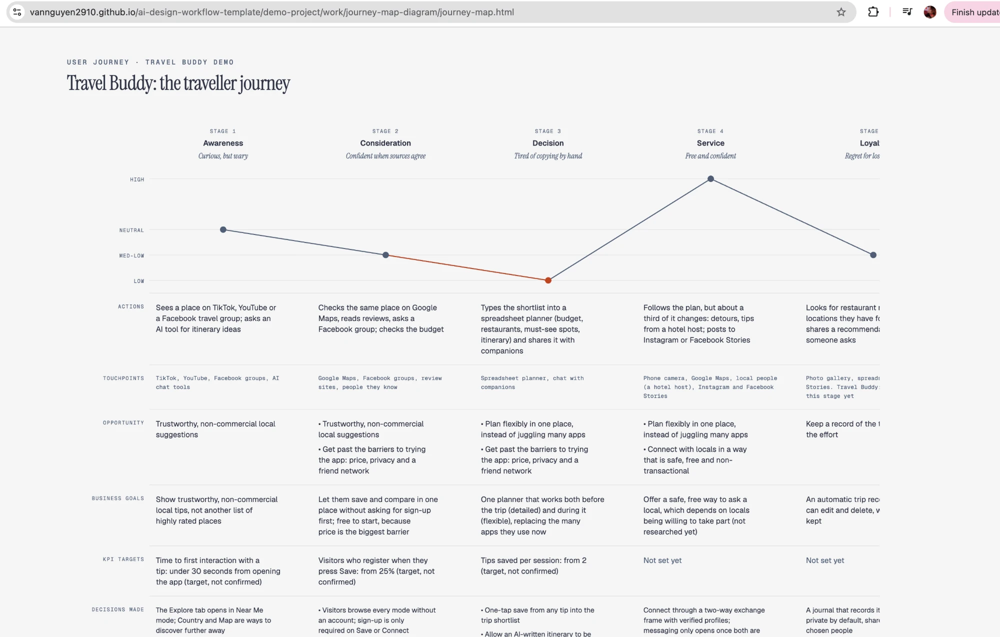

Sau Lesson 2, bạn đã có bộ nguyên tắc và các insight từ nghiên cứu, mỗi insight có insight ID và source ID. Buổi này biến chúng thành persona, customer journey map và opportunity mà mỗi dòng truy được về insight ID. Bộ nguyên tắc vừa là ràng buộc trong prompt, vừa là phép kiểm tra của bạn. Sau đó bạn đưa insight đã kiểm tra vào insight hub và đóng gói quy trình thành agent.

> **AI soạn nháp. Bạn kiểm tra. Bạn quyết định.** Một persona đọc thuyết phục chưa chắc có dữ liệu đứng sau. Dòng nào không truy được về insight ID thì xoá hoặc ghi unknown.

## Nội dung buổi học

1. Ôn: nguyên tắc và insight
2. Ba đầu ra từ insight: persona, journey map, opportunity
3. Insight hub
4. Package thành agent
5. Bốn câu hỏi về giới hạn của AI trong research
6. Ví dụ xuyên suốt với Delivery App

## Sau buổi học, bạn có thể

1. Nối insight đã kiểm tra từ Lesson 2 với persona, journey map hoặc opportunity, mỗi dòng dẫn về insight ID
2. Viết persona, journey map hoặc opportunity như một insight "ai, khi nào, quyết định nào", dùng bộ nguyên tắc làm ràng buộc cho AI và phép kiểm tra, và đánh dấu ô chưa có insight làm căn cứ là assumption
3. Phân biệt persona dựng từ insight với persona AI tự sinh, và chỉ ra dòng không có insight nào làm căn cứ
4. Đóng góp một insight đã kiểm tra vào insight hub, và tìm trong hub trước khi hỏi lại
5. Nêu khi nào một quy trình đã sẵn sàng để package thành agent
6. Quyết định khi nào dùng và khi nào bỏ AI cho một bộ dữ liệu

---

## 1. Recap: principles and insights

Phần này nhắc lại những gì bạn đã học ở Lesson 2, đủ để nối sang ba đầu ra.

| Điều đã học | Nhắc lại |
|---|---|
| Bộ nguyên tắc | UX principle và business principle: đặt trước khi AI chạy, dùng làm ràng buộc trong prompt và làm phép kiểm tra của bạn |
| Ba quy tắc với dữ liệu | Ẩn danh trên máy trước khi đưa cho AI; mỗi ghi chú nguồn có source ID, mỗi insight có insight ID; AI được phép nói unknown |
| Kiểm tra insight | Tìm đúng source ID trong bộ ghi chú, rồi đọc ngữ cảnh quanh ghi chú; tìm đúng source ID chỉ bắt được nguồn bịa |
| Ba bước | Decision (bạn viết), Insight (AI đề xuất kèm source ID, bạn kiểm tra, chọn và viết lại), Challenge (bạn phản biện, giữ ý kiến trái chiều) |
| Năm điều cần soi | Phạm vi, sự đồng thuận, sample mix, giải pháp, cảm xúc |

Persona, journey map và opportunity dùng insight đã qua ba bước làm nguyên liệu. Một persona dựng từ insight chưa kiểm tra vẫn là persona chưa kiểm tra.

---

## 2. Three outputs from insights

Persona điền chỗ "ai", journey map điền chỗ "khi nào", opportunity điền chỗ "quyết định nào". Đây là cách nhìn của chương trình. Chuỗi nối chúng: synthesis (đã làm ở Lesson 2), persona, journey map, opportunity, insight hub. Mỗi bước dùng đầu ra của bước trước, và mọi dòng dẫn về insight ID. Xem sơ đồ [insight-chain.html](../assets/insight-chain.html).

Bộ nguyên tắc từ Lesson 2 dùng hai lần ở cả ba đầu ra: đưa vào prompt làm ràng buộc, và dùng lại khi bạn kiểm tra bản AI soạn.

### 2.1 Persona

| | |
|---|---|
| **What** | Mô tả một nhóm người dùng có cùng hành vi, mục tiêu và kỳ vọng trong một tình huống, dựng từ dữ liệu research. Không phải một người điển hình, cũng không phải một nhóm nhân khẩu học |
| **Why** | Cả team nói về cùng một người thay vì mỗi người hình dung một kiểu, và tránh thiết kế theo sở thích của người thiết kế |
| **When** | Sau khi synthesis cho thấy các nhóm hành vi khác nhau, trước journey map. Không cần khi chỉ có một nhóm rõ ràng; khi dữ liệu mới có vài phỏng vấn, gọi nó là giả định |
| **How with AI** | AI gom insight đã kiểm tra thành tối đa 3 nhóm hành vi và soạn mô tả, theo bộ nguyên tắc. Bạn đối chiếu từng dòng với insight ID; dòng không có insight thì xoá hoặc ghi unknown |
| **AI không làm** | Tự sinh persona từ kiến thức chung |

**Phát hiện.** Một nghiên cứu tại CHI 2024 phân tích 450 persona do LLM sinh (4 người đánh giá nội bộ, 5 chuyên gia): các persona thiên lệch về tuổi, nghề, pain point và nghiêng mạnh về persona ở Mỹ. Người đánh giá chấm các mô tả là thông tin, đáng tin và gần gũi; chuyên gia chấm hơi rập khuôn hơn. Mẫu người đánh giá nhỏ và không so với persona dựng từ dữ liệu thật.

Nielsen Norman Group chạy lại ba nghiên cứu cũ với người dùng AI: giá trị và nhu cầu nêu ra quá nông, mọi yếu tố được coi ngang nhau nên không giúp xếp ưu tiên, và người dùng AI lý tưởng hoá hành vi. NN/g chấp nhận proto persona được xem lại sau research thật. Hướng "persona có nguồn" (chỉ trả lời từ tài liệu thật, từ chối khi thiếu dữ liệu) có ở một preprint, chưa được đánh giá độc lập.

**Suy luận.** Vấn đề không phải AI viết persona được hay không (viết được và đọc thuyết phục) mà là người đọc không phân biệt được persona có dữ liệu với persona nghe hợp lý.

**Quy trình làm việc với persona.** AI soạn nháp từ insight, bạn chỉnh sửa, rồi AI đối chiếu từng ô với evidence (insight ID, rồi source ID) và bạn mở source ID để xác nhận. Khi bản nháp đã chỉnh xong, lưu thành file markdown và đặt vào `hub/artifacts/` (`type: persona`); định dạng phức tạp thì dùng HTML trong một folder có `index.md`.

### 2.2 Customer journey map

| | |
|---|---|
| **What** | Bản đồ các bước một persona đi qua để đạt một mục tiêu, với hành động, suy nghĩ, cảm xúc và chỗ đau ở từng bước |
| **Why** | Cho thấy chỗ đau xảy ra ở bước nào và sau điều gì, thay vì một danh sách pain point rời rạc |
| **When** | Sau persona, khi vấn đề trải dài qua nhiều bước, kênh hoặc thời gian. Không cần khi vấn đề nằm trong một màn hình |
| **How with AI** | Bạn liệt kê các giai đoạn trước; AI đề xuất bước còn thiếu và điền ô từ insight. Ô nào không có insight được đánh dấu assumption, và bạn đếm tỷ lệ ô assumption |
| **AI không làm** | Vẽ trọn một bản đồ từ kiến thức chung |

**Phát hiện.** Không tìm thấy nghiên cứu đo độ chính xác của journey map do AI soạn. Nghiên cứu gần nhất là mind map do LLM tạo so với bản của designer: LLM nắm khái niệm trung tâm nhưng yếu ở phân cấp và bám ngữ cảnh. Hướng dẫn thực hành: pain point trên persona phải xuất hiện lại ở đúng bước gây ra nó, và chỗ suy đoán phải được đánh dấu.

**Suy luận.** Bản đồ trông đầy đủ ngay cả khi các bước là bịa, nên bài dạy bằng quy trình kiểm tra, không hứa độ chính xác. Assumption không phải lỗi; giấu assumption mới là lỗi.

**Quy trình làm việc với journey map.** AI soạn nháp từ insight, bạn chỉnh sửa, rồi AI đối chiếu từng ô với evidence và bạn mở source ID để xác nhận. Bản đồ dựng bằng một skill tải từ internet (hoặc skill `customer-journey-map` của toolkit) với ghi chú phỏng vấn đã ẩn danh làm đầu vào, hoặc tự làm bằng một bảng markdown thuần. Skill tải từ internet là code của người khác: đọc `SKILL.md` trước khi dùng, chỉ dùng từ nguồn tin cậy, và không đưa dữ liệu chưa ẩn danh. Khi bản nháp đã chỉnh xong, lưu thành file markdown và đặt vào `hub/artifacts/` (`type: journey-map`).

### 2.3 Opportunity

| | |
|---|---|
| **What** | Danh sách các nhu cầu và khó khăn của người dùng đáng giải, viết như vấn đề của khách hàng chứ không phải tính năng, mỗi cái có evidence và được xếp thứ tự |
| **Why** | Tách vấn đề khỏi giải pháp trước khi nghĩ ý tưởng, và nối research với quyết định |
| **When** | Sau journey map (từ các pain point), trước hypothesis và ý tưởng ở Lesson 4. Không dùng làm danh sách việc cần làm |
| **How with AI** | AI viết opportunity theo mẫu "[Người dùng] gặp khó khi [tình huống] vì [lý do]", cấm nhắc tính năng. Bạn kiểm tra: nhu cầu hay giải pháp, có insight ID chưa, xếp theo severity, context và reach |
| **AI không làm** | Quyết định opportunity nào đáng giải |

**Phát hiện.** Trong opportunity solution tree, opportunity là tầng khách hàng (nhu cầu, pain point, mong muốn) nằm giữa outcome và solution; một opportunity sai khung kéo lệch mọi tầng phía trên. Không tìm thấy nghiên cứu độc lập đo chất lượng opportunity do AI đề xuất.

**Suy luận.** AI nghiêng về viết tính năng, nên kiểm tra quan trọng nhất là "nhu cầu hay giải pháp?".

**Xếp opportunity.** Một opportunity chỉ một người gặp nhưng khiến họ bỏ dở task vẫn quan trọng hơn một khó chịu nhỏ nhiều người nhắc. Opportunity được xếp theo severity (hậu quả), context (hoàn cảnh xảy ra) và reach (bao nhiêu người, thuộc nhóm nào), không theo số lần nhắc, và đi kèm một câu nêu mẫu không cho biết điều gì.

**Quy trình làm việc với opportunity.** AI soạn nháp từ insight, bạn chỉnh sửa, rồi AI đối chiếu từng ô với evidence và bạn mở source ID để xác nhận. Khi bản nháp đã chỉnh xong, lưu thành file markdown và đặt vào `hub/artifacts/` (`type: opportunity`).

---

## 3. Insight hub

Insight hub là một phần của Knowledge Hub của project (thư mục `insights/`), không phải một công cụ repository riêng.

| | |
|---|---|
| **What** | Nơi lưu các insight đã kiểm tra, mỗi insight có ID, evidence, ngày và tag |
| **Why** | Tránh làm lại research cho cùng một câu hỏi, giữ insight khi người thay đổi, và nối insight với các quyết định về sau |
| **When** | Đóng góp sau khi insight đã qua kiểm tra; tìm trong hub trước khi lên kế hoạch research mới |
| **How with AI** | AI giúp tìm entry liên quan và gợi ý tag. Chỉ được trích entry có ID, và bạn duyệt trước khi thêm |
| **AI không làm** | Tự thêm insight vào hub |

**Phát hiện.** Atomic research được đề xuất năm 2018 sau khi một team lặp lại nghiên cứu vì không tìm lại được câu trả lời cũ: finding chia thành đơn vị nhỏ có evidence và tag, và thói quen "kiểm tra repository trước" ngăn việc làm lại. Tag có kiểm soát giữ repository tìm được. NN/g ghi nhận chỉ một tỷ lệ nhỏ tổ chức có vai trò riêng để quản lý repository. Nguồn về atomic research chủ yếu là blog của agency và vendor.

**Thói quen** (xem [insight-hub-loop.html](../assets/insight-hub-loop.html)):

- Đóng góp mỗi insight đã kiểm tra thành một entry gồm insight ID, source ID dẫn về, ngày, độ mạnh evidence, tag và người phụ trách.
- Tìm trước khi hỏi.
- Cập nhật khi có evidence mới thay vì thêm bản trùng.
- Có người chăm sóc hub (với người làm một mình, chính là bạn).

---

## 4. Package into agents

Khi bạn hài lòng với một quy trình (ví dụ ba bước synthesis đã chạy ổn trên hai bộ ghi chú nguồn), bước cuối là đóng gói nó:

1. Viết quy trình thành skill: ai làm (bạn hay AI), đầu vào, đầu ra, check nào phải qua.
2. Biến skill thành một agent: một bộ instruction dùng lại được, gắn với bộ nguyên tắc làm chuẩn.
3. Đóng góp agent và file output vào Knowledge Hub của project, cùng insight đã kiểm tra, để buổi sau dùng lại.

Điều kiện để package: quy trình đã chạy ít nhất hai lần trên hai đầu vào khác nhau và phần bạn kiểm tra đã được ghi rõ. Đóng gói sớm quá sẽ đóng gói cả lỗi. Agent không thay bước Challenge và bước kiểm tra insight: những bước đó vẫn do bạn làm.

---

## 5. Four questions about AI in research

Bốn câu hỏi còn lại nảy ra khi dùng AI cho research. Năm câu đầu của danh sách chín câu (được đưa dữ liệu vào AI không, làm sao biết không bịa nguồn, còn phải đọc research không, insight còn của người làm không, AI có làm phẳng khách hàng không) đã được trả lời ở Lesson 2.

| # | Câu hỏi | Trả lời ngắn |
|---|---|---|
| 1 | Đưa gì cho lead? | Một trang: quyết định, insight, evidence (bao nhiêu người, bao nhiêu source ID), điều dữ liệu không nói, ý kiến trái chiều giữ lại, việc đã kiểm tra |
| 2 | Tiết kiệm bao nhiêu thời gian? | Bước phân tích theme giảm rất mạnh trong một nghiên cứu (khoảng 20 phút so với 567 phút) nhưng trên 40 tin nhắn SMS, mô hình đời 2024; cả quy trình gồm kiểm tra chưa ai đo |
| 3 | Khi nào bỏ AI? | Dữ liệu chưa được phép đưa vào; mẫu nhỏ đọc hết được; nhóm dễ tổn thương; theme trừu tượng; quyết định lớn chỉ có bản AI chưa kiểm tra |
| 4 | Dùng công cụ nào? | Không có so sánh độc lập về độ chính xác; chọn theo tiêu chí: dữ liệu, truy được nguồn, nói được unknown, công ty cho phép, xuất được dữ liệu |

### 5.1 What goes in front of the lead

Một trang gồm:

1. Quyết định mà insight phục vụ.
2. Insight, do bạn viết.
3. Evidence: bao nhiêu người, bao nhiêu ghi chú nguồn, các insight ID và source ID.
4. Điều dữ liệu không cho biết.
5. Ý kiến trái chiều đã giữ lại.
6. AI đã làm gì, bạn đã kiểm tra gì, và số lỗi đã đếm.
7. Việc tiếp theo đề xuất.

Hướng dẫn thực hành khuyên nêu method và cỡ mẫu từ đầu, tập trung 3 đến 5 insight, dùng lời trích nguyên văn khi cần và không ngụ ý chắc chắn thống kê. Mục này là đề xuất của chương trình, chưa có nguồn cho thấy lead muốn đọc nó.

### 5.2 How much time does it save

Một nghiên cứu năm 2024 trên tạp chí JMIR AI so hai công cụ AI chat với người trên 40 tin nhắn SMS: khoảng 20 phút so với khoảng 567 phút cho phân tích theme. Theme của AI khớp 71% (5 trên 7) theme của người ở cách quy nạp và 50 đến 58% ở cách diễn dịch, còn độ đồng thuận khi gắn code chỉ 36 đến 47%. Dữ liệu là tin nhắn ngắn, hai công cụ đời 2024, nên không suy trực tiếp sang bộ phỏng vấn dài hay mô hình hiện nay. Trong bảng task của chương trình, việc loại soạn nháp và kiểm tra tiết kiệm khoảng 25 đến 55% khi đã tính bước kiểm tra.

**Suy luận.** Con số lớn là của một bước (phân tích theme), không phải cả quy trình; chưa có nguồn đo cả quy trình gồm kiểm tra cho designer. Nên bạn tự đo: bấm giờ từng bước trên cùng bộ insight và ghi chênh lệch với cách tự làm.

### 5.3 When to leave AI out

Danh sách dưới đây là suy luận từ các nguồn, không có nguồn đo riêng.

| Không nên dùng khi | Vì sao |
|---|---|
| Chưa chắc được phép đưa dữ liệu vào | Quyền của participant đi trước lợi ích tốc độ |
| Mẫu nhỏ, tự đọc hết được trong cùng thời gian | Lợi ích thời gian nhỏ, rủi ro lệch vẫn còn |
| Nhóm dễ tổn thương hoặc chủ đề nhạy cảm | Bất đồng giữa người và AI rõ nhất ở trải nghiệm sống |
| Mục tiêu là hiểu cảm xúc, bối cảnh, theme trừu tượng | AI yếu ở theme diễn giải |
| Mới bắt đầu, chưa tự đọc dữ liệu | Mất cơ hội hình thành cảm nhận ban đầu |
| Quyết định lớn mà chỉ có bản AI chưa kiểm tra | Đầu ra trơn tru khiến lỗi khó thấy |
| Cần kết luận về tỷ lệ hoặc mức độ phổ biến | Mẫu định tính không cho phép, AI không sửa được |

### 5.4 Which tool

Không tìm thấy đánh giá độc lập về độ chính xác so sánh các công cụ phân tích định tính; kết quả tìm được là so sánh tính năng hoặc bài của vendor. Vì vậy chương trình dùng nhãn "AI chat tool đã được công ty cho phép" và dạy chọn theo năm tiêu chí:

1. **Dữ liệu:** có huấn luyện trên dữ liệu không, tắt được không; lưu bao lâu; xoá có tới bản sao lưu; có hợp đồng xử lý dữ liệu; có chế độ chạy trên máy.
2. **Truy được nguồn:** mỗi output trỏ về insight ID, source ID hoặc mốc thời gian, để kiểm tra từng dòng.
3. **Nói được unknown:** từ chối khi dữ liệu thiếu.
4. **Được công ty cho phép** và có người chịu trách nhiệm.
5. **Xuất được dữ liệu**, để insight không bị khoá trong công cụ và nối được với insight hub.

---

## 6. Worked example: Delivery App

### 6.1 The data

Project mẫu hư cấu: Delivery App, nhiều khách mới không đặt lại sau đơn đầu tiên, team tin giá là lý do chính, chưa có research nào (cùng project với Lesson 2). Bộ `insight-set.md` có chín insight (IN-01 đến IN-09): sáu từ phỏng vấn, review và forum, một từ scope, hai là giả định. Mỗi insight kèm nguồn, source ID dẫn về `source-notes.md` (24 ghi chú) và mức độ chắc chắn. Insight bằng tiếng Anh; persona, journey map và opportunity có thể viết bằng tiếng Việt, nhưng mọi insight ID dẫn vào phải có thật.

Bộ này là ví dụ xuyên suốt: persona khách mới ở đơn đầu tiên (2.1), journey từ chọn khung giờ giao đến huỷ đơn (2.2) và opportunity về khung giờ giao (2.3). Có thêm một persona mẫu do AI sinh cho cùng project (`persona-ai-draft.md`), với sáu dòng: một số có insight làm căn cứ, một số không. Bạn thử tự phát hiện dòng nào không có căn cứ.

---

## Giới hạn của bài học

- Bằng chứng về AI gắn code và tổng hợp đến từ nghiên cứu nhỏ ở các lĩnh vực khác (tin nhắn SMS, sức khoẻ, sinh viên khuyết tật, review sản phẩm). Áp vào phỏng vấn UX bằng tiếng Việt là suy luận, và chưa có số đo cho tiếng Việt (giọng vùng miền, từ tiếng Anh chen vào).
- Không có nghiên cứu đo độ chính xác của journey map và opportunity do AI soạn; phần này dựa trên suy luận và quy trình. Con số tiết kiệm thời gian nổi bật nhất đến từ một nghiên cứu trên 40 tin nhắn SMS với mô hình đời 2024.
- Cách coi ba khái niệm là ba đầu ra từ insight do chương trình tự thiết kế, chưa thử với lớp thật.
- Bộ insight, bộ ghi chú nguồn và persona mẫu của Delivery App là dữ liệu hư cấu do chương trình soạn, không đại diện cho dữ liệu thật hay phỏng vấn bằng tiếng Việt.
- Một số nguồn mới được đọc qua kết quả tìm kiếm, chưa mở bản gốc.
