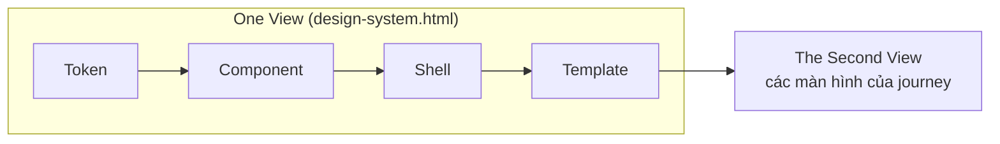
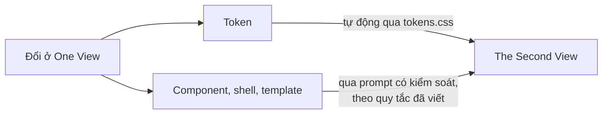
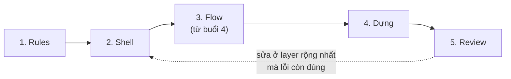

Chúng ta dựng prototype từ design system riêng bằng rules file, thay vì để AI tự vẽ lại từng màn hình. Bạn học bốn layer của Design Pattern (token, component, shell, template), phân biệt One View với The Second View, và viết rules file mà AI tool phải làm theo trước mỗi lần dựng.

> **AI soạn nháp. Bạn kiểm tra. Bạn quyết định.** Chất lượng prototype phụ thuộc vào bộ context đưa cho AI trước khi dựng, nhiều hơn là cách viết một prompt. Bạn giữ các quyết định; AI lắp ráp.

## Nội dung buổi học

1. The Aim: vì sao dựng từng màn hình thì lệch dần
2. One View: nền chuẩn và bốn layer
3. The Second View: prototype thật
4. Các lớp kiểm soát: Rules, Skill và Hook
5. Share prototype: đưa prototype đến tay team

## Sau buổi học, bạn có thể

1. Giải thích vì sao dựng từng màn hình từ đầu thì kết quả lệch dần, và vì sao Design Pattern đi trước màn hình
2. Phân biệt token, component, template và shell, gọi tên cả bộ là Design Pattern, và chỉ ra layer nào còn thiếu trong design system đang có
3. Phân biệt One View (nền chuẩn) với The Second View (prototype thật), và nêu vì sao thay đổi ở nguồn chỉ tự cập nhật sang ở layer token
4. Nêu vai trò của Rules, Skill và Hook, và hai nhóm quy tắc của một rules file (quy tắc hệ thống, quy tắc làm việc)
5. Nhận ra một màn hình do AI dựng vi phạm quy tắc bằng cách đối chiếu với rules file và component có sẵn, và nêu giới hạn của prototype: là bản tham chiếu và thứ để test
6. Chọn cách chia sẻ prototype (file HTML, live site hoặc hub) phù hợp với tình huống

---

## 1. The Aim

### 1.1 Dựng từng màn hình từ đầu thì lệch dần

Quy trình thường gặp: mở một màn hình, mô tả, để AI dựng, rồi sang màn kế. Màn đầu và màn hai thường ổn; từ màn ba, bốn vấn đề bắt đầu xuất hiện:

- **Component bị lệch.** Nút ở màn một hơi khác nút ở màn ba; mỗi màn có một kiểu điều hướng.
- **Không có trí nhớ giữa các prompt.** Mỗi yêu cầu bắt đầu lại từ đầu và không có gì cố định phía sau.
- **Trạng thái bị quên.** Trạng thái rỗng, đang tải, lỗi thường chỉ lộ ra khi developer hoặc người dùng gặp sau khi ra mắt.
- **Mỗi lần làm lại đều tốn token.** Prompt lại thì AI xử lý lại toàn bộ phần đi trước.

Khi thiết kế đổi, mọi màn đều phải sửa lại. Với Delivery App, ba màn "Giỏ hàng", "Chọn thời gian giao" và "Thanh toán" dựng ở ba lần prompt riêng dễ cho ra ba thanh điều hướng khác nhau, và màu nút chính cũng có thể lệch. Sửa từng màn không chặn được lỗi tiếp theo; phải đổi thứ AI được đưa vào trước khi dựng. Mô tả này đến từ thực hành của chương trình, chưa có số đo.

### 1.2 Pattern first

Design system là **đầu vào** của prototype, không phải đầu ra của việc thiết kế. Thay vì bắt đầu từ màn hình, bắt đầu từ thứ đã có: component (kể cả trạng thái) và cách các màn nối với nhau. Mỗi màn chỉ còn là một cách sắp xếp những thứ đã tồn tại. Trong chương trình, bộ nền này gọi là **Design Pattern**. Bốn vấn đề ở 1.1 có cùng một cách sửa:

| Vấn đề | Cách sửa |
|---|---|
| Mọi thứ lệch dần | Template cho mọi màn cùng một bố cục |
| AI quên hết | Một pattern viết sẵn, được đọc lại ở mỗi prompt |
| Trạng thái bị quên | Component inventory ghi mọi trạng thái ngay từ đầu |
| Làm lại tốn token | Ít phải suy lại thì ít phải thử lại |

Giống như trong lập trình: định nghĩa một mẫu một lần, dùng lại nhiều lần, và chỉ tuỳ chỉnh phần khác biệt. Mỗi màn do AI dựng là một bản sao của cùng một mẫu, không phải một thứ được phát minh lại.

### 1.3 Tư duy hệ thống: AI-assisted, không phải AI-generated

Tư duy hệ thống nghĩa là bạn giữ các quyết định: định nghĩa hệ thống, đặt ràng buộc, review từng màn. AI lắp ráp.

### 1.4 Các đội lớn đưa gì cho AI

Điểm chung ở các nguồn công khai: đội không để AI tự nghĩ ra giao diện, mà đưa design system vào dạng AI đọc được trước.

| Đội | Điều nguồn mô tả | Mức nguồn |
|---|---|---|
| Stripe | Công cụ nội bộ cho designer và PM: bộ rules file, khung điều hướng và design system mở qua MCP, nên đầu ra dùng component thật. Người xây công cụ nói nó "đến 80%" và designer vẫn lái hướng | Lời kể trong podcast qua tóm tắt thứ cấp, chưa có transcript |
| Atlassian | Bộ skill cài vào repo kèm một chỉ dẫn ngắn trong `AGENTS.md`; CLI và MCP server công khai; bố cục dựng từ một Root bọc các vùng cố định | Tài liệu chính thức; bộ skill chỉ dành cho nhân viên |
| Vercel | Registry đóng gói component và block để AI đọc, nối MCP để dùng ở nhiều tool | Blog của vendor, không có số liệu |
| Uber | Agent đọc design system và tạo spec accessibility ba nền tảng trong dưới 2 phút | Số liệu của chính Uber, không có số đo độ chính xác |

Thông điệp rút ra là suy luận của chương trình: chất lượng đầu ra phụ thuộc vào bộ context đưa vào trước khi dựng, hơn là vào cách viết một prompt.

**Giới hạn của bằng chứng.** Phần lớn nguồn là tài liệu của vendor hoặc lời kể của một người; chưa có nghiên cứu độc lập đo hiệu quả. Chưa nguồn nào đo thứ tự shell, template rồi màn hình; thứ tự này là phương pháp của chương trình cộng suy luận từ cấu trúc của các hệ thống thiết kế.

---

## 2. One View

### 2.1 One View là gì

**One View** là nền chuẩn mà mọi prototype xuất phát từ nó: cùng parent prototype, cấu trúc folder, component và content voice. Trong One View có bốn layer (2.2) và một journey chuẩn (2.4). Trong khoá AI Prototype Development, One View là trang `design-system.html`: một trang gom token, component inventory, template và shell, nơi bạn kiểm tra hệ thống trước khi dựng màn hình. The Second View là prototype dựng từ trang này.

**Content voice** là cách đặt nhãn, thông báo và thuật ngữ nhất quán giữa các màn hình. Ví dụ trong Delivery App: luôn gọi là "Đơn hàng", không lúc "Đơn" lúc "Order".

### 2.2 Bốn layer

| Layer | Là gì | Ví dụ trong Delivery App | Ai định nghĩa |
|---|---|---|---|
| **Token** | Màu, cỡ chữ, khoảng cách, bo góc | Màu chính, cỡ chữ tiêu đề | Design system |
| **Component** | Đơn vị nhỏ nhất | Nút, ô nhập, thẻ chọn | Design system |
| **Shell** (còn gọi shared layout) | Khung lặp ở mọi màn hình | Header và menu của app | Từng product |
| **Template** | Bố cục một loại trang | Trang danh sách, trang chi tiết | Từng product |

**Design Pattern** là tên chung cho cả bộ bốn layer này. **Experience pattern** là cụm component lặp ở nhiều màn (search, navigation, bộ lọc, trạng thái rỗng), ghép từ component có sẵn và khác với Design Pattern; dựng experience pattern ở bài tập về nhà là tuỳ chọn. Design system dùng làm chuẩn trong buổi này chỉ có token và component. Shell và template thuộc về từng product, nên bạn tự định nghĩa cho product đang làm.

### 2.3 Tên gọi khác nhau theo hệ thống

| Hệ thống | Cách gọi shell | Cách gọi template |
|---|---|---|
| IBM Carbon | UI shell: header, left panel, right panel | Không có layer riêng; template chỉ là nguyên liệu của pattern |
| Shopify Polaris | Khung admin do nền tảng cấp; app chỉ dựng nội dung trong khung | Template là mẫu trang đầy đủ (Homepage, Index, Details, Settings); composition là nhóm component nhỏ |
| Material Design 3 | Layout scaffold | Canonical layout: feed, list-detail, supporting pane |
| Atlassian | Layout: Root bọc Banner, Top nav, Side nav, Main, Panel | Không có layer template riêng trong các trang đã đọc |
| Atomic Design | Header là một organism | Template là bộ khung cấp trang, chưa có nội dung cuối; trang mới là nơi kiểm tra hệ thống |

Vì mỗi nơi gọi khác nhau, bộ từ của buổi này là bộ ở 2.2.

### 2.4 Một journey: một đường đi từ đầu đến thành công

Phạm vi của prototype ở buổi này là **một shell và một journey**: đường chính từ lúc người dùng bắt đầu đến lúc đạt mục tiêu, ví dụ từ mở app đến đặt xong một đơn. Đó là một mảnh của product, nên prototype là thứ để test đường chính, không phải bằng chứng cho toàn bộ trải nghiệm. Theo quan sát của chương trình, journey thứ hai tốn ít công hơn journey đầu vì hệ thống đã có; đây chưa có số đo.

### 2.5 Vì sao thứ tự này

- **Phát hiện:** Material khuyên khi tạo layout mới thì dùng scaffold, bắt đầu từ một canonical layout, và kiểm tra layout co giãn qua các breakpoint. Brad Frost mô tả template là bộ khung cấp trang, và nội dung thật ở trang là nơi kiểm tra hệ thống: nếu nội dung làm vỡ một pattern thì quay lại sửa layer dưới.
- **Suy luận:** layer càng thấp càng ít thay đổi và càng nhiều thứ phụ thuộc vào nó, nên cố định trước. Đổi shell là đổi mọi màn hình; đổi một màn hình thì không ảnh hưởng layer nào.
- **Phương pháp của chương trình:** cố định quy tắc, rồi shell, rồi đưa flow vào, rồi dựng. Chưa có nghiên cứu đo hiệu quả của thứ tự này.

### 2.6 Ví dụ: cùng một màn hình, hai prompt

Cùng màn hình "Chọn thời gian giao", hai kết quả dựng khác nhau. Bản một đến từ prompt mơ hồ: AI tự chọn màu, tự thêm thanh điều hướng và đặt tên nút theo ý nó. Bản hai đến từ prompt kèm rules file: màn dùng đúng token, đúng component trong inventory và nằm trong shell đã có. Hai bản được dựng sẵn trước buổi dạy, không chạy trực tiếp. Bạn thử chỉ ra bản nào dùng đúng design system trước khi mở file ra đối chiếu.

---

## 3. The Second View

### 3.1 The Second View là gì

**The Second View** là prototype thật: chạy được trong trình duyệt, dựng từ One View. Đây là thứ bạn sửa, test và đưa cho người khác. One View cho biết "đúng" trông như thế nào; The Second View là nơi áp dụng nó vào flow của bạn.

### 3.2 Sửa ở One View, rồi cập nhật The Second View theo quy tắc

Một thay đổi ở One View có thể cập nhật sang The Second View, nhưng **chỉ layer token tự động cập nhật**. Với component, shell và template, thay đổi được đưa sang qua một prompt có kiểm soát, theo quy tắc đã viết. Cả trang `design-system.html` và các màn hình đều dùng `tokens.css`, nên đổi token là cả hai đổi theo. Quy tắc của chương trình: sửa ở nguồn trước, dựng lại phần bị ảnh hưởng, rồi review. Các demo hay nói "tự động cập nhật" mà không nói rõ lớp nào; điều đáng giá hơn là hệ thống cập nhật đáng tin cậy qua một prompt có quy tắc.

### 3.3 Thứ tự dựng

Rules, shell, flow, dựng, review:

1. **Rules:** viết hoặc nhận rules file trước, vì nó quyết định mọi thứ được dựng.
2. **Shell:** dựng màn hình số 0 là shell trống (header, điều hướng, vùng nội dung trống), kiểm ở độ rộng điện thoại và máy tính.
3. **Flow:** đưa flow đã có từ buổi 4 vào, không để AI tự nghĩ ra flow.
4. **Dựng:** AI dựng cả journey trong shell, dùng template đã chọn.
5. **Review:** bạn mở các file đã đổi và mở trang ra dùng, đối chiếu với rules file.

Skill `prototype` của toolkit có thêm các điểm kiểm tra, từ Check A đến E (đối chiếu kế hoạch, bàn phím, hai độ rộng, giá trị thô) và được dùng ở bài tập về nhà.

### 3.4 Sửa ở đúng layer

Báo cáo của AI chỉ là bản tóm tắt. Bằng chứng là trang bạn mở ra và so với quy tắc. Một lượt dựng cả journey cho ra nhiều chỗ cần sửa, nên review là phần dài nhất của quá trình.

Quy tắc: sửa ở **layer rộng nhất mà lỗi còn đúng**. Câu hỏi kiểm tra: lỗi này có sai ở nhiều hơn một màn không? Có hai cách sai:

- **Fix too low:** sửa lại ở từng màn hình, và các bản lệch nhau thêm sau mỗi lần sửa.
- **Push too high:** hệ thống mang một thứ mà chỉ một màn hình cần.

**Layer ladder**, từ rộng đến hẹp:

| Layer | Áp dụng cho |
|---|---|
| Token | Mọi màn |
| Component | Mọi chỗ dùng |
| Shell | Mọi loại màn |
| Template | Mọi màn cùng loại |
| Màn hình | Chỉ màn đó |

Màn hình không dẫn đi đâu thì sửa ở flow.

### 3.5 Gắn requirement vào element (mẫu Link, tuỳ chọn)

Một cách một số designer dùng để kiểm prototype: mỗi requirement có một ID (R1, R2, R3), và mỗi element trong prototype mang ID của requirement mà nó thể hiện. Ví dụ màn thanh toán của Delivery App có ba requirement: R1 áp dụng mã giảm giá, R2 thanh toán một chạm, R3 hiển thị phí vận chuyển. AI dựng ô nhập mã mang R1 và nút Thanh toán mang R2, nhưng không element nào mang R3.

**Một requirement chưa có element nào gắn là chỗ hở:** màn hình trông đủ nhưng thiếu một thứ nó phải có. Ngược lại, một element không mang ID nào là chỗ để hỏi: nó thể hiện requirement nào? Bạn, không phải AI, quyết định chỗ hở được bổ sung hay requirement bị bỏ. Mục này là nội dung thêm, không bắt buộc.

Sơ đồ: mỗi requirement gắn vào một element. Mở [ai-pattern-link.html](../assets/ai-pattern-link.html) trong trình duyệt để xem.

### 3.6 Prototype là gì, và cái gì đi cùng nó

- **Là:** bản tham chiếu cho developer và thứ để test với người dùng.
- **Không là:** code production, hay bằng chứng rằng thiết kế đúng. Prototype chạy được chỉ cho thấy ý tưởng **có thể** hoạt động, chưa cho thấy nó **có** hoạt động; buổi test ở Lesson 6 mới cho thấy điều đó.

Khi chuyển cho người khác, ba thứ đi cùng prototype: link chạy được, rules file, và danh sách điều chưa làm (state chưa dựng, nội dung giả, màn hình thiếu).

---

## 4. Các lớp kiểm soát: Rules, Skill và Hook

### 4.1 Ba lớp kiểm soát

| Lớp | Là gì | Dùng để |
|---|---|---|
| **Rules** | Rules file: các quy tắc AI đọc trước mỗi lần dựng | Giữ AI trong One View |
| **Skill** | Các bước và prompt mà AI tool làm theo | Làm quy trình có thể dùng lại |
| **Hook** | Bước kiểm tra máy tự chạy mỗi khi AI làm xong một việc | Bắt lỗi có đúng sai rõ mà không cần ai nhớ |

Ba lớp nằm ở ba thời điểm: rules trước khi dựng, skill trong lúc dựng, hook sau mỗi việc. Rules và skill là thứ AI đọc và làm theo; hook là việc máy làm. Việc cần phán đoán, như màn này có dễ dùng không, vẫn là của bạn.

Atlassian cài bộ skill vào repo kèm một chỉ dẫn ngắn trong `AGENTS.md`; Uber dùng các skill riêng cho từng loại spec, ví dụ spec screen reader. Cả hai là cách giữ cho quy trình không nằm trong trí nhớ của một người.

### 4.2 Rules là gì

Rules file là file quy tắc mà AI đọc trước mỗi lần dựng; mỗi dòng là một quy tắc kiểm tra được. Không có nó thì AI quay về default của nó, và một token còn thiếu dễ biến thành một mã màu tự bịa mà trông vẫn ổn. Ví dụ ở delivery app, quy tắc 1: thiếu component trong inventory thì yêu cầu thêm trước, rồi mới dựng. Bộ mẫu gồm mười quy tắc, nói ở mục 4.3. Rules chỉ là lời nhắc; phần chạy tự động là hook (mục 4.8).

### 4.3 Mười quy tắc của rules file

Bộ mẫu của buổi này gồm mười quy tắc, chia hai nhóm: năm quy tắc về hệ thống (AI được phép dùng gì) và năm quy tắc về cách làm việc.

**Năm quy tắc hệ thống**

1. Chỉ dùng component trong inventory. Thiếu thì yêu cầu thêm vào inventory trước, rồi mới dựng.
2. Không dùng giá trị thô, không ngoại lệ: chỉ dùng token, và báo những gì chưa tồn tại.
3. Màn hình kế thừa template và nằm trong shell, không tách nhánh.
4. Mỗi lần dựng mang theo flow context.
5. Nội dung thật, đúng content voice đã chốt, không lorem ipsum.

**Năm quy tắc làm việc**

6. Mỗi lần sửa một layer, nêu tên layer trong prompt.
7. Chỉ đính kèm file mà bước đó cần.
8. Báo, không bịa: mỗi lần dựng kết thúc bằng những gì chưa làm được.
9. Lưu trước khi sửa cấu trúc.
10. WCAG 2.1 AA ở mọi màn hình: độ tương phản, focus nhìn thấy, kích thước vùng chạm.

> **Ghi chú:** quy tắc 1 đến 3 cần nhấn nhất; quy tắc 1 và 2 cùng trả lời câu "đừng dùng gì ngoài design system". Vế sau của quy tắc 2 ngăn một token còn thiếu biến thành một mã màu tự bịa mà trông vẫn ổn. Quy tắc 3 giúp việc cập nhật thay đổi xuống các màn hình khả thi về sau. Quy tắc 7 ngược trực giác: thêm context không giúp mà chỉ mở rộng phạm vi tool có thể sửa. Quy tắc 10: màn do AI dựng thường có focus không nhìn thấy và độ tương phản sát ngưỡng; áp quy tắc lúc dựng không tốn gì, kiểm tra sau thì tốn cả một buổi. Quy tắc 9: "lưu" là lưu một checkpoint (skill `prototype` dùng lệnh "Lưu lại").

### 4.4 Phải cập nhật cùng design system

Rules file và design system có thể lệch nhau khi một bên đổi mà bên kia không đổi. Một nguồn agency báo rủi ro này; đó là kinh nghiệm của một agency, chưa phải kết quả đo. Quy tắc của chương trình: khi thêm component hoặc đổi token, cập nhật `design-system-notes.md` và rules file trong cùng lượt.

### 4.5 Quy tắc nhận từ người khác chưa thuộc về bạn

Bộ quy tắc mẫu đến từ kinh nghiệm của người khác. Quy tắc chỉ thật sự thuộc về bạn sau khi bạn dựng một lần, thấy quy tắc nào AI vẫn vi phạm hoặc quy tắc nào thiếu, và tự viết lại bằng lời riêng. Quy tắc nào chưa có thì viết thêm bằng lời của bạn, đặt ở đầu danh sách. Một quy tắc không bắt được gì chưa chắc là sai: đánh dấu, đừng xoá, xem lại sau journey thứ hai.

### 4.6 Biến pattern thành định luật thiết kế

Nếu chỉ đưa AI một đoạn HTML mẫu của danh sách khung giờ, AI biết nó trông thế nào nhưng không biết khi nào dùng; khi không chắc, AI quay về default của nó. Viết thành một dòng bốn phần thì AI có lý do để chọn. Ví dụ ở màn Chọn thời gian giao của Delivery App:

| Phần | Ví dụ |
|---|---|
| Khi | Có hơn 5 khung giờ để chọn |
| Dùng | Danh sách cuộn (scrolling) |
| Vì | Chip bị chồng trên small screen |
| Không dùng cho | Chọn ngày giao |

Sau dòng đầu tiên còn hai việc đi kèm:

- **Ghi ra những thứ AI hay tự thêm**, như nền cream với serif và accent coral, font Inter, card grid kiểu icon, heading một câu kèm nhãn nhỏ phía trên, đánh số 01/02/03 không có thứ tự thật. Mỗi thứ hoặc được giải thích trong một câu hoặc bị thay, và không cần cấm.
- **Ghi lại mỗi lần bạn loại một kết quả của AI:** trường hợp, lý do, cách kiểm tra. Sau đó chuyển dần thành dòng trong rules file.

Nên giữ rules file là một file markdown của bạn và đưa vào mọi project, thay vì dựa vào việc import design system giữa các tool. Thấy AI lặp lại một lỗi thì ghi vào rules file ngay, đừng sửa lại mỗi ngày; ví dụ chữ trắng trên nền vàng khó đọc, hoặc khoảng cách không được nhỏ hơn 16px. Viết một lần thì AI tự kiểm tra ở mọi màn.

Mười quy tắc nói AI không được làm gì; dòng bốn phần nói khi nào chọn pattern nào. Không cần cấm mọi default của AI; chỉ không để default xuất hiện ngẫu nhiên. Nguồn: lời kể của người dùng trên Reddit, chưa phải nghiên cứu đo.

### 4.7 Skill là gì

Skill là các bước và prompt mà AI tool làm theo, gói lại thành một quy trình dùng lại được. Rules là quy tắc cố định; skill là các bước của một quy trình. Skill `prototype` của toolkit đi từ design system, shell, Screen plan và journey, đến review và Known gaps, và có một chỗ để bạn kiểm tra sau mỗi bước. Trong toolkit, các chỗ kiểm tra này được đặt tên Check A đến E (xem Practice 5).

### 4.8 Hook: bước kiểm tra tự chạy (nâng cao)

Rules file là lời nhắc, và AI có thể bỏ sót khi dựng nhiều màn liên tiếp. Hook là bước kiểm tra tự chạy mỗi khi AI làm xong một việc, không cần ai nhớ. Phần kiểm tra bằng mắt vẫn là của bạn; hook là phần kiểm tra mà máy làm thay. Ví dụ ở delivery app: AI vừa dựng xong màn Chọn thời gian giao, hook tự kiểm tra màn đó có đủ state loading, empty, error và không có mã màu viết tay ngoài token. Thiếu thì báo ngay, trước khi bạn mở màn ra xem.

Mỗi hook có hai phần: sự kiện kích hoạt (AI sửa xong một file, xong một lượt việc) và việc tự chạy theo (một lệnh kiểm tra, một thông báo). Thường developer hoặc người rành tool cài đặt; phần của designer là quyết định kiểm tra cái gì, tức các quy tắc bạn viết ở mục 4.3. Hook chỉ bắt được lỗi có đúng sai rõ, như thiếu state, token sai, nhãn lệch. Việc cần phán đoán, như màn này có dễ dùng không, vẫn cần designer và người dùng thật ở Lesson 6.

Hook phổ biến chia theo thời điểm chạy: trước khi AI làm (chặn, ví dụ chặn sửa file token), sau mỗi lần AI sửa (kiểm: tìm màu và cỡ chữ viết tay ngoài token, kiểm tra component nằm trong inventory, tương phản, vùng chạm 44 px, một h1), và khi AI xong lượt việc (báo: nhắc ghi điều chưa làm, gửi thông báo cho team). Đây là phần nâng cao: designer không cần cài hook, chỉ cần nói được mình muốn kiểm gì ở thời điểm nào. Tên gọi và cách cài hook khác nhau theo từng tool; buổi này chỉ dạy khái niệm. Mức cơ sở: một số AI tool dạng agent có tính năng hook; cách ghép với design system là đề xuất của khoá, chưa phải cách làm do khoá đo.

### 4.9 Package trong toolkit (tuỳ chọn)

Toolkit của khoá có sẵn hai lớp đầu trong thư mục `toolkit/skills/prototype/`: rules là `starter/project-rules.md` (mười quy tắc để copy vào project rồi viết lại) và skill là `SKILL.md` (các bước và prompt từ design system đến Known gaps). Các công ty lớn để rules trong repo, thường là file `AGENTS.md` mà nhiều tool tự đọc; bản khởi đầu `project-rules.md` được copy vào `AGENTS.md` (hoặc file rules mà tool của bạn đọc) rồi viết lại. Cách dùng: copy thư mục `starter` thành `work/prototype/`, đưa `project-rules.md` cho AI tool ở mỗi lần dựng, và chạy các bước của skill theo thứ tự. Không bắt buộc; bạn có thể tự viết rules của mình. Hook thì toolkit chưa có bản mẫu; Hook là phần nâng cao ở mục 4.8: khi cần, nhờ developer cài. Skill `prototype` đang ở trạng thái draft, chưa thử với lớp thật.

Bộ này là cách khoá xếp lại các thực hành có thật, không phải một package có sẵn của các công ty lớn. Các công ty không đóng gói thành một bộ: skill và MCP được phát hành qua npm hoặc registry, rules nằm trong repo, và việc kiểm tra chạy bằng lint, CI hoặc hook. Chưa tìm thấy case study công khai nào dùng đủ cả bộ.

---

## 5. Share prototype

Prototype chạy được rồi thì bước tiếp theo là đưa nó đến người cần xem.

### 5.1 Vì sao prototype code cần cách chia sẻ riêng

Với Figma, bạn gửi link file và người xem có thể comment ngay. Prototype code thì không có sẵn bước đó, nên bạn phải chọn cách chia sẻ. Figma file thường chỉ nằm trong team design; stakeholder cần xem prototype chạy được.

### 5.2 Ba cách chia sẻ

| Cách | Là gì | Dùng khi |
|---|---|---|
| 1. File HTML | Gửi một file qua Slack, email hoặc Drive | Bản nháp nhanh, một người xem |
| 2. Live site | Host trên GitHub, một link duy nhất | Mặc định nên dùng |
| 3. Prototype hub (tuỳ chọn) | Một trang chung liệt kê mọi prototype của product | Product có nhiều prototype và khó tìm |

### 5.3 Cách 1: gửi file HTML

File HTML mở được ngay trên trình duyệt, nên là cách nhanh nhất. Vấn đề nằm ở việc theo dõi: sau vài vòng sửa, bạn có `prototype.html`, `prototype_v2.html` và `prototype_final.html` nằm rải rác ở Slack, email và Drive, và không biết người xem đang mở bản nào. Cách này không nên dùng cho bản stakeholder cần xem nhiều lần. Nếu file lớn hơn giới hạn gửi thì chuyển sang live site.

### 5.4 Cách 2: live site trên GitHub

Ba bước: push prototype lên repo GitHub, bật GitHub Pages để repo thành website có một link, rồi gửi link cho stakeholder. Link giữ nguyên; bạn push bản mới thì mọi người cùng thấy bản mới. Đây là mặc định nên dùng vì giải quyết chính vấn đề của cách 1: chỉ có một bản. Nếu repo public, dùng dữ liệu giả hoặc đã ẩn danh; repo public hay private tuỳ chính sách của công ty `[to confirm]`. Vercel hay Netlify cũng được, nguyên tắc giống nhau: một link cho một bản mới nhất. Chi tiết thao tác nằm ở tài liệu practice `[to confirm]`.

### 5.5 Cách 3: prototype hub

Hub là một trang chung liệt kê mọi prototype của product, mỗi prototype có link, ngày cập nhật và người phụ trách, giúp team khỏi hỏi "link ở đâu". Đây là tuỳ chọn: nếu product chỉ có vài prototype thì live site là đủ. Cần hub khi bạn mất thời gian tìm link hoặc phải trả lời "đây có phải bản mới nhất không?". Hub có thể là một trang mở rộng của Knowledge Hub hoặc một hub riêng `[to confirm]`.
