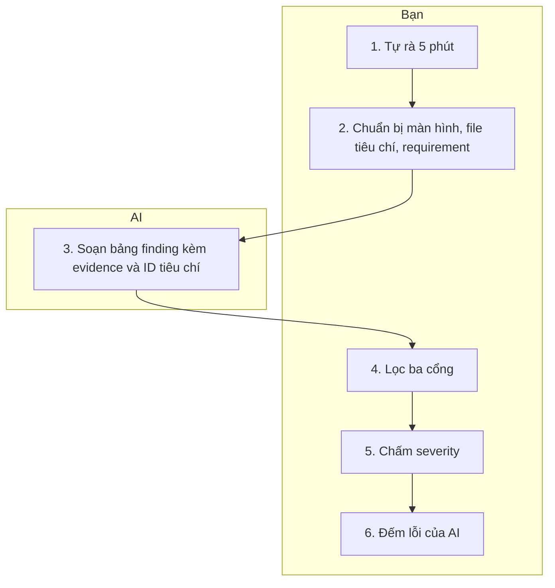
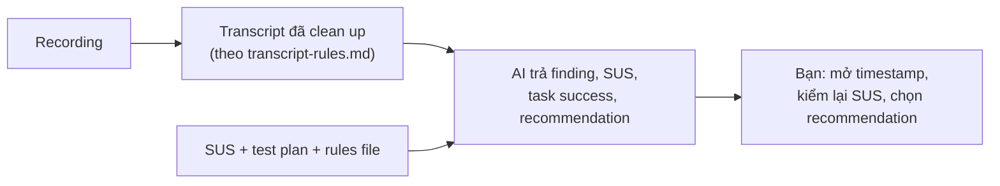
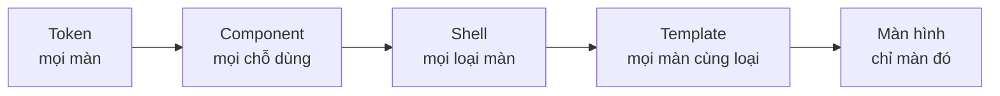

Ở Lesson 5, bạn dựng một prototype chạy được từ design system của mình. Buổi này kiểm tra nó. Bạn viết tiêu chí thành các file markdown, nhờ AI audit theo từng dòng, kiểm accessibility theo ba lượt, rồi test với 3 đến 5 người thật bạn tự tìm. Mọi kết quả đi vào một audit report duy nhất, và severity quyết định việc dev làm. Cuối cùng bạn gom gói handoff và đưa kết quả lên hub để stakeholder và team đọc.

> AI soạn bản nháp, bạn kiểm tra rồi quyết định. AI giúp bạn rà nhanh và gom ghi chú, nhưng không thay người dùng thật và không chấm severity thay bạn.

## Nội dung buổi học

1. Validate sau khi AI build: vì sao verification là nút thắt
2. UX Audit với AI: bốn bộ tiêu chí là bốn file markdown
3. Accessibility với AI: checklist, ba lượt kiểm, và khi nào tin AI
4. Usability test với người thật: Goals, Signals, Metrics, rồi test với participant bạn tự tìm
5. Một report, làm việc với dev và chia sẻ trên hub: gộp finding, chốt severity, sửa đúng layer, soạn ticket, tóm tắt cho stakeholder
6. Handoff và nhìn lại cả khoá: bàn giao UX foundation, và nhìn lại đóng góp của từng lesson

## Sau buổi học, bạn có thể

1. Giải thích vì sao implement nhanh bằng AI làm verification thành nút thắt, và khi nào dùng UX Audit, khi nào dùng usability test
2. Viết tiêu chí audit thành file markdown có ID, và chạy một UX Audit với AI: lọc finding qua ba cổng, chấm severity, và đếm finding AI sai hoặc bỏ sót
3. Đọc một checklist accessibility, biết dòng nào AI kiểm được và dòng nào chỉ người kiểm được, rồi chạy ba lượt kiểm trên prototype
4. Viết Goals, Signals, Metrics cho một test, và chuẩn bị usability test với participant bạn tự tìm mà không để AI đóng vai người dùng
5. Gộp kết quả test vào audit report, kiểm phần phân tích của AI với ghi chú gốc, và xếp finding theo severity
6. Biến severity thành việc cho dev: sửa ở đúng layer, soạn ticket với AI, và test lại
7. Gom gói handoff, đưa trang Findings lên hub, và nêu mỗi lesson đóng góp gì cho design outcome và business outcome (đóng góp có thể có, chưa phải kết quả đã đo)

---

## 1. Validate after AI builds

### 1.1 Verification là nút thắt mới

Khi AI làm implementation rẻ đi, nút thắt chuyển sang bước kiểm tra. Ở Lesson 1, bạn đã thấy hình này: trước AI, nút thắt nằm ở implementation; sau AI, implementation rộng ra còn verification vẫn là ống hẹp. Với designer, AI dựng mười màn hình trong vài phút, còn kiểm tra màn nào đúng và người dùng có dùng được không thì không nhanh theo.

### 1.2 Vì sao UX bị bỏ qua

Ở nhiều team product, ai cũng làm được design và prototype, từ product owner đến developer. Vì implement nhanh nên UX thường bị bỏ qua ở nhiều giai đoạn. Khi có vấn đề xảy ra, team hay build thêm tính năng chồng lên tính năng, thay vì nghĩ lại UX foundation một cách toàn diện. Kết quả là người dùng không hài lòng, và đó là lý do cần có người rà soát và kiểm chứng những gì được giao ra.

### 1.3 Audit trước, test sau, một report

| | UX Audit | Usability test |
|---|---|---|
| **Ai đánh giá** | Bạn, cùng AI | Người dùng thật |
| **Cho biết** | Chỗ nào nên nghi ngờ | Người dùng có gặp vấn đề thật không, và vì sao |
| **Chi phí** | Thấp, làm trong vài giờ | Cao hơn: tìm người, chạy từng buổi |
| **Giới hạn** | Một vi phạm chưa chắc là vấn đề thật | Mẫu nhỏ, chỉ cho tín hiệu |
| **Thứ tự** | Trước | Sau, để dùng thời gian của người dùng cho điều audit chưa trả lời được |

Audit rẻ và chạy nhanh, nên nó là cách sớm nhất để kiểm tra bản build của AI hoặc của developer. Usability test đến sau. Hai bước không tạo ra hai báo cáo: kết quả test được kéo vào chính audit report, để dev và stakeholder chỉ có một danh sách để làm (mục 5).

### 1.4 Prototype của bạn chỉ chứng minh đường chính

Prototype ở Lesson 5 là bản tham chiếu và thứ để test, không phải bằng chứng thiết kế đúng. Nó còn các "Known gaps" mà bạn đã ghi: state chưa dựng, nội dung giả, màn hình thiếu. Test cho bạn biết đường chính dùng được hay không, không nói thay cho phần chưa dựng.

---

## 2. UX Audit with AI

### 2.1 UX Audit là gì

| | |
|---|---|
| **What** | Rà một sản phẩm đã dựng theo các bộ tiêu chí, ghi các vấn đề kèm evidence và severity |
| **Why** | Bắt sớm những trải nghiệm bị bỏ sót khi implement nhanh, trước khi tốn thời gian của người dùng |
| **When** | Sau khi prototype đã dựng, trước usability test. Không cần khi thay đổi chỉ nằm ở một màn hình nhỏ |
| **How with AI** | Bạn đưa AI màn hình và các file tiêu chí; AI soạn bảng finding kèm evidence. Bạn lọc, chấm severity và đếm lỗi của AI |
| **AI không làm** | Chấm severity cuối, hoặc kết luận người dùng sẽ gặp vấn đề |

### 2.2 Bốn bộ tiêu chí là bốn file markdown

Khi bạn nhờ AI "audit màn này", AI chỉ trả những nhận xét chung chung. Khi bạn đưa nó các bộ tiêu chí, nó đối chiếu từng dòng và trả finding có thể kiểm lại. Một audit dùng bốn bộ tiêu chí, mỗi bộ là một file:

| Bộ tiêu chí | File | ID | Lấy từ đâu |
|---|---|---|---|
| Heuristics | `principle-checks.md` | P1 đến P10 | Mười heuristic của Nielsen, dùng cho mọi sản phẩm |
| Design principles | `principle-checks.md` | P11 trở đi | Principle riêng của project, viết ở Lesson 2 |
| Business principles | `principle-checks.md` | P11 trở đi | Ràng buộc của business từ Lesson 2 (ghi "assumed" nếu chưa xác nhận) |
| Accessibility | `accessibility-rules.md` | P30 trở đi | Checklist WCAG ở mục 3 |

Mỗi dòng có một ID. Finding ghi ID của dòng bị vi phạm, nên bất kỳ ai đọc cũng quay về được đúng tiêu chí. Khi báo cáo lên hub, ID tự biến thành link giữa finding và principle. Bảng mười heuristic nằm ở tài liệu tham khảo. Trên slide, design principle và business principle nằm chung một card vì cả hai đều đến từ Lesson 2.

### 2.3 Các layer của một audit

Bốn bộ tiêu chí cho biết dùng thước nào. Layer cho biết nhìn vào đâu:

| Layer | Câu hỏi | Ví dụ trong Delivery App |
|---|---|---|
| Heuristic | Màn hình vi phạm heuristic nào? | Chọn xong khung giờ mà không có xác nhận (P1, trạng thái hệ thống) |
| Accessibility | Có đạt checklist ở mục 3 không? | Focus không nhìn thấy (P33) |
| Design system | Có dùng đúng token và component không? | Nút "Xác nhận" dùng màu thô thay vì token |
| State | Đã có trạng thái rỗng, đang tải, lỗi chưa? | Không có trạng thái "không còn khung giờ nào" |
| Nội dung | Nhãn và thông báo có nhất quán với content voice không? | Chỗ gọi "Đơn hàng", chỗ gọi "Order" |
| Flow | Có khớp requirement và flow đã chọn ở Lesson 4 không? | Thiếu bước hiển thị cut-off trước khi thanh toán |

Bạn không cần audit đủ sáu layer. Chọn layer phù hợp với flow, và ghi rõ layer nào chưa rà.

### 2.4 Thang severity

Mỗi finding cần một severity để bạn biết sửa gì trước. Chương trình dùng thang 0 đến 4 của Nielsen.

| Điểm | Mức | Nghĩa | Ví dụ trong Delivery App |
|---|---|---|---|
| 0 | Không phải vấn đề | Bạn không đồng ý đây là vấn đề về usability | Nút "Xác nhận" hơi khác tông so với mock nhưng vẫn đúng token |
| 1 | Thẩm mỹ | Chỉ cần sửa nếu còn thời gian | Khoảng cách giữa hai dòng chữ lệch vài pixel |
| 2 | Nhỏ | Sửa có độ ưu tiên thấp | Nhãn "Order" thay vì "Đơn hàng" ở một màn |
| 3 | Lớn | Cần ưu tiên sửa | Không có trạng thái "không còn khung giờ nào" |
| 4 | Nghiêm trọng | Phải sửa trước khi phát hành | Khách chọn khung giờ, thanh toán rồi mới biết không đổi được |

Ba điều giúp bạn chọn điểm:

- **Tần suất:** bao nhiêu người có thể gặp.
- **Tác động:** người gặp có hoàn thành được task không, hay bỏ dở.
- **Tính lặp lại:** vấn đề chỉ gặp một lần, hay lần nào cũng gặp.

AI có thể đề xuất severity, nhưng bạn chốt điểm cuối, vì AI không biết hậu quả với người dùng và business của bạn. Khi đặt điểm, ghi kèm một dòng lý do (ví dụ "3, vì khách bỏ dở task mà không biết vì sao"). Ở mục 5, severity này quyết định việc dev làm.

Xem severity gắn lên màn hình thật trong audit mẫu của Travel Buddy: [travel-buddy-ux-audit.html](../assets/travel-buddy-ux-audit.html). Màn Connect có ba finding ở mức 4, 3 và 2.

### 2.5 Cách chạy một UX Audit với AI

1. **Tự rà trước (khoảng 5 phút).** Bạn mở prototype và tự ghi vài điều thấy ngay, trước khi nhờ AI. Đây là mốc để đếm lỗi của AI.
2. **Chuẩn bị đầu vào.** Màn hình (HTML nếu có, vì AI đọc được cấu trúc chứ không chỉ nhìn ảnh), các file tiêu chí, business principle, và requirement của flow.
3. **AI soạn bảng finding.** Mỗi dòng có: màn, finding, ID tiêu chí, evidence (đoạn code hoặc vùng trên ảnh), severity đề xuất kèm lý do, layer cần sửa. Điều không thấy trong màn hình thì AI ghi unknown, và AI liệt kê riêng tiêu chí cần người kiểm.
4. **Lọc qua ba cổng.** (a) Thấy được trên màn hình không? (b) Có vi phạm tiêu chí đã gán không? (c) Người dùng thật có gặp không? Không qua cổng nào thì bỏ hoặc chuyển thành giả thuyết để hỏi ở usability test.
5. **Bạn chấm severity** theo thang ở mục 2.4. Severity cuối do bạn chốt.
6. **Đếm lỗi của AI:** finding sai, và finding bỏ sót so với bước tự rà. Con số này cho bạn biết AI đáng tin đến đâu với loại task này.

Một dòng của audit report trông như thế này:

```markdown
| F3 | Chọn thời gian giao | Focus không nhìn thấy ở ô khung giờ | P33 | audit | `.slot:focus-within { outline: none }` | 3, vì khách dùng bàn phím không biết mình đang ở ô nào | token focus | mở |
```

Template `deliver-audit-report.md` có sẵn các cột này; mẫu prompt nằm ở tài liệu tham khảo. Một audit hoàn chỉnh trên màn hình thật: phạm vi, 10 heuristic với câu hỏi yes/no, 11 finding ghim trên 8 màn hình, và mục giới hạn. Mở [travel-buddy-ux-audit.html](../assets/travel-buddy-ux-audit.html) để xem; đây là bản nháp của một người, chưa phải kết luận.



### 2.6 Cách đưa màn hình cho AI

Chụp từng màn rồi đưa cho AI tốn thời gian. Các designer khác đang dùng một số cách để đỡ việc này, và bạn chọn cách hợp với quyền truy cập của mình:

- **Prototype dạng HTML:** AI đọc được cấu trúc chứ không chỉ nhìn ảnh, nên kiểm được cả accessibility. Đây là cách mặc định trong bài.
- **Video quay màn hình:** bạn quay lại lúc đi qua flow. AI lấy ra các khung hình quan trọng từ video rồi đối chiếu từng khung hình với principle và trả danh sách finding. Bạn vẫn mở lại khung hình AI dẫn để kiểm, và điều không thấy trong video thì AI ghi unknown.
- **Môi trường test hoặc production:** nếu bạn có quyền đăng nhập, hoặc cho AI dùng chế độ truy cập trình duyệt, AI duyệt trực tiếp từng màn, đối chiếu với principle và trả danh sách audit kèm mức ưu tiên. Cách này thường cần workaround riêng cho từng môi trường (tài khoản thử, dữ liệu giả, quyền chỉ đọc). Chỉ làm khi công ty cho phép, và đừng đưa thông tin đăng nhập thật cho công cụ AI khi chưa được duyệt.
- **FigJam:** đặt các màn hình của flow lên FigJam theo thứ tự, nối Figma với công cụ AI qua MCP để AI đọc màn hình thật, rồi AI ghi mỗi finding thành một sticky note gắn cạnh màn hình, kèm giả thuyết, Importance và Evidence. Ví dụ dựng sẵn nằm trong dự án mẫu Travel Buddy.

Dù dùng cách nào, đầu ra vẫn là một bảng finding có ID tiêu chí và evidence như ở mục 2.5, và bạn vẫn lọc qua ba cổng.

### 2.7 AI làm audit tốt đến đâu

- Trong một nghiên cứu, một mô hình ngôn ngữ lớn đánh giá usability chỉ tìm lại khoảng 21,2% vấn đề của chuyên gia, và 24,3% kết quả là false positive.
- Một nghiên cứu khác (preprint) thấy mô hình tìm 73 đến 77% vấn đề so với 57 đến 63% của năm chuyên gia gộp lại, kèm nhiều non-issue.
- NN/g khuyên ba đến năm người đánh giá độc lập cho heuristic evaluation.

Cả hai nghiên cứu cùng kết luận AI là phần bổ sung và cần người kiểm tra. Vì vậy, kết quả của một người làm cùng AI là giả thuyết cần người dùng xác nhận, chưa phải kết luận.

**Chạy thử của chương trình (20/11/2026).** Chương trình chạy prompt audit ở trên một lần, trên màn "Chọn thời gian giao" của Delivery App (bảy vấn đề cài sẵn), với `principle-checks.md`, `accessibility-rules.md` và requirement của flow trong prompt. AI tìm lại cả bảy vấn đề, và báo thêm năm finding ngoài đáp án: ba đúng (chữ trắng trên nút cam với tương phản khoảng 3,6:1, thứ tự heading, link trỏ đến một `id` không tồn tại), một sai (thẻ "Phổ biến", vốn hợp lệ) và một còn tranh cãi (nhóm khung giờ không có tên nhóm). AI chấm lệch severity ở ba vấn đề, trong đó chấm vấn đề không hiện cut-off thấp hơn một bậc. Đây là một lần chạy, một màn, một mô hình; kết quả không nói gì về prototype của bạn.

---

## 3. Accessibility with AI

### 3.1 Accessibility là gì

| | |
|---|---|
| **What** | Thiết kế để người có khuyết tật và người dùng trong hoàn cảnh khó vẫn dùng được sản phẩm |
| **Why** | Một số sản phẩm không bán được hay không ra mắt được nếu thiếu; ở healthcare, finance và khách hàng doanh nghiệp lớn, bên mua thường yêu cầu tài liệu chứng minh mức độ accessibility |
| **When** | Kiểm ngay từ audit, không để đến cuối |
| **How with AI** | AI đối chiếu từng màn với từng dòng checklist; bạn kiểm lại các dòng fail và tự làm các dòng chỉ người kiểm được |
| **AI không làm** | Thay việc kiểm bằng bàn phím, screen reader và người dùng thật |

Một ví dụ hư cấu: ứng dụng đặt lịch khám có phiên hết hạn sau hai phút. Người chỉ dùng bàn phím, hoặc cần thêm thời gian để đọc, bị đẩy ra trước khi điền xong. Với họ, sản phẩm không dùng được.

Chuẩn thường dùng là WCAG. Ở nhiều nơi, luật hiện yêu cầu WCAG 2.1 AA (ví dụ quy định ADA Title II của Mỹ), và Đạo luật accessibility của EU (European Accessibility Act, có hiệu lực từ 28/6/2025) dùng chuẩn EN 301 549, bản mới đã gồm WCAG 2.2 AA. Chương trình lấy WCAG 2.2 AA làm mức nên nhắm, vì mức này bao gồm mức 2.1 AA. Các nguồn lệch nhau về việc WCAG 2.2 đã bắt buộc ở Mỹ chưa, và nhiều nguồn là blog của vendor; trước khi dùng cho tuyên bố tuân thủ, kiểm lại với văn bản gốc và với bộ phận pháp lý của công ty.

Bên mua doanh nghiệp thường đòi một tài liệu gọi là ACR (hay VPAT): bản bên bán tự khai về mức độ sản phẩm đạt chuẩn. Checklist trong buổi này không thay tài liệu đó, nhưng là bước chuẩn bị cho nó.

### 3.2 Đọc một checklist accessibility

Checklist nằm ở `accessibility-rules.md` trong template, soạn từ WCAG 2.2. Mỗi dòng là một câu hỏi có hoặc không, để AI trả lời được và bạn kiểm lại được:

| ID | Kiểm gì | WCAG | Mức | Ai kiểm được |
|---|---|---|---|---|
| P30 | Chữ có tương phản tối thiểu 4,5:1 với nền (3:1 với chữ lớn)? | 1.4.3 | AA | Tool, AI |
| P32 | Mọi thao tác làm được bằng bàn phím, và focus không bị kẹt? | 2.1.1, 2.1.2 | A | Người |
| P33 | Focus luôn nhìn thấy được và không bị che? | 2.4.7, 2.4.11 | AA | AI, Người |
| P34 | Vùng chạm tối thiểu 24 x 24 px (nên 44 x 44 px)? | 2.5.8 | AA | Tool, AI |

Bản đầy đủ có 17 dòng, từ P30 đến P46. Cột **Ai kiểm được** là phần bạn cần đọc kỹ nhất:

- **Tool:** công cụ tự động chạy trên HTML (như axe hoặc Lighthouse).
- **AI:** AI đọc code hoặc ảnh theo câu hỏi; bạn kiểm lại các fail.
- **Người:** chỉ kiểm được bằng bàn phím, screen reader hoặc người dùng thật. AI chỉ trả "cần người".

Cuối file có chỗ để thêm quy tắc riêng của công ty, bắt đầu từ P47: yêu cầu từ ACR, quy định ngành, hay chuẩn nội bộ khắt khe hơn WCAG.

### 3.3 Ba lượt kiểm

1. **Lượt 1, công cụ tự động.** Chạy trên HTML của prototype. Nhanh, và nên chạy mỗi lần bạn sửa. Một nghiên cứu của vendor Deque thấy công cụ tự động tìm được khoảng 57% issue theo số lượng, còn bài của REI viết tự động chỉ chiếm khoảng 30% đến 50% việc kiểm accessibility.
2. **Lượt 2, AI theo checklist.** AI đọc code và ảnh, trả từng dòng pass, fail, unknown hoặc cần người. Mỗi fail thành một finding có ID.
3. **Lượt 3, bạn kiểm bằng người.** Bấm Tab qua toàn bộ flow, phóng to 200% và 400%, nghe thử bằng screen reader. Lượt này là lượt duy nhất cho thấy người dùng bàn phím và screen reader gặp gì. Dòng nào còn "cần người" mà chưa kiểm thì ghi vào audit report là accessibility còn hở.

### 3.4 Chạy checklist với AI

1. Đưa AI HTML của prototype, `accessibility-rules.md` và requirement của flow.
2. Yêu cầu AI chỉ kết luận điều thấy trong code, còn lại ghi unknown, và liệt kê riêng các dòng cần người.
3. Với mỗi fail, mở đúng đoạn code AI dẫn. Dòng AI ghi pass mà không dẫn được code thì nghi ngờ; đếm vào số lỗi của AI.
4. Tự làm các dòng "cần người", rồi ghi kết quả vào audit report.

Prompt mẫu nằm ở tài liệu tham khảo. AI tự dựng thường cho ra focus không nhìn thấy và tương phản sát ngưỡng, vì vậy Lesson 5 đã đưa WCAG vào rules file; buổi này kiểm lại những gì rules file không bắt được.

### 3.5 Hai tổ chức làm audit accessibility

- **GOV.UK** yêu cầu dịch vụ trên `.service.gov.uk` được audit trước khi sang public beta. Theo Service Manual, audit kiểm theo WCAG 2.2 AA và gồm công nghệ hỗ trợ như screen reader và phóng to; Service Manual dặn không chỉ dựa vào công cụ tự động, và nếu dịch vụ nằm trong Service Standard thì còn phải test với người khuyết tật. Trang audit ghi cập nhật năm 2019 nhưng đã nhắc WCAG 2.2; trang testing cập nhật tháng 10/2024.
- **REI** (bài Engineering, tháng 10/2023) đưa axe-core vào CI với bộ khoảng 42 rule và chặn code không đạt trước khi lên production; REI tự báo cáo hơn 90% ứng dụng dùng bộ test này. Bài cũng viết tự động chỉ là một phần: một chỗ ghi khoảng 30%, đoạn kết ghi 30 đến 50%, và hai con số không được đối chiếu.

Hai nguồn này không nhắc đến AI. Chúng cho thấy lượt 1 và lượt 3 là cách các tổ chức làm thật, và AI ở lượt 2 đi cùng hai lượt đó, không thay thế.

### 3.6 Checklist của công ty thành model file

*[to confirm]* Phần này dành cho một trường hợp thật Winnie đã thấy: một designer có checklist accessibility của công ty, viết nó thành một file, và AI đọc file này mỗi lần chạy UX audit. Giống design principle và business principle, accessibility cũng là một bộ nguyên tắc; AI đối chiếu giữa các bộ rồi trả danh sách UX issue. Cần ví dụ thật, đã ẩn danh, trước khi viết tiếp mục này.

### 3.7 Giới hạn

- Checklist soạn từ WCAG 2.2 và chưa đối chiếu lại với bản gốc.
- AI tự dựng thường cho ra focus không nhìn thấy và tương phản sát ngưỡng, nhưng một nghiên cứu về trang AI dựng (VentureBeat, 30/9/2026, bài do AudioEye tài trợ) chỉ có 15 trang, không công bố prompt hay phương pháp, và không cho biết nhắc accessibility trong prompt có giúp không. Dùng như lời cảnh báo, chưa phải thước đo.
- Audit này là bước sớm, chưa phải báo cáo tuân thủ.

---

## 4. Usability test with real users

### 4.1 Từ hypothesis đến câu hỏi test được

| | |
|---|---|
| **What** | Một chuỗi nối mục tiêu đến thứ bạn quan sát và đo được trong test |
| **Why** | Biết test xong thì thế nào là "đạt", trước khi gặp người dùng |
| **When** | Trước khi viết test plan |

- **Goal:** điều bạn muốn người dùng làm được, lấy từ hypothesis (Lesson 4) và business question (Lesson 2).
- **Signal:** hành vi bạn quan sát được cho thấy goal đạt hay chưa.
- **Metric:** cách đo signal.

Khung HEART của Google gợi ý năm nhóm: Happiness, Engagement, Adoption, Retention, Task success. Trong một test ngắn trên prototype, bạn chủ yếu dùng Task success và Happiness.

| | Ví dụ trong Delivery App |
|---|---|
| Goal | Khách mới đặt xong đơn đầu và biết khung giờ giao đã chốt hay còn đổi được |
| Signal | Khách chọn khung giờ, dừng lại đọc cut-off, rồi thanh toán mà không hỏi lại |
| Metric | Task success (hoàn thành không cần trợ giúp), time on task, số lỗi, SUS |

### 4.2 SUS và giới hạn của mẫu nhỏ

SUS (System Usability Scale) là bảng mười câu hỏi, cho điểm từ 0 đến 100. Điểm 68 thường được dùng làm mức tham chiếu trung bình. Với 3 đến 5 người, SUS và tỷ lệ task success chỉ là tín hiệu để so sánh trước và sau khi sửa, không phải con số có ý nghĩa thống kê. Điều bạn học được nhiều nhất từ mẫu nhỏ là vì sao người dùng gặp khó, không phải bao nhiêu phần trăm.

### 4.3 Usability test là gì

| | |
|---|---|
| **What** | Một người thật làm các task thật trên prototype của bạn, trong khi bạn quan sát và nhờ họ nói to suy nghĩ |
| **Why** | Thấy thiết kế hỏng ở đâu và vì sao, và hỏi sâu về điều vừa thấy |
| **When** | Sau audit và sau khi bạn đã sửa các lỗi hiển nhiên |
| **How with AI** | AI soạn bản nháp test plan và script, rồi gom ghi chú sau buổi test |
| **AI không làm** | Đóng vai người dùng. Phản hồi của người dùng mô phỏng không thay được người thật |

Buổi này dạy moderated test: bạn ngồi cùng (hoặc gọi video với) từng participant. A/B testing, concept testing và unmoderated test cũng tồn tại; bạn xem method card nếu cần.

### 4.4 Chuẩn bị và chạy một buổi test

**Tìm participant.**

- **Số người:** 3 đến 5 người. Một số ít người dùng thường đủ để thấy phần lớn vấn đề lớn của một nhóm.
- **Đúng nhóm:** chọn người giống nhóm người dùng mục tiêu (ví dụ khách đặt đồ ăn giao tận nơi), không chọn người cùng làm với bạn trong project.
- **Screener hai câu:** hai câu hỏi lọc để chắc họ đúng nhóm (ví dụ: bạn đã đặt đồ ăn giao tận nơi trong tháng qua chưa, và bạn thường đặt bằng app nào).
- **Cẩn thận với bạn bè:** người quen có xu hướng khen cho dễ chịu. Nếu chỉ có người quen, ghi rõ điều này như giới hạn của test.

**Consent và dữ liệu.** Participant là người thật, nên áp lại data rules từ Lesson 1:

1. Nói rõ trước buổi test: bạn ghi hình hay không, dùng để làm gì, ai xem.
2. Chỉ ghi hình khi họ đồng ý; người từ chối ghi hình thì ghi chú tay.
3. Ẩn danh trên máy bằng participant code (P1, P2) trước khi đưa ghi chú hay bản phiên âm cho AI.
4. Hỏi công ty bạn có cho phép công cụ AI bạn dùng không.

Chương trình dạy mức thực hành cho nghiên cứu nội bộ, không thay chính sách công ty hay tư vấn pháp lý.

**Test plan và script với AI.** Bạn có sẵn template `deliver-test-plan.md`. Các phần chính: hypothesis và điều gì làm bạn đổi ý, task, participant, script, metric.

- **Task** là một việc người dùng thử làm, không nói trước cách làm. Ví dụ: "Bạn đặt một đơn và muốn nhận lúc 19:00. Hãy thử làm." Không viết "bấm vào ô chọn khung giờ".
- **Script** gồm lời mở, các task, câu hỏi tiếp theo, lời kết. Câu hỏi hỏi về điều đã xảy ra ("Lúc nãy bạn dừng ở màn này, bạn đang nghĩ gì?"), không hỏi ý kiến về ý tưởng ("Bạn có thích màn này không?").
- **AI soạn nháp, bạn cắt:** AI hay viết câu dẫn dắt và lặp ý. Bạn cắt ít nhất một nửa và viết lại các câu dẫn dắt. Quy tắc hỏi trung tính ở Lesson 2 áp dụng nguyên vẹn.

**Chạy buổi test.**

1. Mở đầu: nói rõ bạn test prototype, không test người dùng, và không có câu trả lời sai.
2. Nhờ họ nói to suy nghĩ khi làm.
3. Đưa task, rồi **im lặng và quan sát**. Không chỉ cách làm. Khi họ hỏi "chỗ này bấm gì?", hỏi lại "bạn nghĩ nó sẽ làm gì?".
4. Ghi hình màn hình và tiếng khi họ đồng ý, và ghi nhanh khi cần: họ làm gì, dừng ở đâu, nói gì (nguyên văn khi được), có hoàn thành không, mất bao lâu. Mỗi quan sát ghi kèm participant code và thứ tự (ví dụ P1-03).
5. Cuối buổi: SUS và một hai câu hỏi mở.

### 4.5 Vì sao AI không đóng vai người dùng

Các nghiên cứu về người trả lời mô phỏng (silicon sampling) cho thấy họ thiên về câu trả lời dễ nghe và chỉ khớp ở mức nhóm. NN/g, khi chạy lại ba nghiên cứu cũ với người dùng AI, thấy giá trị và nhu cầu nêu ra quá nông và hành vi bị lý tưởng hoá. Một "người dùng" do AI mô phỏng luôn làm được task, nên nó che đúng chỗ bạn cần thấy. AI giúp được ở khâu chuẩn bị và gom ghi chú, nhưng không thay thế được người dùng thật.

### 4.6 Từ recording đến finding cùng AI

Một cách làm thực tế: bạn ghi hình từng buổi test (màn hình và tiếng, khi participant đồng ý), nhờ AI clean up transcript, rồi để AI gom finding, tính SUS và đề xuất thay đổi. Bạn giữ phần quyết định.

**Bước 1: viết rules cho transcript, thay vì soát từng timestamp.** Bạn viết một bộ rules một lần và đưa cho AI cùng transcript. Rules nên có năm điều:

1. Ẩn danh bằng participant code (P1, P2) trên máy trước khi đưa cho AI, và chỉ dùng công cụ công ty cho phép.
2. Giữ nguyên văn lời participant, không diễn giải hay làm đẹp câu.
3. Giữ timestamp và người nói cho mỗi lượt.
4. Chỗ nghe không rõ thì ghi "không rõ", không đoán.
5. Không thêm ý, không gộp hay bỏ lượt nói.

Rules thay cho việc soát từng timestamp vì chúng ép transcript giữ đúng những thứ bạn cần kiểm sau này: lời nguyên văn và mốc thời gian để quay về video.

**Bước 2: đưa AI đầu vào đủ.** Gồm transcript đã clean up, câu trả lời SUS của từng participant, test plan (goal, signal, metric) và rules file. Có test plan và rules file thì recommendation bám theo mục tiêu đã đặt, không theo cảm giác.

**Bước 3: AI trả ba thứ.**

- **Finding** kèm timestamp và lời trích nguyên văn. Finding không dẫn về được timestamp thì chưa phải finding.
- **Điểm SUS** của từng người và trung bình, cùng task success của từng task. SUS có công thức cố định (câu lẻ lấy điểm trừ 1, câu chẵn lấy 5 trừ điểm, cộng lại rồi nhân 2,5), nên AI tính được. Bạn tự kiểm lại phép tính của một participant trước khi dùng cả bảng.
- **Recommendation** kèm layer cần sửa (xem mục 5.3).

**Bước 4: bạn quyết định.** Bạn mở timestamp của các finding quan trọng, nhờ AI liệt kê điều participant nói hoặc làm mà chưa được đưa vào finding (vì đọc danh sách chỉ bắt được điều viết sai, không bắt được điều thiếu), rồi chọn recommendation nào làm. Việc chấm severity và gộp vào audit report nằm ở mục 5.

Nếu participant từ chối ghi hình, bạn ghi chú tay, gõ lại theo cùng rules rồi làm tiếp từ bước 2.



Vì sao rules đòi giữ timestamp và lời nguyên văn? Năm 2023, NN/g thử các công cụ AI phân tích recording của một usability test đã được nhà nghiên cứu phân tích, rồi so kết quả. Công cụ chỉ đọc transcript chứ không nhìn video; NN/g viết rằng người hay AI đều không phân tích được buổi test chỉ từ transcript. Công cụ cũng không nhận mục tiêu nghiên cứu, nên insight không xếp theo ưu tiên, và trích dẫn thường thiếu session hay timestamp. Trang bài ghi công cụ đã cải thiện từ đó; bài là một mốc thời điểm để hiểu lý do của các rules, không phải đánh giá công cụ hiện tại.

---

## 5. One report, working with dev, and sharing on the hub

Mọi thứ đi quanh một file `audit-report.md`, và AI giúp bạn ở ba việc: gộp kết quả test (mục 5.1), soạn ticket cho dev (mục 5.4), và tóm tắt cho stakeholder trên hub (mục 5.5). Severity (mục 5.2) và layer (mục 5.3) là phần bạn quyết định ở giữa.

### 5.1 Kéo kết quả test vào audit report

Bạn không viết một báo cáo test riêng. Finding từ test đi vào cùng bảng với finding từ audit, để dev chỉ có một danh sách để làm. Bảng có hai cột mới: **nguồn** (audit, test hoặc cả hai) và **trạng thái**.

1. Đưa AI `audit-report.md` và các finding đã có timestamp từ test.
2. AI khớp từng finding của test với finding của audit theo màn và ID tiêu chí.
3. Finding audit mà test xác nhận: nguồn thành "cả hai", và AI đề xuất nâng severity kèm lý do (bạn có người thật gặp vấn đề).
4. Điều test thấy mà audit không thấy: một dòng mới, nguồn "test", kèm timestamp và lời trích nguyên văn.
5. Finding audit mà test không thấy: giữ nguyên, ghi "mẫu test chưa cho thấy". Không xoá, vì test chỉ có 3 đến 5 người.
6. Bạn mở timestamp của mọi dòng đổi, rồi chốt severity.

Ví dụ trong Delivery App: audit ghi F1 "không hiện cut-off" ở mức 3. Hai trong năm participant thanh toán xong rồi hỏi "sao không đổi được giờ", ở P2-08:15 và P4-11:40. AI đề xuất nâng F1 lên 4; bạn xem lại video rồi đồng ý.

Xếp finding theo severity, không theo số người nhắc. Một vấn đề chỉ một người gặp nhưng khiến họ bỏ dở task vẫn quan trọng hơn một khó chịu nhỏ năm người cùng nhắc. Mỗi finding đi kèm một dòng nêu mẫu của bạn không cho biết điều gì, và ý kiến trái chiều giữ cùng trang với finding.

### 5.2 Severity thành việc cho dev

*[to confirm]* Bảng này là mặc định của chương trình. Nhóm của bạn có thể có quy tắc riêng.

| Severity | Việc dev làm |
|---|---|
| 4 | Chặn release; sửa trước khi phát hành |
| 3 | Sửa trước khi flow đó ra |
| 2 | Vào backlog; sửa khi chạm đến màn đó |
| 1 | Tuỳ chọn, khi còn thời gian |
| 0 | Bỏ khỏi báo cáo |

Với sản phẩm bị quy định (healthcare, finance), một đề xuất là lỗi accessibility mức A hoặc AA ở flow chính tối thiểu là severity 3, vì nó có thể là rủi ro pháp lý và không nên nằm ở mức "thẩm mỹ". Bạn đề xuất cùng PO; dev nêu chi phí sửa.

### 5.3 Sửa ở đúng layer

Dùng lại layer ladder ở Lesson 5. Câu hỏi kiểm tra: lỗi này có sai ở nhiều hơn một màn không?

| Lỗi lặp ở nhiều màn | Sửa ở |
|---|---|
| Màu, cỡ chữ, khoảng cách sai | Token |
| Một component hoạt động sai | Component |
| Điều hướng sai ở mọi màn | Shell |
| Cả loại trang sai bố cục | Template |
| Chỉ một màn hình | Màn hình đó |



Chọn bậc rộng nhất mà lỗi còn đúng (đọc từ trái sang phải). Có hai cách sai: **fix too low** (sửa lại ở từng màn, các bản lệch nhau thêm) và **push too high** (đưa vào hệ thống thứ chỉ một màn cần). Sau khi sửa ở nguồn, dựng lại phần bị ảnh hưởng và test lại đường chính một lần ngắn.

Atlassian là một ví dụ về cách làm này ở quy mô lớn. Theo blog của Atlassian (tháng 12/2025), họ audit toàn hệ thống component, ưu tiên component dùng nhiều nhất, và sửa ở token màu và chữ để component sau tự thừa hưởng. Atlassian công bố hơn 6.000 issue được xử lý từ tháng 6/2024 đến tháng 6/2025, và họ có bộ annotation trong Figma cùng các Accessibility Design Specialists trong team. Con số này là Atlassian tự công bố, không chia theo mức nghiêm trọng, và bài không nhắc đến AI.

### 5.4 Để AI soạn ticket cho dev

1. Đưa AI `audit-report.md` đã chốt severity.
2. AI nhóm finding theo layer: ba lỗi focus ở ba màn thường là một việc ở token. Sau đó AI soạn một ticket cho mỗi finding hoặc nhóm finding.
3. Mỗi ticket có ba thứ: lỗi ở đâu, sửa ở layer nào, và khi nào coi là xong. Điều kiện nghiệm thu dẫn ID tiêu chí, ví dụ "P33 pass trên mọi màn".
4. Bạn đọc lại, kiểm xem AI gộp finding có cùng nguyên nhân không; dev thêm chi phí sửa.
5. Sau khi dev sửa, bạn dựng lại phần bị ảnh hưởng và chạy lại đúng dòng tiêu chí đó.

Cập nhật `design-system-notes.md` và rules file trong cùng lượt khi đổi token hoặc component.

### 5.5 Chia sẻ trên hub

Audit report nằm trong markdown để AI đọc được. Hub là chỗ đưa nó ra cho stakeholder và team đọc. Trang Findings của hub nhận phần tóm tắt từ `audit-report.md`:

- Số finding theo severity, và các rủi ro lớn nhất.
- Trạng thái accessibility: ba lượt đã làm gì, và dòng nào còn "cần người".
- Điều đã sửa, điều chưa sửa, và quyết định đang chờ stakeholder (ví dụ "PO chọn mức hành động cho F5").

Principle dùng ID (P1, P33…), nên hub tự nối finding với principle và cảnh báo khi có chỗ gãy, như một quyết định kéo ngược principle. AI có thể soạn phần tóm tắt từ audit report; bạn đọc lại như một stakeholder và bỏ những gì dễ gây hiểu nhầm.

---

## 6. Handoff and the whole course

### 6.1 Handoff không còn là bàn giao màn hình

Handoff pack và measurement plan kiểu cũ không còn trong chương trình. Điều còn lại cần bàn giao là **UX foundation**, vì người implement sau (có thể là developer, product owner hay chính AI của họ) dễ chồng tính năng lên nhau mà không biết nền UX đang giữ điều gì.

| Mục | Dùng để |
|---|---|
| Rules file, design system (token, component) và các file tiêu chí (principle, accessibility) | Người implement dùng đúng nền, và AI của họ kiểm theo cùng tiêu chí bạn đã dùng |
| Decision log | Biết vì sao chọn hướng này, để không đảo quyết định vô tình |
| Audit report, kèm finding chưa sửa và trạng thái accessibility | Biết vấn đề nào còn tồn tại, và dòng nào của checklist chưa được kiểm bằng người |
| Danh sách điều chưa làm (state, nội dung, màn thiếu) | Không nhầm một bản chưa xong là bản hoàn chỉnh |
| Một câu "điều không được phá" cho mỗi flow | Có chuẩn để kiểm khi thêm tính năng |

Người implement cho AI của họ đọc chính gói này, giống cách bạn đưa rules file cho AI ở Lesson 5. Sau khi bản build ra, bạn có thể audit lại bản đó bằng cùng quy trình ở mục 2, kể cả bản developer đã build; đây là phần mở rộng, chưa phải nội dung chính của buổi.

### 6.2 Cả khoá: mỗi lesson đóng góp gì

Lesson này là lesson cuối. Bảng dưới nối từng lesson với business question của Delivery App từ Lesson 2 (khách mới không đặt lại sau đơn đầu tiên; tỷ lệ đặt đơn thứ hai trong 30 ngày là 41%). Cùng nội dung ở dạng bảng một trang: [course-contribution.html](../assets/course-contribution.html).

| Lesson | Đóng góp cho design outcome | Đóng góp cho business outcome |
|---|---|---|
| 1 | Làm việc với AI trong một workspace lặp lại được, không đưa dữ liệu nhạy cảm vào AI tool công khai | Giảm rủi ro dữ liệu và tuân thủ, để công ty dùng AI một cách an toàn |
| 2 | Biết đúng vấn đề đáng giải và có chuẩn chung để đánh giá thiết kế | Thống nhất business question và metric với business trước khi build, tránh build sai vấn đề |
| 3 | Hiểu người dùng bằng persona, journey map, opportunity có evidence | Quyết định dựa trên evidence thay vì niềm tin của team (ví dụ "giá là lý do chính") |
| 4 | Chọn được hướng giải pháp có lý do và vẽ rõ flow phía sau màn hình | Chọn hướng trước khi tốn công của developer, thấy sớm việc chạm đến team nào |
| 5 | Trải nghiệm nhất quán nhờ design system và rules file | Có prototype nhanh để test sớm, giảm làm lại giữa design và developer |
| 6 | Bắt lỗi UX và accessibility trước khi ship, và giữ UX foundation khi người khác implement | Giảm lỗi sau launch và tránh chồng tính năng lên nền yếu; có tín hiệu về task success cho quyết định đầu tư |

Bảng này nói **đóng góp có thể có**, không phải kết quả đã đo. Một prototype đã test cho tín hiệu về trải nghiệm, nhưng không chứng minh tỷ lệ đặt đơn thứ hai tăng. Điều đó phải đo sau launch, ngoài phạm vi khoá.

Điều bạn làm được bây giờ: cùng product và business chọn vấn đề đáng giải, dùng AI để làm nhanh mà vẫn tự kiểm tra và tự quyết định.

---

## Common mistakes

| Sai lầm | Biểu hiện | Cách sửa |
|---|---|---|
| Tin audit của AI | Gửi danh sách AI cho developer mà chưa kiểm | Lọc qua ba cổng và đếm lỗi của AI |
| Hỏi AI chung chung | "Audit màn này giúp mình" cho ra nhận xét không kiểm lại được | Đưa các file tiêu chí và yêu cầu finding có ID, evidence |
| Chỉ chạy công cụ tự động rồi coi accessibility xong | Báo cáo "đạt" nhưng chưa ai bấm Tab hay nghe screen reader | Làm đủ ba lượt; ghi rõ dòng nào còn "cần người" |
| Test với toàn bạn bè | Mọi người đều khen | Tìm ít nhất vài người đúng nhóm; ghi giới hạn nếu không được |
| Câu hỏi dẫn dắt | "Bạn có thấy nút này dễ bấm không?" | Hỏi về điều đã xảy ra, không hỏi ý kiến |
| Giúp participant giữa chừng | Chỉ chỗ bấm khi họ kẹt | Im lặng, ghi lại chỗ họ kẹt |
| Hai báo cáo cho một việc | Dev phải ghép audit với test, severity lệch nhau | Một audit report, finding có cột nguồn |
| Xếp finding theo số người nhắc | Vấn đề nghiêm trọng một người gặp bị bỏ | Xếp theo severity |
| Sửa từng màn | Lỗi lặp lại sau khi sửa | Sửa ở layer rộng nhất mà lỗi còn đúng |
| Bàn giao chỉ màn hình | Người implement chồng tính năng, nền UX mất | Bàn giao cả gói UX foundation |

---

## Giới hạn của bài học

- Mục 1.2 mô tả một xu hướng thường gặp trong thực tế làm việc, không phải kết quả nghiên cứu có số đo.
- Bằng chứng về AI làm heuristic evaluation đến từ hai nghiên cứu nhỏ có thiết kế khác nhau; áp vào prototype của bạn là suy luận.
- Chạy thử của chương trình ở mục 2.7 là một lần, một màn, một mô hình, với requirement nằm trong prompt; chưa thử lặp lại hay bỏ requirement.
- Checklist accessibility soạn từ WCAG 2.2, chưa đối chiếu lại với bản gốc; các nguồn pháp lý (ADA Title II, European Accessibility Act) chủ yếu là blog của vendor và lệch nhau về WCAG 2.2, cần kiểm với văn bản gốc.
- Các con số của Atlassian, REI và Deque đều do chính họ công bố; bài của REI ghi hai con số về phần tự động không được đối chiếu; bài của Deque không nêu mẫu hay baseline; GOV.UK và REI không nhắc đến AI.
- Bài NN/g năm 2023 về công cụ AI phân tích recording là một mốc thời điểm; công cụ đã cải thiện từ đó.
- Con số "3 đến 5 người", điểm SUS tham chiếu và khung HEART là kiến thức chung của ngành; chương trình chưa mở lại bản gốc để kiểm lại.
- Mẫu test nhỏ chỉ cho tín hiệu định tính, không cho kết luận về tỷ lệ.
- Bảng severity thành việc cho dev ở mục 5.2 và mục 3.6 (checklist của công ty) đang chờ Winnie xác nhận.
- Bảng đóng góp ở mục 6.2 là suy luận của chương trình, chưa đo.
- Delivery App và các ví dụ là hư cấu, do chương trình tự dựng.
