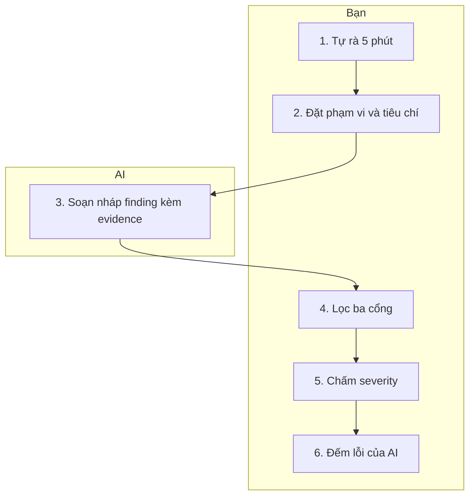
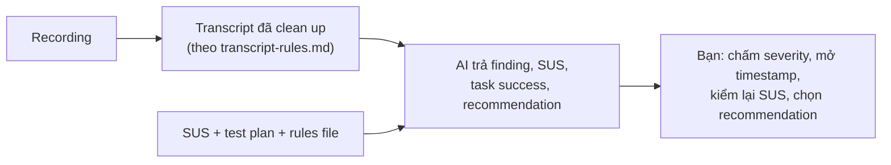
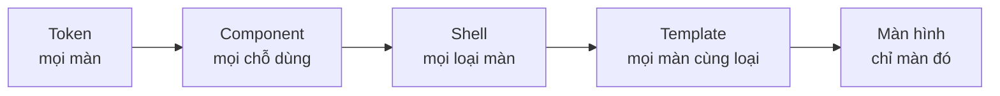

Ở Lesson 5, bạn dựng một prototype chạy được từ design system của mình. Buổi này kiểm tra nó: bạn tự rà bằng UX Audit với AI, rồi test với 3 đến 5 người thật bạn tự tìm. Sau đó bạn xếp finding, sửa đúng layer, dựng lại và gom một gói handoff để người implement sau không bỏ qua nền UX.

> **AI soạn nháp. Bạn kiểm tra. Bạn quyết định.** AI giúp bạn rà nhanh và gom ghi chú, nhưng AI không thay người dùng thật và không chấm severity thay bạn.

## Nội dung buổi học

1. Validate sau khi AI build: vì sao verification là nút thắt
2. UX Audit với AI: heuristic evaluation và các layer khác
3. Usability test với người thật: Goals, Signals, Metrics, rồi test với participant bạn tự tìm
4. Phân tích, xếp finding và sửa đúng layer
5. Handoff kiểu mới: bàn giao UX foundation, và nhìn lại cả khoá

## Sau buổi học, bạn có thể

1. Giải thích vì sao implement nhanh bằng AI làm verification thành nút thắt, và khi nào dùng UX Audit, khi nào dùng usability test
2. Chạy một UX Audit với AI: đặt phạm vi và tiêu chí, lọc finding qua ba cổng, chấm severity, và đếm finding AI sai hoặc bỏ sót
3. Viết Goals, Signals, Metrics cho một test và nêu giới hạn của SUS trên mẫu nhỏ
4. Chuẩn bị một usability test: tìm participant, xin consent, viết test plan và script với AI mà không để AI đóng vai người dùng
5. Kiểm tra phần phân tích của AI với ghi chú gốc, xếp finding theo severity và sửa ở đúng layer
6. Gom gói handoff giữ UX foundation để người implement sau không chồng tính năng lên mà bỏ qua nền
7. Nêu mỗi lesson đóng góp gì cho design outcome và business outcome, và phân biệt đóng góp có thể có với kết quả đã đo

---

## 1. Validate after AI builds

### 1.1 Verification là nút thắt mới

Khi AI làm implementation rẻ đi, nút thắt chuyển sang bước kiểm tra. Ở Lesson 1, bạn đã thấy hình này: trước AI, nút thắt nằm ở implementation; sau AI, implementation rộng ra còn verification vẫn là ống hẹp. Với designer, AI dựng mười màn hình trong vài phút, còn kiểm tra màn nào đúng và người dùng có dùng được không thì không nhanh theo.

### 1.2 Vì sao UX bị bỏ qua

Ở nhiều team product, ai cũng làm được design và prototype, từ product owner đến developer. Vì implement nhanh nên UX thường bị bỏ qua ở nhiều giai đoạn. Khi có vấn đề xảy ra, team hay build thêm tính năng chồng lên tính năng, thay vì nghĩ lại UX foundation một cách toàn diện. Kết quả là người dùng không hài lòng, và đó là lý do cần có người rà soát và kiểm chứng những gì được giao ra.

### 1.3 Audit hay test

| | UX Audit | Usability test |
|---|---|---|
| **Ai đánh giá** | Bạn, cùng AI | Người dùng thật |
| **Cho biết** | Chỗ nào nên nghi ngờ | Người dùng có gặp vấn đề thật không, và vì sao |
| **Chi phí** | Thấp, làm trong vài giờ | Cao hơn: tìm người, chạy từng buổi |
| **Giới hạn** | Một vi phạm chưa chắc là vấn đề thật | Mẫu nhỏ, chỉ cho tín hiệu |
| **Thứ tự** | Trước | Sau, để dùng thời gian của người dùng cho điều audit chưa trả lời được |

### 1.4 Prototype của bạn chỉ chứng minh đường chính

Prototype ở Lesson 5 là bản tham chiếu và thứ để test, không phải bằng chứng thiết kế đúng. Nó còn các "Known gaps" mà bạn đã ghi: state chưa dựng, nội dung giả, màn hình thiếu. Test cho bạn biết đường chính dùng được hay không, không nói thay cho phần chưa dựng.

---

## 2. UX Audit with AI

### 2.1 UX Audit là gì

| | |
|---|---|
| **What** | Rà một sản phẩm đã dựng theo một bộ tiêu chí, ghi các vấn đề kèm evidence và severity |
| **Why** | Bắt sớm những trải nghiệm bị bỏ sót khi implement nhanh, trước khi tốn thời gian của người dùng |
| **When** | Sau khi prototype đã dựng, trước usability test. Không cần khi thay đổi chỉ nằm ở một màn hình nhỏ |
| **How with AI** | AI soạn nháp finding kèm evidence (ảnh, vùng nào) theo tiêu chí bạn đặt. Bạn lọc, chấm severity và đếm lỗi của AI |
| **AI không làm** | Chấm severity cuối, hoặc kết luận người dùng sẽ gặp vấn đề |

### 2.2 Heuristic evaluation và UX Audit

Heuristic evaluation là một method: bạn chấm giao diện theo mười usability heuristic của Nielsen (mục 2.3) và thang severity (mục 2.4). UX Audit rộng hơn, gồm heuristic evaluation và các layer khác:

| Layer | Câu hỏi | Ví dụ trong Delivery App |
|---|---|---|
| Heuristic | Màn hình vi phạm heuristic nào? | Chọn xong khung giờ mà không có xác nhận (trạng thái hệ thống) |
| Accessibility | Có đạt WCAG 2.1 AA không? | Vùng chạm dưới 44 px, focus không nhìn thấy |
| Design system | Có dùng đúng token và component không? | Nút "Xác nhận" dùng màu thô thay vì token |
| State | Đã có trạng thái rỗng, đang tải, lỗi chưa? | Không có trạng thái "không còn khung giờ nào" |
| Nội dung | Nhãn và thông báo có nhất quán với content voice không? | Chỗ gọi "Đơn hàng", chỗ gọi "Order" |
| Flow | Có khớp requirement và flow đã chọn ở Lesson 4 không? | Thiếu bước hiển thị cut-off trước khi thanh toán |

### 2.3 Mười heuristic của Nielsen

Mười heuristic là chuẩn chung để chấm một giao diện. Bạn cần nhận ra từng cái để kiểm nhãn mà AI gán cho finding.

| # | Heuristic | Ý chính |
|---|---|---|
| 1 | Trạng thái hệ thống | Luôn cho người dùng biết điều gì đang diễn ra |
| 2 | Khớp thế giới thực | Dùng ngôn ngữ và khái niệm người dùng quen |
| 3 | Kiểm soát và tự do | Có lối thoát và hoàn tác khi bấm nhầm |
| 4 | Nhất quán và chuẩn | Cùng một thứ thì cùng tên, cùng cách làm |
| 5 | Ngăn lỗi | Thiết kế để lỗi khó xảy ra ngay từ đầu |
| 6 | Nhận ra, không phải nhớ | Hiện sẵn lựa chọn thay vì bắt nhớ |
| 7 | Linh hoạt và hiệu quả | Có đường tắt cho người dùng thành thạo |
| 8 | Gọn và tối giản | Bỏ thông tin không cần cho việc đang làm |
| 9 | Giúp sửa lỗi | Thông báo lỗi nói rõ vấn đề và cách khắc phục |
| 10 | Trợ giúp và tài liệu | Tìm được hướng dẫn đúng lúc cần |

Ví dụ trong Delivery App: không có xác nhận sau khi chọn khung giờ là heuristic 1; không đổi được khung giờ sau khi thanh toán là heuristic 3; nhãn nút khác nhau giữa hai màn hình là heuristic 4. Mỗi finding gắn đúng một heuristic. Heuristic đúng với mọi sản phẩm; principle riêng ở bộ nguyên tắc của bạn mới cho biết sản phẩm này đánh đổi điều gì.

### 2.4 Thang severity

Mỗi finding cần một severity để bạn biết sửa gì trước. Chương trình dùng thang 0 đến 4 của Nielsen.

| Điểm | Mức | Nghĩa | Ví dụ trong Delivery App |
|---|---|---|---|
| 0 | Không phải vấn đề | Bạn không đồng ý đây là vấn đề về usability | Nút "Xác nhận" hơi khác tông so với mock nhưng vẫn đúng token |
| 1 | Thẩm mỹ | Chỉ cần sửa nếu còn thời gian | Khoảng cách giữa hai dòng chữ lệch vài pixel |
| 2 | Nhỏ | Sửa có độ ưu tiên thấp | Nhãn "Order" thay vì "Đơn hàng" ở một màn |
| 3 | Lớn | Cần ưu tiên sửa | Không có trạng thái "không còn khung giờ nào" |
| 4 | Nghiêm trọng | Phải sửa trước khi phát hành | Khách chọn khung giờ, thanh toán rồi mới biết không đổi được |

Ba điều giúp bạn chọn điểm:

- **Tần suất:** bao nhiêu người có thể gặp.
- **Tác động:** người gặp có hoàn thành được task không, hay bỏ dở.
- **Tính lặp lại:** vấn đề chỉ gặp một lần, hay lần nào cũng gặp.

AI có thể đề xuất severity, nhưng bạn chốt điểm cuối, vì AI không biết hậu quả với người dùng và business của bạn. Khi đặt điểm, ghi kèm một dòng lý do (ví dụ "3, vì khách bỏ dở task mà không biết vì sao"). Ở mục 4.2, bạn dùng chính thang này để xếp finding sau test.

Xem severity gắn lên màn hình thật trong audit mẫu của Travel Buddy: [travel-buddy-ux-audit.html](../assets/travel-buddy-ux-audit.html). Màn Connect có ba finding ở mức 4, 3 và 2.

### 2.5 Cách chạy một UX Audit với AI

1. **Tự rà trước (khoảng 5 phút).** Bạn mở prototype và tự ghi vài điều thấy ngay, trước khi nhờ AI.
2. **Đặt phạm vi và tiêu chí.** Một flow, một số màn hình, các layer ở bảng trên. Bộ nguyên tắc và rules file của bạn là tiêu chí.
3. **AI soạn nháp finding.** Mỗi finding ghi màn hình, layer, tiêu chí bị vi phạm, evidence (ảnh và vùng nào) và severity đề xuất. Điều không thấy trong ảnh thì AI ghi unknown.
4. **Lọc qua ba cổng.** (a) Thấy được trên màn hình không? (b) Có vi phạm tiêu chí đã gán không? (c) Người dùng thật có gặp không? Không qua cổng nào thì bỏ hoặc chuyển thành giả thuyết để hỏi ở usability test.
5. **Bạn chấm severity** theo thang ở mục 2.4. Severity cuối do bạn chốt.
6. **Đếm lỗi của AI:** finding sai, finding bỏ sót so với bước tự rà. Con số này cho bạn biết AI đáng tin đến đâu với loại task này.

Một audit hoàn chỉnh trông như thế nào: phạm vi, 10 heuristic với câu hỏi yes/no, 11 finding ghim trên 8 màn hình, và mục giới hạn của audit. Mở [travel-buddy-ux-audit.html](../assets/travel-buddy-ux-audit.html) để xem; đây là bản nháp của một người, chưa phải kết luận.

### 2.6 AI làm audit tốt đến đâu

- Trong một nghiên cứu, một mô hình ngôn ngữ lớn đánh giá usability chỉ tìm lại khoảng 21,2% vấn đề của chuyên gia, và 24,3% kết quả là false positive.
- Một nghiên cứu khác (preprint) thấy mô hình tìm 73 đến 77% vấn đề so với 57 đến 63% của năm chuyên gia gộp lại, kèm nhiều non-issue.
- Kiểm thử accessibility tự động chỉ phủ một phần vấn đề (khoảng 57% theo số lượng trong một nghiên cứu của vendor Deque).
- NN/g khuyên ba đến năm người đánh giá độc lập cho heuristic evaluation.

Cả hai nghiên cứu cùng kết luận AI là phần bổ sung và cần người kiểm tra. Vì vậy, kết quả của một người làm cùng AI là giả thuyết cần người dùng xác nhận, chưa phải kết luận.

---

## 3. Usability test with real users

### 3.1 Từ hypothesis đến câu hỏi test được

| | |
|---|---|
| **What** | Một chuỗi nối mục tiêu đến thứ bạn quan sát và đo được trong test |
| **Why** | Biết test xong thì thế nào là "đạt", trước khi gặp người dùng |
| **When** | Trước khi viết test plan |

- **Goal:** điều bạn muốn người dùng làm được, lấy từ hypothesis (Lesson 4) và business question (Lesson 2).
- **Signal:** hành vi bạn quan sát được cho thấy goal đạt hay chưa.
- **Metric:** cách đo signal.

Khung HEART của Google gợi ý năm nhóm: Happiness, Engagement, Adoption, Retention, Task success. Trong một test ngắn trên prototype, bạn chủ yếu dùng Task success và Happiness.

| | Ví dụ trong Delivery App |
|---|---|
| Goal | Khách mới đặt xong đơn đầu và biết khung giờ giao đã chốt hay còn đổi được |
| Signal | Khách chọn khung giờ, dừng lại đọc cut-off, rồi thanh toán mà không hỏi lại |
| Metric | Task success (hoàn thành không cần trợ giúp), time on task, số lỗi, SUS |

### 3.2 SUS và giới hạn của mẫu nhỏ

SUS (System Usability Scale) là bảng mười câu hỏi, cho điểm từ 0 đến 100. Điểm 68 thường được dùng làm mức tham chiếu trung bình. Với 3 đến 5 người, SUS và tỷ lệ task success chỉ là tín hiệu để so sánh trước và sau khi sửa, không phải con số có ý nghĩa thống kê. Điều bạn học được nhiều nhất từ mẫu nhỏ là vì sao người dùng gặp khó, không phải bao nhiêu phần trăm.

### 3.3 Usability test là gì

| | |
|---|---|
| **What** | Một người thật làm các task thật trên prototype của bạn, trong khi bạn quan sát và nhờ họ nói to suy nghĩ |
| **Why** | Thấy thiết kế hỏng ở đâu và vì sao, và hỏi sâu về điều vừa thấy |
| **When** | Sau audit và sau khi bạn đã sửa các lỗi hiển nhiên |
| **How with AI** | AI soạn nháp test plan và script, rồi gom ghi chú sau buổi test |
| **AI không làm** | Đóng vai người dùng. Phản hồi của người dùng mô phỏng không thay được người thật |

Buổi này dạy moderated test: bạn ngồi cùng (hoặc gọi video với) từng participant. A/B testing, concept testing và unmoderated test cũng tồn tại; bạn xem method card nếu cần.

### 3.4 Tìm participant

- **Số người:** 3 đến 5 người. Một số ít người dùng thường đủ để thấy phần lớn vấn đề lớn của một nhóm.
- **Đúng nhóm:** chọn người giống nhóm người dùng mục tiêu (ví dụ khách đặt đồ ăn giao tận nơi), không chọn người cùng làm với bạn trong project.
- **Screener hai câu:** hai câu hỏi lọc để chắc họ đúng nhóm (ví dụ: bạn đã đặt đồ ăn giao tận nơi trong tháng qua chưa, và bạn thường đặt bằng app nào).
- **Cẩn thận với bạn bè:** người quen có xu hướng khen cho dễ chịu. Nếu chỉ có người quen, ghi rõ điều này như giới hạn của test.
- **Có người từ chối ghi hình:** ghi chú tay.

### 3.5 Consent và dữ liệu

Participant là người thật, nên áp lại data rules từ Lesson 1:

1. Nói rõ trước buổi test: bạn ghi hình hay không, dùng để làm gì, ai xem.
2. Chỉ ghi hình khi họ đồng ý.
3. Ẩn danh trên máy bằng participant code (P1, P2) trước khi đưa ghi chú hay bản phiên âm cho AI.
4. Hỏi công ty bạn có cho phép công cụ AI bạn dùng không.

Chương trình dạy mức thực hành cho nghiên cứu nội bộ, không thay chính sách công ty hay tư vấn pháp lý.

### 3.6 Test plan và script với AI

Bạn có sẵn template `deliver-test-plan.md`. Các phần chính: hypothesis và điều gì làm bạn đổi ý, task, participant, script, metric.

- **Task** là một việc người dùng thử làm, không nói trước cách làm. Ví dụ: "Bạn đặt một đơn và muốn nhận lúc 19:00. Hãy thử làm." Không viết "bấm vào ô chọn khung giờ".
- **Script** gồm lời mở, các task, câu hỏi tiếp theo, lời kết. Câu hỏi hỏi về điều đã xảy ra ("Lúc nãy bạn dừng ở màn này, bạn đang nghĩ gì?"), không hỏi ý kiến về ý tưởng ("Bạn có thích màn này không?").
- **AI soạn nháp, bạn cắt:** AI hay viết câu dẫn dắt và lặp ý. Bạn cắt ít nhất một nửa và viết lại các câu dẫn dắt. Quy tắc hỏi trung tính ở Lesson 2 áp dụng nguyên vẹn.

### 3.7 Chạy buổi test

1. Mở đầu: nói rõ bạn test prototype, không test người dùng, và không có câu trả lời sai.
2. Nhờ họ nói to suy nghĩ khi làm.
3. Đưa task, rồi **im lặng và quan sát**. Không chỉ cách làm. Khi họ hỏi "chỗ này bấm gì?", hỏi lại "bạn nghĩ nó sẽ làm gì?".
4. Ghi hình màn hình và tiếng khi họ đồng ý, và ghi nhanh khi cần: họ làm gì, dừng ở đâu, nói gì (nguyên văn khi được), có hoàn thành không, mất bao lâu. Người từ chối ghi hình thì bạn ghi chú tay.
5. Cuối buổi: SUS và một hai câu hỏi mở.

### 3.8 Vì sao AI không đóng vai người dùng

Các nghiên cứu về người trả lời mô phỏng (silicon sampling) cho thấy họ thiên về câu trả lời dễ nghe và chỉ khớp ở mức nhóm. NN/g, khi chạy lại ba nghiên cứu cũ với người dùng AI, thấy giá trị và nhu cầu nêu ra quá nông và hành vi bị lý tưởng hoá. Một "người dùng" do AI mô phỏng luôn làm được task, nên nó che đúng chỗ bạn cần thấy. AI giúp được ở khâu chuẩn bị và gom ghi chú, nhưng không thay thế được người dùng thật.

---

## 4. Analysis, prioritising and fixing at the right layer

### 4.1 Từ recording đến finding cùng AI

Một cách làm thực tế: bạn ghi hình từng buổi test (màn hình và tiếng, khi participant đồng ý), nhờ AI clean up transcript, rồi để AI gom finding, tính SUS và đề xuất thay đổi. Bạn giữ phần quyết định.

**Bước 1: viết rules cho transcript, thay vì soát từng timestamp.** Bạn viết một bộ rules một lần và đưa cho AI cùng transcript. Rules nên có năm điều:

1. Ẩn danh bằng participant code (P1, P2) trên máy trước khi đưa cho AI, và chỉ dùng công cụ công ty cho phép.
2. Giữ nguyên văn lời participant, không diễn giải hay làm đẹp câu.
3. Giữ timestamp và người nói cho mỗi lượt.
4. Chỗ nghe không rõ thì ghi "không rõ", không đoán.
5. Không thêm ý, không gộp hay bỏ lượt nói.

Rules thay cho việc soát từng timestamp vì chúng ép transcript giữ đúng những thứ bạn cần kiểm sau này: lời nguyên văn và mốc thời gian để quay về video.

**Bước 2: đưa AI đầu vào đủ.** Gồm transcript đã clean up, câu trả lời SUS của từng participant, test plan (goal, signal, metric) và rules file. Có test plan và rules file thì recommendation bám theo mục tiêu đã đặt, không theo cảm giác.

**Bước 3: AI trả ba thứ.**

- **Finding** kèm timestamp và lời trích nguyên văn. Finding không dẫn về được timestamp thì chưa phải finding.
- **Điểm SUS** của từng người và trung bình, cùng task success của từng task. SUS có công thức cố định (câu lẻ lấy điểm trừ 1, câu chẵn lấy 5 trừ điểm, cộng lại rồi nhân 2,5), nên AI tính được. Bạn tự kiểm lại phép tính của một participant trước khi dùng cả bảng.
- **Recommendation** kèm layer cần sửa (xem mục 4.3).

**Bước 4: bạn quyết định.** Bạn chấm severity theo mục 4.2, mở timestamp của các finding quan trọng, nhờ AI liệt kê điều participant nói hoặc làm mà chưa được đưa vào finding (vì đọc danh sách chỉ bắt được điều viết sai, không bắt được điều thiếu), rồi chọn recommendation nào làm.

Nếu participant từ chối ghi hình, bạn ghi chú tay, gõ lại theo cùng rules rồi làm tiếp từ bước 2.

### 4.2 Xếp finding theo severity, không theo tần suất

Một vấn đề chỉ một người gặp nhưng khiến họ bỏ dở task vẫn quan trọng hơn một khó chịu nhỏ năm người cùng nhắc. Dùng thang ở mục 2.4 và xét ba điều: tần suất, tác động và tính lặp lại. Mỗi finding đi kèm một dòng nêu mẫu của bạn không cho biết điều gì, và ý kiến trái chiều giữ cùng trang với finding.

### 4.3 Sửa ở đúng layer

Dùng lại layer ladder ở Lesson 5. Câu hỏi kiểm tra: lỗi này có sai ở nhiều hơn một màn không?

| Lỗi lặp ở nhiều màn | Sửa ở |
|---|---|
| Màu, cỡ chữ, khoảng cách sai | Token |
| Một component hoạt động sai | Component |
| Điều hướng sai ở mọi màn | Shell |
| Cả loại trang sai bố cục | Template |
| Chỉ một màn hình | Màn hình đó |

Chọn bậc rộng nhất mà lỗi còn đúng (đọc từ trái sang phải).

Có hai cách sai: **fix too low** (sửa lại ở từng màn, các bản lệch nhau thêm) và **push too high** (đưa vào hệ thống thứ chỉ một màn cần). Sau khi sửa ở nguồn, dựng lại phần bị ảnh hưởng và test lại đường chính một lần ngắn.

---

## 5. Handoff and the whole course

### 5.1 Handoff không còn là bàn giao màn hình

Handoff pack và measurement plan kiểu cũ không còn trong chương trình. Điều còn lại cần bàn giao là **UX foundation**, vì người implement sau (có thể là developer, product owner hay chính AI của họ) dễ chồng tính năng lên nhau mà không biết nền UX đang giữ điều gì.

### 5.2 Gói handoff

| Mục | Dùng để |
|---|---|
| Rules file và design system (token, component) | Người implement dùng đúng nền, không tự vẽ lại |
| Decision log | Biết vì sao chọn hướng này, để không đảo quyết định vô tình |
| Kết quả audit và test, kèm finding chưa sửa | Biết vấn đề nào còn tồn tại |
| Danh sách điều chưa làm (state, nội dung, màn thiếu) | Không nhầm một bản chưa xong là bản hoàn chỉnh |
| Một câu "điều không được phá" cho mỗi flow | Có chuẩn để kiểm khi thêm tính năng |

Người implement cho AI của họ đọc chính gói này, giống cách bạn đưa rules file cho AI ở Lesson 5.

### 5.3 Vòng lặp

Sau khi bản build ra, bạn audit lại bản đó bằng cùng quy trình ở mục 2. Bạn có thể áp dụng cho cả bản developer đã build, không chỉ prototype của bạn. Đây là phần mở rộng, chưa phải nội dung chính của buổi.

### 5.4 Cả khoá: mỗi lesson đóng góp gì

Lesson này là lesson cuối. Bảng dưới nối từng lesson với business question của Delivery App từ Lesson 2 (khách mới không đặt lại sau đơn đầu tiên; tỷ lệ đặt đơn thứ hai trong 30 ngày là 41%). Cùng nội dung ở dạng bảng một trang: [course-contribution.html](../assets/course-contribution.html).

| Lesson | Đóng góp cho design outcome | Đóng góp cho business outcome |
|---|---|---|
| 1 | Làm việc với AI trong một workspace lặp lại được, không đưa dữ liệu nhạy cảm vào AI tool công khai | Giảm rủi ro dữ liệu và tuân thủ, để công ty dùng AI một cách an toàn |
| 2 | Biết đúng vấn đề đáng giải và có chuẩn chung để đánh giá thiết kế | Thống nhất business question và metric với business trước khi build, tránh build sai vấn đề |
| 3 | Hiểu người dùng bằng persona, journey map, opportunity có evidence | Quyết định dựa trên evidence thay vì niềm tin của team (ví dụ "giá là lý do chính") |
| 4 | Chọn được hướng giải pháp có lý do và vẽ rõ flow phía sau màn hình | Chọn hướng trước khi tốn công của developer, thấy sớm việc chạm đến team nào |
| 5 | Trải nghiệm nhất quán nhờ design system và rules file | Có prototype nhanh để test sớm, giảm làm lại giữa design và developer |
| 6 | Bắt lỗi UX trước khi ship và giữ UX foundation khi người khác implement | Giảm lỗi sau launch và tránh chồng tính năng lên nền yếu; có tín hiệu về task success cho quyết định đầu tư |

Bảng này nói **đóng góp có thể có**, không phải kết quả đã đo. Một prototype đã test cho tín hiệu về trải nghiệm, nhưng không chứng minh tỷ lệ đặt đơn thứ hai tăng. Điều đó phải đo sau launch, ngoài phạm vi khoá.

Điều bạn làm được bây giờ: cùng product và business chọn vấn đề đáng giải, dùng AI để làm nhanh mà vẫn tự kiểm tra và tự quyết định.

---

## Common mistakes

| Sai lầm | Biểu hiện | Cách sửa |
|---|---|---|
| Tin audit của AI | Gửi danh sách AI cho developer mà chưa kiểm | Lọc qua ba cổng và đếm lỗi của AI |
| Test với toàn bạn bè | Mọi người đều khen | Tìm ít nhất vài người đúng nhóm; ghi giới hạn nếu không được |
| Câu hỏi dẫn dắt | "Bạn có thấy nút này dễ bấm không?" | Hỏi về điều đã xảy ra, không hỏi ý kiến |
| Giúp participant giữa chừng | Chỉ chỗ bấm khi họ kẹt | Im lặng, ghi lại chỗ họ kẹt |
| Xếp finding theo số người nhắc | Vấn đề nghiêm trọng một người gặp bị bỏ | Xếp theo severity |
| Sửa từng màn | Lỗi lặp lại sau khi sửa | Sửa ở layer rộng nhất mà lỗi còn đúng |
| Bàn giao chỉ màn hình | Người implement chồng tính năng, nền UX mất | Bàn giao cả gói UX foundation |

---

## Giới hạn của bài học

- Mục 1.2 mô tả một xu hướng thường gặp trong thực tế làm việc, không phải kết quả nghiên cứu có số đo.
- Bằng chứng về AI làm heuristic evaluation đến từ hai nghiên cứu nhỏ có thiết kế khác nhau; áp vào prototype của bạn là suy luận.
- Con số "3 đến 5 người", điểm SUS tham chiếu và khung HEART là kiến thức chung của ngành; chương trình chưa mở lại bản gốc để kiểm lại.
- Mẫu test nhỏ chỉ cho tín hiệu định tính, không cho kết luận về tỷ lệ.
- Bảng đóng góp ở mục 5.4 là suy luận của chương trình, chưa đo.
- Delivery App và các ví dụ là hư cấu, do chương trình tự dựng.
